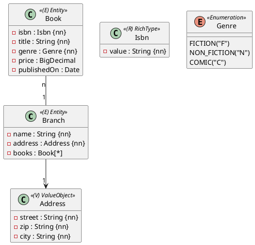

Task 1 of the Matura always starts the same way: a UML class diagram, a few sentences of text below it and the assignment to implement the model with JPA, map it to a database and test it. Before you write the first annotation, you have to read the diagram correctly. That is what this unit is about.

Throughout this module we use a small library:

## The four stereotypes

The stereotype in the angle brackets tells you **how** a class gets into the database:

| Stereotype | In Java | In the database | Unit |
|---|---|---|---|
| `«Entity»` | class with `@Entity` and an id | a table of its own | 2 |
| `«ValueObject»` | `@Embeddable` (class or record), no id | columns in the owner's table | 7 |
| `«RichType»` | record with rules, `AttributeConverter` | **one** column | 8 |
| `«Enumeration»` | `enum`, `AttributeConverter` | one column with a code | 6 |

An entity has an **identity**: two books with the same title are still two books. A value object has none: two addresses with the same values are the same address.

:::achtung The id is not in the diagram
Technical attributes like `id` are missing in the UML diagram. Every entity still needs a primary key – you add it yourself.
:::

## Reading attributes

`- title : String {nn}` means: a private field `title` of type `String` that must never be `null`. `{nn}` stands for *not null*.

| In the diagram | In Java |
|---|---|
| `String`, `Integer`, `Boolean` | `String`, `Integer`, `boolean` |
| `Date` | `LocalDate` |
| `DateTime` | `LocalDateTime` |
| `BigDecimal` (amounts of money) | `BigDecimal` |
| `Book[*]` | `List<Book>` |
| `address : Address` | a field of the value object's type |

If the type of an attribute is another class from the diagram, it is **not** a simple column, but a relation, a value object or a rich type – depending on the stereotype of that class.

## Lines and multiplicities

| Line | Meaning | Unit |
|---|---|---|
| `Book "n" -- "1" Branch` | without an arrow: both sides know each other (bidirectional). Many books belong to one branch | 9, 10 |
| `Branch --> "1" Address` | with an arrow: only `Branch` knows `Address` | 7 |
| `"0,1"` or `"0..1"` | optional: may be missing | 9 |
| `"1"` | mandatory: exactly one | 9 |

A line with an empty triangle (`A <|-- B`) means inheritance: `B` inherits from `A` (unit 14).

## How to go through the task

1. **Count:** how many entities, value objects, rich types and enums are there? The task often states the number in the text ("five entities, one ValueObject and one RichType") – compare.
2. **Per class:** note the attributes with their types, mark `{nn}`.
3. **Per line:** who knows whom, and how many?
4. **Text below the diagram:** there you find rules for rich types (e.g. allowed values), lengths, unique values and the required queries.
5. **Access classes:** every entity gets a repository and a test. Value objects and rich types get no repository – they are stored with their entity.

:::pruefung
The grading demands that the classes are implemented "with the right name and attributes" and that the characterisation as entity, value object, rich type or enumeration is right. Take the names exactly from the diagram, even if you do not like them.
:::

:::merke
- `«Entity»` → a table with an id, `«ValueObject»` → columns at the owner, `«RichType»` → one column, `«Enumeration»` → a code in one column.
- `{nn}` = must not be `null`.
- The id is not in the diagram, you need it anyway.
- An attribute whose type is a class from the diagram is a relation, not a simple value.
:::
