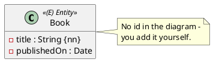

An entity is a completely normal Java class that JPA maps to a table. For that it needs exactly two things: the annotation `@Entity` and a primary key.

This is how an entity looks in the diagram:



## Option 1: writing the id yourself

```java
import jakarta.persistence.Entity;
import jakarta.persistence.GeneratedValue;
import jakarta.persistence.Id;
import jakarta.persistence.Table;

@Entity
@Table(name = "books")
public class Book {

    @Id
    @GeneratedValue
    private Long id;

    private String title;
    private LocalDate publishedOn;

    // Lombok generates constructors, getters and setters: unit 3
}
```

- `@Entity` makes the class an entity. All annotations come from `jakarta.persistence`.
- `@Id` marks the primary key. Use `Long`, not `long`: a new object has no id yet, and `null` shows that.
- `@GeneratedValue` lets the database assign the id. You never set it yourself.
- `@Table` is optional but recommended. Without `@Table` the table is named like the class: `book`.

Spring Boot turns camelCase names into names with underscores. The field `publishedOn` becomes the column `published_on`:

```sql
create table books (
    published_on date,
    id bigint not null,
    title varchar(255),
    primary key (id)
)
```

## Option 2: `AbstractPersistable`

Spring Data comes with a ready-made base class that takes care of the id for you:

```java
import jakarta.persistence.Entity;
import jakarta.persistence.Table;
import org.springframework.data.jpa.domain.AbstractPersistable;

@Entity
@Table(name = "books")
public class Book extends AbstractPersistable<Long> {

    private String title;
    private LocalDate publishedOn;
}
```

The type argument is the type of the id. You get for free:

| Method | Returns |
|---|---|
| `getId()` | the id, `null` before saving |
| `isNew()` | `true` as long as the id is `null` |
| `equals` / `hashCode` | equal if class and id are equal |
| `toString()` | `Entity of type ormapping.model.Book with id: 1` |

From now on we use `AbstractPersistable<Long>` in this module. The sample solutions of the Matura do the same.

:::achtung equals and hashCode
The grading demands `equals` and `hashCode` for the model classes. If you write the id yourself (option 1), you also have to implement them yourself. Without `equals`, a book that you read anew from the database is **not** equal to the object you saved. With `AbstractPersistable` it is equal because the id matches.
:::

## How the id is assigned

Without further settings, Hibernate uses a **sequence** called `<table>_seq`, here `books_seq`. The sequence counts in steps of 50: Hibernate fetches 50 ids at once and then assigns them itself. That is why Hibernate only writes a new object into the table at the next **flush**, not already when saving. This becomes important in unit 4.

With `@GeneratedValue(strategy = GenerationType.IDENTITY)` the table assigns the id instead (`id bigint generated by default as identity`), and Hibernate has to insert right away to learn it. For the exam the default is enough.

:::merke
- An entity needs `@Entity` and an id with `@Id`.
- `@Table(name = "...")` is optional but recommended.
- `extends AbstractPersistable<Long>` provides id, `isNew()`, `equals` and `hashCode`.
- Column names: `publishedOn` → `published_on`.
:::
