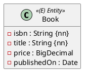

`@Entity` and an id are enough for Hibernate to create a table. For full points, though, an entity needs more: a constructor for JPA, a business constructor, getters and setters. You do not write most of it yourself – **Lombok** generates it at compile time from four annotations.



## The four annotations

In this course every entity without relations looks like this:

```java
import lombok.AccessLevel;
import lombok.AllArgsConstructor;
import lombok.Getter;
import lombok.NoArgsConstructor;
import lombok.Setter;

@Entity
@Table(name = "books")
@Getter
@Setter
@NoArgsConstructor(access = AccessLevel.PROTECTED)
@AllArgsConstructor
public class Book extends AbstractPersistable<Long> {

    @NotNull
    private String isbn;
    @NotNull
    private String title;
    private BigDecimal price;
    private LocalDate publishedOn;
}
```

| Annotation | Generates | Here |
|---|---|---|
| `@Getter` | one getter per field | `getIsbn()`, `getTitle()`, … |
| `@Setter` | one setter per field | `setTitle(String title)`, … |
| `@NoArgsConstructor(access = AccessLevel.PROTECTED)` | the constructor without parameters for JPA | `protected Book()` |
| `@AllArgsConstructor` | a `public` constructor with **all** fields, in the order in the code | `Book(isbn, title, price, publishedOn)` |

The annotations come from the package `lombok`, and so does `AccessLevel`.

## What Lombok writes for you

Without Lombok you would have to type this yourself – this is exactly the code Lombok generates:

```java
protected Book() {
}

public Book(String isbn, String title, BigDecimal price, LocalDate publishedOn) {
    this.isbn = isbn;
    this.title = title;
    this.price = price;
    this.publishedOn = publishedOn;
}

public String getIsbn() {
    return isbn;
}

public void setIsbn(String isbn) {
    this.isbn = isbn;
}

// … and the same for title, price and publishedOn
```

- JPA needs the **constructor without parameters**: when reading, Hibernate first creates an empty object and then fills the fields. It is `protected` so that your own code does not use it.
- You use the **business constructor** yourself: `new Book("9783161484100", "Dune", new BigDecimal("12.90"), LocalDate.of(1965, 8, 1))`.
- The **id** is not part of it: it is a field of `AbstractPersistable`, and `@AllArgsConstructor` only takes the fields of its own class.
- For a `boolean` field `electric` the getter is called `isElectric()`, not `getElectric()`.

:::achtung If the constructor without parameters is missing, you notice late
Hibernate still starts and only writes an info message to the log. Saving works too. Only when **reading** from the database does `InstantiationException: No default constructor for entity` appear. A test that reads right after saving, however, gets the object from memory instead of from the database (unit 5) – and does not notice the mistake.
:::

## The order of the fields matters

`@AllArgsConstructor` takes the fields in the order in which they appear in the code. So write the fields **in the order of the diagram** – then the constructor matches the task: `new Book(isbn, title, price, publishedOn)`.

If you swap `isbn` and `title` in the code, it becomes `Book(String title, String isbn, …)`. That still compiles, because both are `String` – but then every book has the ISBN as its title.

## Entities with relations: write the constructor yourself

`@AllArgsConstructor` takes **every** field – including lists and relations (units 9 to 12). The business constructor, however, should only take the **attributes** from the diagram, no relations: that is what the grading tests expect, e.g. `new Station("Westbahnhof", address, 24)` without the list of bikes.

So if an entity has a relation, you leave out `@AllArgsConstructor` and write the business constructor yourself:

```java
@Entity
@Table(name = "branches")
@Getter
@Setter
@NoArgsConstructor(access = AccessLevel.PROTECTED)
public class Branch extends AbstractPersistable<Long> {

    @NotNull
    private String name;
    @OneToMany(mappedBy = "branch")
    private List<Book> books = new ArrayList<>();

    public Branch(String name) {
        this.name = name;
    }

    public List<Book> getBooks() {
        return Collections.unmodifiableList(books);
    }

    public void addBook(Book book) {
        books.add(book);
        book.setBranch(this);
    }
}
```

- The **constructor** only takes `name`. The list is created at the field, so it is never `null`.
- The **getter of the list** is written by hand too: it hands out an unmodifiable view, `getBooks().add(...)` throws an `UnsupportedOperationException`. If you write a method yourself, Lombok does not generate it – all other getters and setters still come from Lombok.
- The list is only changed through methods like `addBook`. They also keep the other side up to date (unit 10); `@Setter` in `Book` generates `book.setBranch(...)`.
- The same goes for the **other side**: `Book` has the field `branch` and therefore no `@AllArgsConstructor` either, but its own constructor without `branch`. The branch is set by `addBook` or `book.setBranch(branch)`.

| The entity has … | Business constructor |
|---|---|
| only attributes (also enums, value objects) | `@AllArgsConstructor` |
| at least one relation (`@ManyToOne`, `@OneToMany`, `@ManyToMany`, `@OneToOne`, `@ElementCollection`) | write it yourself, only with the attributes |

## What an entity must not be

- **Not a record.** Records are immutable, Hibernate cannot set the id after saving: `persist` fails with `Can not set final java.lang.Long field ... id`. Records, on the other hand, are perfect for value objects and rich types.
- **Not `final`**, and neither are the stored fields. The JPA specification forbids it, and Hibernate needs subclasses for lazy loading.
- **No `@Data`.** `@Data` generates a `public` constructor without parameters and its own `equals`/`hashCode` over all fields, which replaces the one from `AbstractPersistable`. Lombok warns about it: `Generating equals/hashCode implementation but without a call to superclass`.

## Lombok in the project

In the exam project Lombok is already included in every subproject, the version is in `gradle/libs.versions.toml`:

```kotlin
dependencies {
    compileOnly(libs.lombok)
    annotationProcessor(libs.lombok)
    testCompileOnly(libs.lombok)
    testAnnotationProcessor(libs.lombok)
    // ...
}
```

IntelliJ knows Lombok out of the box. If it asks about *annotation processing* when you open the project for the first time, confirm with *Enable*.

If you write a method or a constructor yourself, Lombok keeps your version. You need that for relations (see above) and for inheritance.

:::achtung Inheritance: child entities need their own constructor
`@AllArgsConstructor` only takes the fields of its **own** class. For a child entity (unit 14), the attributes of the parent class would therefore be missing. So write the business constructor of the child yourself and pass the attributes of the parent class on to `super(...)`:

```java
@Entity
@Getter
@Setter
@NoArgsConstructor(access = AccessLevel.PROTECTED)
public class Reading extends LibraryEvent {

    private String authorName;

    public Reading(String title, LocalDate heldOn, String authorName) {
        super(title, heldOn);
        this.authorName = authorName;
    }
}
```

If the child has no fields of its own at all, you must not use `@AllArgsConstructor` in addition: both annotations then generate a constructor without parameters, and the code does not compile (`constructor Reading() is already defined in class Reading`).
:::

## Lombok in services and controllers

A service or controller gets its dependencies via the constructor. `@RequiredArgsConstructor` generates it: a constructor with all `final` fields.

```java
@Service
@RequiredArgsConstructor
public class LoanService {

    private final LoanRepository loanRepository;
}
```

Spring calls this constructor and passes in the repository. More on that in the modules service layer and REST controller.

:::merke
- Every entity: `@Getter`, `@Setter`, `@NoArgsConstructor(access = AccessLevel.PROTECTED)` – and without relations `@AllArgsConstructor`.
- Fields in the order of the diagram – that is the order of the parameters in the constructor.
- With relations: no `@AllArgsConstructor`, but your own constructor with the attributes only; create lists at the field and hand them out unmodifiable with your own getter.
- An entity is not a record, not `final` and has no `@Data`.
- Child entities: write the business constructor with `super(...)` yourself.
- Services and controllers: `@RequiredArgsConstructor` with `final` fields.
:::
