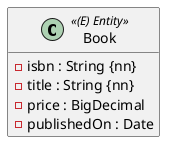

Without further settings every `String` becomes `varchar(255)` and every column may be `null`. The task usually demands more, though: mandatory fields, maximum lengths, unique values, amounts of money with two decimal places. You set this with annotations on the field.

The rules are in two places in the task: `{nn}` in the diagram, lengths and uniqueness usually in the text below.



> `isbn` has exactly 13 characters and is unique, `title` at most 120 characters. `price` has 6 digits, 2 of them after the decimal point.

## `@Column`

```java
@Column(length = 13, nullable = false, unique = true)
private String isbn;

@Column(length = 120, nullable = false)
private String title;

@Column(precision = 6, scale = 2)
private BigDecimal price;
```

| Attribute | Effect | Column |
|---|---|---|
| `length = 120` | at most 120 characters (only for strings) | `varchar(120)` |
| `nullable = false` | mandatory field | `not null` |
| `unique = true` | no value twice | `unique` |
| `precision = 6, scale = 2` | 6 digits, 2 of them after the decimal point: at most `9999.99` | `numeric(6,2)` |
| `name = "build_year"` | a column name of your own | `build_year` |

Without `precision` a `BigDecimal` becomes `numeric(38,2)`.

## Bean Validation: `@NotNull`, `@NotBlank`, `@Size`

The annotations from `jakarta.validation.constraints` check the value in Java before Hibernate sends it to the database. Hibernate also takes them over into the table:

```java
@NotNull
private String firstName;      // varchar(255) not null

@NotBlank
private String lastName;       // varchar(255) not null, and also not "" or "  "

@Size(max = 30)
private String nickName;       // varchar(30)

@NotNull
@Size(min = 2, max = 20)
private String city;           // varchar(20) not null
```

For `{nn}` in the diagram you write `@NotNull`. The sample solutions do the same.

:::achtung Primitive types are always not null
`int`, `long` and `boolean` cannot be `null` in Java. Hibernate therefore always creates the column with `not null`, even without an annotation. If the diagram has no `{nn}`, use the wrapper type (`Integer`) so that `null` stays possible.
:::

## When the error shows up

Both ways report a violation with different exceptions:

| Violation of | Who reports it | Exception |
|---|---|---|
| `@NotNull`, `@NotBlank`, `@Size` | Bean Validation, before the SQL is sent | `jakarta.validation.ConstraintViolationException` |
| `nullable`, `length`, `unique` | the database when inserting | `org.springframework.dao.DataIntegrityViolationException` |

Both only happen, however, when Hibernate really inserts the object – and with the default id assignment that is only at the **flush** (unit 2), not already at `save`. A test that only calls `save` therefore sees no error at all. Use `saveAndFlush` in the test:

```java
@Test
void verify_isbn_is_unique() {
    bookRepository.saveAndFlush(book("9783161484100", "First book"));

    assertThatThrownBy(() -> bookRepository.saveAndFlush(book("9783161484100", "Second book")))
            .isInstanceOf(DataIntegrityViolationException.class);
}

private static Book book(String isbn, String title) {
    return new Book(isbn, title, new BigDecimal("19.90"), LocalDate.of(2024, 5, 1));
}
```

## Reserved words

Some field names are keywords in SQL. Hibernate writes them unprotected into the `create table`, and H2 aborts with a syntax error when the test starts. In H2 this concerns, among others:

`year`, `month`, `day`, `hour`, `minute`, `second`, `from`, `to`, `order`, `group`, `user`, `value`, `key`, `end`, `row`, `limit`

Not affected are, for example, `name`, `type`, `date`, `time`, `number`, `status`, `level` and `until`. The solution is a column name of your own – the field in Java keeps its name from the diagram:

```java
@NotNull
@Column(name = "build_year")
private Integer year;

@NotNull
@Column(name = "valid_from")
private LocalDateTime from;
```

:::pruefung
`from` and `until` have already appeared in a Matura task (`DividerBoxLocation`). `from` needs a column name of its own, `until` does not.
:::

## Fields that are not stored

A field with `@Transient` gets no column, e.g. a value that is calculated anew every time.

:::merke
- `@Column(length, nullable, unique, precision, scale, name)` defines the column.
- `@NotNull`, `@NotBlank`, `@Size` already check in Java and also affect the table.
- Violations only show up at the flush, not at `save` → `saveAndFlush` in the test.
- Reserved words like `year` or `from`: `@Column(name = "...")`.
:::
