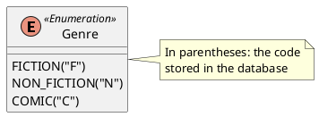

An enum looks harmless: a field `private Genre genre;` and done. But this is exactly where many lose points, because the default behaviour of JPA is wrong for the exam.

```java
public enum Genre {
    FICTION, NON_FICTION, COMIC
}
```

## The ordinal problem

Without an annotation JPA stores the **position** of the value in the enum, the *ordinal*: `FICTION` = 0, `NON_FICTION` = 1, `COMIC` = 2.

```sql
genre tinyint check ((genre between 0 and 2))
```

That works exactly until someone changes the enum. If a colleague inserts `BIOGRAPHY` at the beginning, `FICTION` is suddenly 1 – and every stored novel is a non-fiction book in the database. Besides, nobody can read in the table what `2` means.

## Better: `@Enumerated(EnumType.STRING)`

```java
@Enumerated(EnumType.STRING)
private Genre genre;
```

Now the **name** is in the database (`'FICTION'`). In H2 Hibernate creates an enum column of its own for it: `genre enum ('FICTION','NON_FICTION','COMIC')`. The order in the enum no longer matters, but renaming still breaks the data.

:::achtung According to the cheat sheet this costs points
On the cheat sheet it says about enums: either `@Enumerated(EnumType.STRING)` "and lose some points" or a null-safe converter. For full points you use the converter. And careful, a typo in the cheat sheet: it is `EnumType.STRING`, not `EnumerationType.STRING`.
:::

## Best: codes with `AttributeConverter`



The diagram often shows codes next to the values, e.g. `FICTION("F")`. For that the enum gets a field and a method that finds the value for a code. Lombok generates the constructor and getter – `@AllArgsConstructor` makes the constructor of an enum `private` automatically:

```java
@Getter
@AllArgsConstructor
public enum Genre {
    FICTION("F"), NON_FICTION("N"), COMIC("C");

    private final String code;

    public static Genre fromCode(String code) {
        for (Genre genre : values()) {
            if (genre.code.equals(code)) {
                return genre;
            }
        }
        throw new IllegalArgumentException("unknown genre code: " + code);
    }
}
```

The converter translates in both directions:

```java
import jakarta.persistence.AttributeConverter;
import jakarta.persistence.Converter;

@Converter(autoApply = true)
public class GenreConverter implements AttributeConverter<Genre, String> {

    @Override
    public String convertToDatabaseColumn(Genre genre) {
        return genre == null ? null : genre.getCode();
    }

    @Override
    public Genre convertToEntityAttribute(String code) {
        return code == null ? null : Genre.fromCode(code);
    }
}
```

- `AttributeConverter<Genre, String>`: on the left the type in Java, on the right the type in the database.
- `autoApply = true` applies the converter to **every** field of type `Genre`. The entity then only says `private Genre genre;`. Without `autoApply` you write `@Convert(converter = GenreConverter.class)` on the field.
- Hibernate creates the column as `varchar(255)` with `check (genre in ('C','F','N'))`.

:::achtung Null-safe is mandatory
Hibernate also calls the converter with `null`, in both directions – for example for a book without a genre. Without the `null` check an exception is thrown: `genre.getCode()` throws a `NullPointerException`, `fromCode(null)` an `IllegalArgumentException`. The cheat sheet explicitly demands a *null-safe* converter.
:::

A code can also be a single character ("Map to Character D, T, Q, P"). Then the database type is `Character`, the field in the enum a `char`, and the column becomes `char(1)`.

## Testing

The lifecycle test checks that the enum comes out correctly again. If you want to be completely sure, look with a `JdbcTemplate` at what is really in the column:

```java
@Autowired
private JdbcTemplate jdbcTemplate;

@Test
void verify_genre_is_stored_as_code() {
    bookRepository.saveAndFlush(book(Genre.COMIC));

    String stored = jdbcTemplate.queryForObject("select genre from books", String.class);
    assertThat(stored).isEqualTo("C");
}
```

:::achtung "Check constraint invalid" when inserting
H2 2.4.240 – the version Spring Boot 4.1 brings along – has a bug: every insert into a column with such a `check (... in (...))` fails in the `@DataJpaTest` with `Check constraint invalid` (in German: "Ungültige Bedingung"), even though the value is right. That is why H2 2.5.252 is set in the Lernwerkstatt templates. If you hit the bug elsewhere (for example at the exam), this annotation on the test class helps:

```java
import org.springframework.boot.jdbc.test.autoconfigure.AutoConfigureTestDatabase;

@DataJpaTest
@AutoConfigureTestDatabase(replace = AutoConfigureTestDatabase.Replace.NONE)
class BookRepositoryTest { ... }
```
:::

:::merke
- Without an annotation: ordinal – breaks as soon as the order changes.
- `@Enumerated(EnumType.STRING)`: readable, but according to the cheat sheet it costs points.
- Full points: enum with a code, `fromCode`, `@Converter(autoApply = true)` with `AttributeConverter<Enum, String>`.
- Converter always null-safe in both directions.
:::
