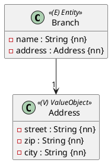
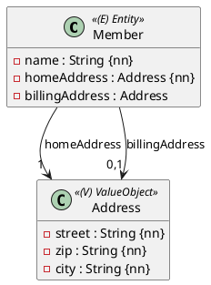

An address consists of street, postcode and city. It has no identity of its own: two addresses with the same values are the same address. In the diagram it is a `«ValueObject»`. In the database it gets no table of its own – its values end up as columns in the table of the entity that owns it.



## `@Embeddable` and `@Embedded`

The shortest way to write a value object is as a record:

```java
import jakarta.persistence.Embeddable;

@Embeddable
public record Address(
        @NotNull @Size(max = 64) String street,
        @NotNull @Size(min = 4, max = 5) String zip,
        @NotNull @Size(max = 64) String city) {
}
```

In the entity you embed it with `@Embedded`:

```java
@Entity
@Table(name = "branches")
public class Branch extends AbstractPersistable<Long> {

    @NotNull
    @Size(max = 40)
    private String name;

    @Embedded
    private Address address;
}
```

```sql
create table branches (
    id bigint not null,
    name varchar(40) not null,
    city varchar(255),
    street varchar(255),
    zip varchar(255),
    primary key (id)
)
```

- A value object has **no** id and no repository.
- Record or class: both work. A class, like an entity, needs a `protected` constructor without parameters, a record does not.
- Records come with `equals` and `hashCode` over all values – exactly what a value object needs.
- The columns are named like the attributes of the record: `street`, `zip`, `city`.
- If all columns are `null`, Hibernate reads `null` for `address` again.

## Validation in the value object: `@Valid`

Look closely at the table above: `street` is `varchar(255)`, even though the record says `@Size(max = 64)`. Without further settings Hibernate does not look into the value object. With `@Valid` on the field that changes:

```java
@Valid
@Embedded
private Address address;
```

Now Bean Validation also checks the values of the address before Hibernate inserts them, and the columns become `varchar(64)`, `varchar(5)` and `varchar(64)`.

:::achtung `@NotNull` in the value object does not become `not null`
Even with `@Valid` the columns of a value object stay nullable in the table, because the whole address may be missing. `@NotNull` does work in Java, though: if there is an address, `street` must not be `null`. If the value object itself is mandatory (`address : Address {nn}`), you additionally write `@NotNull` on the field in the entity.
:::

## Two addresses in one entity



A member has a home address and a billing address. If you simply embed both, there is the column `street` twice, and Hibernate aborts at startup:

```text
MappingException: Column 'street' is duplicated in mapping for entity 'Member'
```

So you have to rename the columns. There are two ways to do that.

**`@EmbeddedColumnNaming`** (from Hibernate) puts a prefix in front of all columns:

```java
import org.hibernate.annotations.EmbeddedColumnNaming;

@Embedded
@EmbeddedColumnNaming("home_%s")
private Address homeAddress;
```

That gives `home_street`, `home_zip`, `home_city`. The `%s` stands for the original name and is mandatory – it is missing in the cheat sheet (`"contact_"`).

**`@AttributeOverrides`** (standard JPA) renames every column separately:

```java
@Embedded
@AttributeOverrides({
        @AttributeOverride(name = "street", column = @Column(name = "billing_street")),
        @AttributeOverride(name = "zip", column = @Column(name = "billing_zip")),
        @AttributeOverride(name = "city", column = @Column(name = "billing_city"))
})
private Address billingAddress;
```

`name` is the attribute in the value object, `column` the column in the table. More typing, but you can name every column freely and, for example, also set `length`.

:::pruefung
A list of value objects (`logEntries : DividerBoxLogBook[*]`) is not implemented with `@Embedded` but with `@ElementCollection` and gets a table of its own. That comes in unit 13.
:::

:::merke
- Value object: `@Embeddable`, preferably as a record, without an id and repository.
- In the entity: `@Embedded`, the columns end up in the entity's table.
- `@Valid` on the field so that `@Size` and co. are checked in the value object.
- The same value object twice: `@EmbeddedColumnNaming("home_%s")` or `@AttributeOverrides`.
:::
