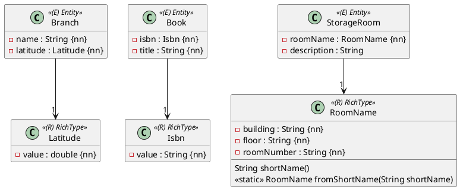

A latitude is more than a `double`: it always lies between −90 and 90. An ISBN is more than a `String`: it has exactly 13 digits. A room name like `B307` consists of building, floor and room number, and each part has its own rules. Values with their own rules like these are called `«RichType»` in the diagram. In Java they are a type of their own, in the database **one** column.



Even if a rich type like `RoomName` has several attributes: in the database it is **one** column.

## The type: a record with rules

The simplest rich type is a number with limits. The task says: "The latitude (`latitude`) lies between −90 and 90 degrees, both limits are allowed."

```java
public record Latitude(double value) {

    public Latitude {
        if (value < -90 || value > 90) {
            throw new IllegalArgumentException("latitude must be between -90 and 90: " + value);
        }
    }
}
```

The **compact constructor** (without a parameter list) runs on every `new Latitude(...)`. So an invalid latitude cannot exist – neither in code nor when it is read from the database. The entity now says `private Latitude latitude;` instead of `private double latitude;`.

Watch the limits: "between −90 and 90, both allowed" means that **only** values `< -90` or `> 90` are wrong. With `<=` instead of `<` you would reject the South Pole (−90). These are exactly the boundary values you test later.

## The translation: a converter

As with the enums in unit 6, an `AttributeConverter` translates between Java and the database. The second type parameter is the type of the column – here `Double`:

```java
@Converter(autoApply = true)
public class LatitudeConverter implements AttributeConverter<Latitude, Double> {

    @Override
    public Double convertToDatabaseColumn(Latitude latitude) {
        return latitude == null ? null : latitude.value();
    }

    @Override
    public Latitude convertToEntityAttribute(Double value) {
        return value == null ? null : new Latitude(value);
    }
}
```

```java
@NotNull
private Latitude latitude;
```

The column `latitude` gets a floating-point type, just like a `double` field. `@NotNull` works as usual.

## Text with rules: the ISBN

For a `String` you check for `null` first, then the length, then every character:

```java
public record Isbn(String value) {

    public Isbn {
        if (value == null) {
            throw new IllegalArgumentException("ISBN must not be null");
        }
        if (value.length() != 13) {
            throw new IllegalArgumentException("ISBN must have 13 digits: " + value);
        }
        for (char c : value.toCharArray()) {
            if (!Character.isDigit(c)) {
                throw new IllegalArgumentException("ISBN must have 13 digits: " + value);
            }
        }
    }
}
```

The order matters: if `value` were `null`, `value.length()` would already throw a `NullPointerException`.

:::info Shorter with a regular expression
`String.matches(...)` checks a text against a pattern (a regular expression, "regex"). Length and digits then fit in one line:

```java
if (!value.matches("\\d{13}")) {
    throw new IllegalArgumentException("ISBN must have 13 digits: " + value);
}
```

`\d` means "a digit", `{13}` "exactly 13 times". In a Java string you write the backslash twice: `"\\d{13}"`. You still need the `null` check. Both solutions are correct – use the one you are sure about.
:::

The converter for the ISBN looks like the one for `Latitude`, just with `String` as the column type:

```java
@Converter(autoApply = true)
public class IsbnConverter implements AttributeConverter<Isbn, String> {

    @Override
    public String convertToDatabaseColumn(Isbn isbn) {
        return isbn == null ? null : isbn.value();
    }

    @Override
    public Isbn convertToEntityAttribute(String value) {
        return value == null ? null : new Isbn(value);
    }
}
```

```java
@NotNull
@Column(length = 13, unique = true)
private Isbn isbn;
```

`@Column` and `@NotNull` work as for a `String`: the column becomes `isbn varchar(13) not null unique`.

## Several parts, one column

A rich type with several attributes is more interesting. From a Matura task:

> `RoomName.building` can only be `A`, `B`, `C` or `D`, `floor` only `E`, `H`, `1` to `5`, `roomNumber` always consists of two digits. The `shortName` is to be put together from `building`, `floor` and `roomNumber`.

Simply write down the allowed values for building and floor as a list and ask whether the value is in it:

```java
public record RoomName(String building, String floor, String roomNumber) {

    private static final List<String> BUILDINGS = List.of("A", "B", "C", "D");
    private static final List<String> FLOORS = List.of("E", "H", "1", "2", "3", "4", "5");

    public RoomName {
        if (building == null || floor == null || roomNumber == null) {
            throw new IllegalArgumentException("building, floor and roomNumber are required");
        }
        if (!BUILDINGS.contains(building)) {
            throw new IllegalArgumentException("invalid building: " + building);
        }
        if (!FLOORS.contains(floor)) {
            throw new IllegalArgumentException("invalid floor: " + floor);
        }
        if (roomNumber.length() != 2
                || !Character.isDigit(roomNumber.charAt(0))
                || !Character.isDigit(roomNumber.charAt(1))) {
            throw new IllegalArgumentException("invalid room number: " + roomNumber);
        }
    }

    public String shortName() {
        return building + floor + roomNumber;
    }

    public static RoomName fromShortName(String shortName) {
        if (shortName == null || shortName.length() != 4) {
            throw new IllegalArgumentException("invalid short name: " + shortName);
        }
        return new RoomName(shortName.substring(0, 1), shortName.substring(1, 2), shortName.substring(2));
    }
}
```

`fromShortName` only has to check the length and split the text. Whether the parts are valid is checked by the constructor afterwards – the rules live in **one** place only.

:::info The same rules as regex
With regular expressions the three checks get shorter:

```java
if (!building.matches("[ABCD]")) { ... }      // exactly one character out of A, B, C, D
if (!floor.matches("[EH1-5]")) { ... }        // E, H or a digit from 1 to 5
if (!roomNumber.matches("\\d{2}")) { ... }    // exactly two digits
```

`[...]` means "exactly one character out of this set", `1-5` is a range, `\d` a digit, `{2}` "exactly twice". `matches` always checks the **whole** text: `"BB".matches("[ABCD]")` is `false`.
:::

The two methods from the diagram are exactly what the converter needs: `shortName()` into the database, `fromShortName(...)` out of it. The column then holds `B307`.

```java
@Converter(autoApply = true)
public class RoomNameConverter implements AttributeConverter<RoomName, String> {

    @Override
    public String convertToDatabaseColumn(RoomName roomName) {
        return roomName == null ? null : roomName.shortName();
    }

    @Override
    public RoomName convertToEntityAttribute(String shortName) {
        return shortName == null ? null : RoomName.fromShortName(shortName);
    }
}
```

## Converter or `@Embeddable`?

The cheat sheet shows both ways for rich types. With `@Embeddable`, however, `RoomName` would get **three** columns (`building`, `floor`, `room_number`) – that would be a value object. By definition a rich type is mapped to a single column. With a converter you are on the safe side.

## Testing

A rich type has rules, so you test them – without any database, with a normal unit test. For numbers, the limits themselves (−90, 90) and the values just beside them (−90.1, 90.1) always belong in the test:

```java
@ParameterizedTest
@ValueSource(doubles = {-90, 0, 48.2, 90})
void verify_valid_latitudes_are_accepted(double value) {
    assertThat(new Latitude(value).value()).isEqualTo(value);
}

@ParameterizedTest
@ValueSource(doubles = {-90.1, 90.1, 180})
void verify_invalid_latitudes_are_rejected(double value) {
    assertThatThrownBy(() -> new Latitude(value))
            .isInstanceOf(IllegalArgumentException.class);
}

@ParameterizedTest
@ValueSource(strings = {"E307", "B607", "B37", "B3077"})
void verify_invalid_short_names_are_rejected(String shortName) {
    assertThatThrownBy(() -> RoomName.fromShortName(shortName))
            .isInstanceOf(IllegalArgumentException.class);
}
```

On top of that comes the lifecycle test in the repository test: save, `flush`/`clear`, read, compare `getRoomName()`. Because `RoomName` is a record, `isEqualTo(new RoomName("B", "3", "07"))` is enough.

:::merke
- Rich type = a type of its own with rules, as a record with a compact constructor.
- Check the rules with `if` and throw an `IllegalArgumentException`: numbers with `<`/`>`, texts for `null`, length and characters.
- One column via `@Converter(autoApply = true)` and `AttributeConverter<RichType, ColumnType>` (`String`, `Double`, …), null-safe.
- Several parts: put them together into one string (`shortName`) and split it again (`fromShortName`).
- Test the rules with unit tests of their own.
:::
