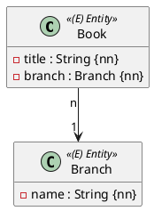

Many books are in one branch: `Book "n" -- "1" Branch`. In the database this is a column `branch_id` in the table `books` – a **foreign key** to `branches`. In Java it is simply a field of type `Branch`.



The arrow shows: only `Book` knows `Branch`. The multiplicity `"1"` at `Branch` means: every book has exactly one branch. If it said `"0,1"`, it could be missing.

## The simplest form

```java
@Entity
@Table(name = "books")
@Getter
@Setter
@NoArgsConstructor(access = AccessLevel.PROTECTED)
public class Book extends AbstractPersistable<Long> {

    // isbn, title, genre, price, publishedOn

    @ManyToOne
    private Branch branch;

    // business constructor with the attributes only, without branch (unit 3)
}
```

Read `@ManyToOne` from the class it is in: **many** books (*Many*) belong to **one** branch (*One*). For this Hibernate creates:

```sql
branch_id bigint,
...
alter table if exists books
    add constraint FKkbcxdegd7hcxsrbeh1x7h5drk
    foreign key (branch_id) references branches
```

The column name is `<field>_id`. Hibernate generates the name of the constraint itself – a meaningless string.

## `@JoinColumn`: naming the column and the constraint

```java
@ManyToOne
@JoinColumn(name = "branch_id", nullable = false,
        foreignKey = @ForeignKey(name = "fk_books_branch"))
private Branch branch;
```

- `name`: the name of the foreign key column.
- `nullable = false`: multiplicity `"1"` – every book **must** have a branch. With `"0,1"` you leave it out.
- `foreignKey = @ForeignKey(name = ...)`: a descriptive name instead of `FKkbcx...`. It shows up in error messages and is a point for "Sehr gut": "Generic names of created database schema elements are replaced with meaningful names."

Instead of `nullable = false` you can also write `@NotNull` on the field: the column becomes `not null` as well, and Bean Validation reports a book without a branch even before the `insert`.

## Saving: the branch first

```java
Branch branch = branchRepository.save(new Branch("Main Library", address));
Book book = new Book(isbn, "The Trial", Genre.FICTION, price, publishedOn);
book.setBranch(branch);
bookRepository.save(book);
```

The relation is not a parameter of the business constructor. You set it with the setter that `@Setter` generates.

If you save a book with a **new**, not yet saved branch, the flush fails:

```text
TransientPropertyValueException: Persistent instance of 'Book' references an unsaved transient
instance of 'Branch' (persist the transient instance before flushing)
```

Either you save the branch first, or you let Hibernate do it with **cascade**:

```java
@ManyToOne(cascade = CascadeType.PERSIST)
private Branch branch;
```

Now a new branch is saved along with the book. The sample solutions of the Matura use this so that a whole object graph can be saved with one `save`.

## Loading: `EAGER` and `LAZY`

When reading a book, Hibernate loads the branch right along by default (`FetchType.EAGER`). With `@ManyToOne(fetch = FetchType.LAZY)` it is only loaded when you call `getBranch().getName()`. In a `@DataJpaTest` you notice no difference, because the whole test runs in one transaction. For the exam the default is enough.

## Testing

```java
@Test
void verify_book_with_branch() {
    Branch branch = branchRepository.save(new Branch("Main Library", address));
    Book book = new Book(isbn, "The Trial", Genre.FICTION, price, publishedOn);
    book.setBranch(branch);
    Book saved = bookRepository.save(book);

    entityManager.flush();
    entityManager.clear();

    Book reread = bookRepository.findById(saved.getId()).orElseThrow();
    assertThat(reread.getBranch().getId()).isEqualTo(branch.getId());
    assertThat(reread.getBranch().getName()).isEqualTo("Main Library");
}
```

:::merke
- `@ManyToOne` sits on the "many" side and becomes the foreign key column `<field>_id`.
- `@JoinColumn(name, nullable = false, foreignKey = @ForeignKey(name = "fk_..."))` for name, mandatory and a descriptive constraint.
- Save new objects first or use `cascade = CascadeType.PERSIST`.
- Reading after `flush`/`clear` checks that the relation really is in the database.
:::
