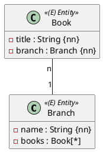
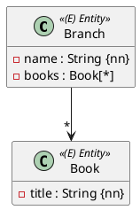

In unit 9 every book knows its branch. In the diagram `Book "n" -- "1" Branch`, however, the arrowhead is missing, and `Branch` has an attribute `books : Book[*]`: the branch knows its books too. The relation is **bidirectional**.



## `mappedBy`: one relation, two sides

```java
@Entity
@Table(name = "branches")
@Getter
@Setter
@NoArgsConstructor(access = AccessLevel.PROTECTED)
public class Branch extends AbstractPersistable<Long> {

    // name, address, ...

    @OneToMany(mappedBy = "branch")
    private List<Book> books = new ArrayList<>();
}
```

In the database there is still only **one** column: `branch_id` in `books`. `mappedBy = "branch"` tells Hibernate: "This list is the same relation as the field `branch` in `Book`. The foreign key is there."

- The side with `@ManyToOne` and the foreign key is the **owning side**.
- The side with `mappedBy` is the **inverse side**. What is only in its list, Hibernate does not save.

:::achtung Without `mappedBy` a second relation is created
If `mappedBy` is missing, Hibernate takes the list for a relation of its own and creates a join table `branches_books`. Then there are two independent ways from branch to book that can drift apart.
:::

## Helper methods keep both sides in sync

When saving, Hibernate only looks at the owning side, i.e. at `book.branch`. Your Java code, however, sees both sides. To make them match, you change the relation only through helper methods that set **both** sides:

```java
// in Branch – written by hand; the other getters and setters come from Lombok
public Branch(String name, Address address) {
    this.name = name;
    this.address = address;
}

public List<Book> getBooks() {
    return Collections.unmodifiableList(books);
}

public void addBook(Book book) {
    books.add(book);
    book.setBranch(this);
}

public void removeBook(Book book) {
    books.remove(book);
    book.setBranch(null);
}
```

`@Setter` in `Book` generates `book.setBranch(...)`. Nobody can change the list itself from outside: `getBooks()` hands out an unmodifiable view, `getBooks().add(...)` throws an `UnsupportedOperationException`.

What goes wrong without a helper method:

| You only set … | Consequence |
|---|---|
| `books.add(book)` (inverse side) | `branch_id` stays `null`. After the next read the branch has no books any more. |
| `book.setBranch(branch)` (owning side) | Everything is right in the database, but `branch.getBooks()` is empty until the branch is read again. |

## Cascade and `orphanRemoval`

```java
@OneToMany(mappedBy = "branch", cascade = CascadeType.ALL, orphanRemoval = true)
private List<Book> books = new ArrayList<>();
```

- `cascade = CascadeType.ALL`: saving, changing and deleting the branch also affect its books. A `branchRepository.save(branch)` saves the new books along with it.
- `CascadeType.PERSIST` alone only passes on saving – that is what the sample solutions do.
- `orphanRemoval = true`: a book that is removed from the list is deleted. Only fits if a book without a branch makes no sense.

For every relation, think about whether cascade fits the business: if you delete a branch, should its books really disappear with it?

## Testing

```java
@Test
void verify_branch_with_books() {
    Branch branch = new Branch("Main Library", address);
    branch.addBook(book("9783161484100"));
    branch.addBook(book("9783161484117"));
    branchRepository.save(branch);

    entityManager.flush();
    entityManager.clear();

    Branch reread = branchRepository.findById(branch.getId()).orElseThrow();
    assertThat(reread.getBooks())
            .hasSize(2)
            .allSatisfy(b -> assertThat(b.getBranch().getId()).isEqualTo(branch.getId()));
}
```

Only after `flush` and `clear` does the test show that both books really are in the database, connected to the branch.

## Variant: unidirectional with `@JoinColumn`



If according to the diagram only the branch knows its books (`Branch --> "*" Book`), `Book` has no field `branch`. Then you put `@JoinColumn` directly on the list, and the foreign key still ends up in `books`:

```java
@OneToMany
@JoinColumn(name = "branch_id")
private List<Book> books = new ArrayList<>();
```

Without `@JoinColumn` a join table would be created here too.

:::merke
- Bidirectional: `@ManyToOne` on the "many" side (owns the foreign key), `@OneToMany(mappedBy = "...")` on the other.
- Hibernate only saves what is on the owning side.
- Helper methods `addBook`/`removeBook` always set both sides.
- `cascade` passes on saving/deleting, `orphanRemoval` deletes removed children.
:::
