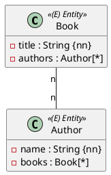

A book can have several authors, and an author writes several books. In the diagram both ends carry multiplicities with `*` or `n`:



A column `author_id` in `books` is not enough for this: a book would then have only one author. The database needs a **join table** with two foreign keys.

## The owning side

```java
@Entity
@Table(name = "books")
@Getter
@Setter
@NoArgsConstructor(access = AccessLevel.PROTECTED)
public class Book extends AbstractPersistable<Long> {

    // isbn, title, price, publishedOn and the business constructor without authors

    @ManyToMany
    @JoinTable(name = "book_authors",
            joinColumns = @JoinColumn(name = "book_id"),
            inverseJoinColumns = @JoinColumn(name = "author_id"))
    private Set<Author> authors = new HashSet<>();
}
```

From this Hibernate generates:

```sql
create table book_authors (
    author_id bigint not null,
    book_id bigint not null,
    primary key (author_id, book_id)
)
```

- `joinColumns` is the column pointing to the **own** class (`book_id`), `inverseJoinColumns` the column for the other side (`author_id`).
- Because `authors` is a `Set`, the pair becomes the primary key: the same book cannot have the same author twice.
- Both columns get a foreign key to `books` and `authors` respectively.

Without `@JoinTable` the table is called `books_authors` (owner's table + `_` + field name), and in the bidirectional relation below the columns are `books_id` and `authors_id` – named after the fields of both sides. That works, but you had better set the names from the task yourself.

## The inverse side with `mappedBy`

If the relation is bidirectional, `Author` gets a set `books` – with `mappedBy`, exactly like `@OneToMany` in unit 10:

```java
@Entity
@Table(name = "authors")
@Getter
@Setter
@NoArgsConstructor(access = AccessLevel.PROTECTED)
public class Author extends AbstractPersistable<Long> {

    private String name;

    @ManyToMany(mappedBy = "authors")
    private Set<Book> books = new HashSet<>();

    public Author(String name) {
        this.name = name;
    }
}
```

You decide which side owns it. Take the side through which you change the relation in code: a book gets authors, not the other way round.

:::achtung Only the owning side counts
If you only add a book to `author.books`, Hibernate writes **no** row into `book_authors`. After the next read the connection is gone.
:::

So, as in unit 10, the helper methods always set both sides:

```java
// in Book – written by hand, as in unit 3
public Set<Author> getAuthors() {
    return Collections.unmodifiableSet(authors);
}

public void addAuthor(Author author) {
    authors.add(author);
    author.addBookInternal(this);
}

public void removeAuthor(Author author) {
    authors.remove(author);
    author.removeBookInternal(this);
}
```

```java
// in Author: package-private, only Book calls them
void addBookInternal(Book book) {
    books.add(book);
}

void removeBookInternal(Book book) {
    books.remove(book);
}
```

## `Set` instead of `List`

The mapping also works with `List`, but:

- The join table has **no** primary key. The same connection can be in it twice.
- If you remove an entry, Hibernate deletes **all** rows of the book and inserts the remaining ones again. With a `Set` it is exactly one `delete`.

```sql
-- List: authors.remove(a)
delete from shelf_tags where shelf_id=?
insert into shelf_tags (shelf_id, tags_id) values (?, ?)
insert into shelf_tags (shelf_id, tags_id) values (?, ?)

-- Set: authors.remove(a)
delete from book_authors where book_id=? and author_id=?
```

If the diagram says `Set<…>` or the order does not matter, use `Set`. For `contains` and `remove` to work, the entity needs `equals`/`hashCode` – `AbstractPersistable` provides them via the id.

## Saving and deleting

- Hibernate rejects authors that are not saved yet at the flush: `TransientPropertyValueException … references an unsaved transient instance of 'Author'`. Save them first or set `cascade = CascadeType.PERSIST`.
- If you delete a **book** (owning side), Hibernate removes its rows in `book_authors` automatically.
- If you delete an **author** who is still in `book.authors`, the flush fails. Take them out of all books first with `book.removeAuthor(author)`.

:::achtung No `CascadeType.REMOVE` with `@ManyToMany`
An author does not belong to a single book. If deleting a book also deleted its authors, they would be missing from all other books.
:::

## Testing

```java
@Test
void verify_book_with_authors() {
    Author bachmann = authorRepository.save(new Author("Ingeborg Bachmann"));
    Author celan = authorRepository.save(new Author("Paul Celan"));
    Book book = new Book("9783518000000", "Herzzeit", new BigDecimal("28.00"), LocalDate.of(2008, 8, 1));
    book.addAuthor(bachmann);
    book.addAuthor(celan);
    bookRepository.save(book);

    entityManager.flush();
    entityManager.clear();

    Book reread = bookRepository.findById(book.getId()).orElseThrow();
    assertThat(reread.getAuthors()).extracting(Author::getName)
            .containsExactlyInAnyOrder("Ingeborg Bachmann", "Paul Celan");
    assertThat(authorRepository.findById(celan.getId()).orElseThrow().getBooks())
            .extracting(Book::getTitle).containsExactly("Herzzeit");
}
```

The test reads **both** directions: the inverse side is only right after `clear` if the rows in `book_authors` were really written.

:::merke
- `@ManyToMany` + `@JoinTable(name, joinColumns, inverseJoinColumns)` on the owning side.
- Inverse side: `@ManyToMany(mappedBy = "…")`. Hibernate only saves what is on the owning side.
- `Set` instead of `List`: primary key in the join table, targeted `delete`s.
- No `CascadeType.REMOVE`; helper methods set both sides.
:::
