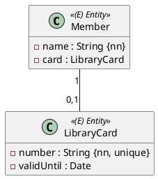

Every member of the library has exactly one library card, and every card belongs to exactly one member:



## A foreign key with `unique`

```java
@Entity
@Table(name = "members")
@Getter
@Setter
@NoArgsConstructor(access = AccessLevel.PROTECTED)
public class Member extends AbstractPersistable<Long> {

    private String name;

    @OneToOne(cascade = CascadeType.PERSIST)
    @JoinColumn(name = "card_id", foreignKey = @ForeignKey(name = "fk_member_card"))
    private LibraryCard card;

    public Member(String name) {
        this.name = name;
    }
}
```

```sql
create table members (
    card_id bigint unique,
    id bigint not null,
    name varchar(255),
    primary key (id)
)
```

This looks like `@ManyToOne` from unit 9 – with one difference: the column `card_id` is **`unique`**. The database rejects two members with the same card (`ConstraintViolationException` at the flush).

You decide where the foreign key goes: it belongs in the table of the class that **knows** or **needs** the other one. Here the member knows their card.

## Bidirectional with `mappedBy`

If the card should also know its member, `LibraryCard` gets the inverse side:

```java
@Entity
@Table(name = "library_cards")
@Getter
@Setter
@NoArgsConstructor(access = AccessLevel.PROTECTED)
public class LibraryCard extends AbstractPersistable<Long> {

    @Column(unique = true)
    private String number;
    private LocalDate validUntil;

    @OneToOne(mappedBy = "card")
    private Member member;

    public LibraryCard(String number, LocalDate validUntil) {
        this.number = number;
        this.validUntil = validUntil;
    }
}
```

```java
// in Member – written by hand so that both sides are set; Lombok then generates no setCard of its own
public void setCard(LibraryCard card) {
    this.card = card;
    card.setMember(this);
}
```

As with `@OneToMany`, Hibernate only saves the owning side (`member.card`). Here, too, the helper method keeps both sides in sync.

## When `@OneToOne`, when `@Embedded`?

| | `@Embedded` (unit 7) | `@OneToOne` |
|---|---|---|
| diagram | `«ValueObject»` | `«Entity»` on both sides |
| table | columns in the owner's table | a table of its own with its own id |
| own repository | no | yes |

If the other class is a value object, `@Embedded` is right – even if the multiplicity is `1`.

:::achtung Eager by default
`@OneToOne` and `@ManyToOne` load the other side right away (`FetchType.EAGER`). In the exercise that is not a problem. In large models `fetch = FetchType.LAZY` is often set.
:::

## Testing

```java
@Test
void verify_member_with_card() {
    Member member = new Member("Anna Berger");
    member.setCard(new LibraryCard("C-0001", LocalDate.of(2027, 6, 30)));
    memberRepository.save(member);

    entityManager.flush();
    entityManager.clear();

    LibraryCard card = libraryCardRepository.findByNumber("C-0001").orElseThrow();
    assertThat(card.getMember().getName()).isEqualTo("Anna Berger");
}
```

`cascade = CascadeType.PERSIST` saves the new card with the member. Without cascade you have to save it yourself first.

:::merke
- `@OneToOne` + `@JoinColumn`: a foreign key with `unique`.
- Inverse side: `@OneToOne(mappedBy = "…")`, a helper method sets both sides.
- Value object → `@Embedded`, not `@OneToOne`.
:::
