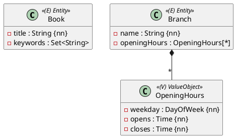

Not every list contains entities. A book has keywords (`String`), a branch has opening hours (a value object):



A list of values does not fit into one column. It gets a table of its own – but no entity of its own and no repository.

## A set of strings

```java
@ElementCollection
@CollectionTable(name = "book_keywords", joinColumns = @JoinColumn(name = "book_id"))
@Column(name = "keyword", length = 30)
private Set<String> keywords = new HashSet<>();
```

```sql
create table book_keywords (
    book_id bigint not null,
    keyword varchar(30),
    unique (book_id, keyword)
)
```

- `@CollectionTable` defines the table and the foreign key column.
- `@Column` applies here to the column with the **value**.
- With a `Set`, the pair `(book_id, keyword)` is unique.

## A list of value objects

```java
@Embeddable
public record OpeningHours(@Enumerated(EnumType.STRING) DayOfWeek weekday,
                           LocalTime opens, LocalTime closes) {
}
```

```java
// in Branch – with a collection there is no @AllArgsConstructor (unit 3)
@ElementCollection
@CollectionTable(name = "opening_hours", joinColumns = @JoinColumn(name = "branch_id"))
private List<OpeningHours> openingHours = new ArrayList<>();
```

```sql
create table opening_hours (
    closes time(0),
    opens time(0),
    branch_id bigint not null,
    weekday enum ('FRIDAY','MONDAY','SATURDAY','SUNDAY','THURSDAY','TUESDAY','WEDNESDAY')
)
```

The fields of the `@Embeddable` become columns of the collection table. The field is called `weekday`, not `day`: `day` is a reserved word in H2 (unit 4).

## What is different from `@OneToMany`

- The elements have **no id**. They belong entirely to the entity: saving and deleting always go along (like cascade ALL + orphanRemoval).
- If a `List` changes, Hibernate deletes **all** rows of the owner and writes the remaining ones anew:

```sql
-- branch.removeOpeningHours(...)
delete from opening_hours where branch_id=?
insert into opening_hours (branch_id, weekday, opens, closes) values (?, ?, ?, ?)
insert into opening_hours (branch_id, weekday, opens, closes) values (?, ?, ?, ?)
```

For a few opening hours that does not matter. If the elements need an identity of their own, relations of their own or queries of their own, make them an entity with `@OneToMany`.

:::pruefung
In the task you recognise an element collection by an attribute like `keywords : Set<String>` or by a list of `«ValueObject»`s. An `«Entity»` at the other end, on the other hand, means `@OneToMany` or `@ManyToMany`.
:::

## Testing

```java
@Test
void verify_branch_with_opening_hours() {
    Branch branch = new Branch("Main Library", address);
    branch.addOpeningHours(new OpeningHours(DayOfWeek.MONDAY, LocalTime.of(11, 0), LocalTime.of(19, 0)));
    branch.addOpeningHours(new OpeningHours(DayOfWeek.TUESDAY, LocalTime.of(11, 0), LocalTime.of(19, 0)));
    branchRepository.save(branch);

    entityManager.flush();
    entityManager.clear();

    assertThat(branchRepository.findById(branch.getId()).orElseThrow().getOpeningHours())
            .extracting(OpeningHours::weekday)
            .containsExactlyInAnyOrder(DayOfWeek.MONDAY, DayOfWeek.TUESDAY);
}
```

Without `@OrderColumn` the database does not remember the order of the list. So check with `containsExactlyInAnyOrder`.

:::merke
- `@ElementCollection` + `@CollectionTable(name, joinColumns)` for lists and sets of values.
- Elements: simple types or `@Embeddable`s, without an id and without a repository.
- They are always saved and deleted with the entity.
:::
