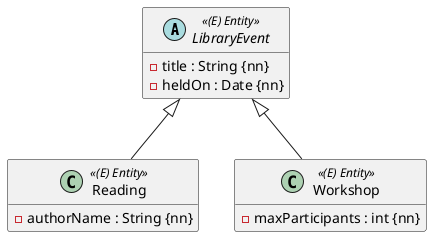

The library organises readings and workshops. Both have a title and a date; a reading additionally has an author, a workshop a maximum number of participants:



In Java this is normal inheritance. JPA additionally has to know how the hierarchy ends up in tables.

## The default: `SINGLE_TABLE`

```java
@Entity
@Table(name = "library_events")
@Getter
@Setter
@NoArgsConstructor(access = AccessLevel.PROTECTED)
@AllArgsConstructor
public abstract class LibraryEvent extends AbstractPersistable<Long> {

    private String title;
    private LocalDate heldOn;
}
```

```java
@Entity
@Getter
@Setter
@NoArgsConstructor(access = AccessLevel.PROTECTED)
public class Reading extends LibraryEvent {

    private String authorName;

    // written by hand: @AllArgsConstructor only knows authorName, not title and heldOn
    public Reading(String title, LocalDate heldOn, String authorName) {
        super(title, heldOn);
        this.authorName = authorName;
    }
}
```

`Workshop` looks just the same, with `private int maxParticipants`. Without further settings the whole hierarchy ends up in **one** table:

```sql
create table library_events (
    held_on date,
    max_participants integer,
    id bigint not null,
    dtype varchar(31) not null check ((dtype in ('Reading','Workshop'))),
    author_name varchar(255),
    title varchar(255),
    primary key (id),
    check (dtype <> 'Workshop' or (max_participants is not null))
)
```

- The column `dtype` (*discriminator type*) stores which class the row is: `'Reading'` or `'Workshop'`.
- The columns of the subclasses must be allowed to be `null` – a reading has no `max_participants`. For the primitive `int`, Hibernate therefore generates a `check` rule that only applies to workshops.
- The superclass is `abstract`: there is no "general" event.

:::achtung No `nullable = false` in subclasses
`@Column(nullable = false)` on a field of `Reading` makes the column `not null` – then **no workshop** can be saved any more (`NULL not allowed for column "AUTHOR_NAME"`). In subclasses use `@NotNull`: Bean Validation checks it in Java, the column stays nullable.
:::

You can name the discriminator and make it shorter:

```java
@Entity
@Inheritance(strategy = InheritanceType.SINGLE_TABLE)
@DiscriminatorColumn(name = "event_type", discriminatorType = DiscriminatorType.STRING, length = 1)
public abstract class LibraryEvent extends AbstractPersistable<Long> { ... }

@Entity
@DiscriminatorValue("R")
public class Reading extends LibraryEvent { ... }
```

## Repositories and polymorphic queries

```java
public interface LibraryEventRepository extends JpaRepository<LibraryEvent, Long> { }
public interface ReadingRepository extends JpaRepository<Reading, Long> { }
```

- `libraryEventRepository.findAll()` returns readings **and** workshops – each as an object of the right subclass.
- `readingRepository.findAll()` only returns readings (`where dtype='Reading'`).

```java
@Test
void verify_events_keep_their_type() {
    libraryEventRepository.save(new Reading("Malina", LocalDate.of(2026, 11, 5), "Ingeborg Bachmann"));
    libraryEventRepository.save(new Workshop("Buchbinden", LocalDate.of(2026, 11, 12), 12));
    entityManager.flush();
    entityManager.clear();

    assertThat(libraryEventRepository.findAll())
            .extracting(e -> e.getClass().getSimpleName())
            .containsExactlyInAnyOrder("Reading", "Workshop");
    assertThat(readingRepository.findAll()).hasSize(1);
}
```

## The other strategies

| Strategy | Tables | Advantage | Disadvantage |
|---|---|---|---|
| `SINGLE_TABLE` (default) | one for all | fast, simple queries | columns of the subclasses nullable |
| `JOINED` | one per class, the subclass with a foreign key `id` to the superclass | clean schema, `not null` possible | joins on every read |
| `TABLE_PER_CLASS` | one per **concrete** class, with all inherited columns | no joins for a subclass | queries over the superclass need `union` |

```java
@Entity
@Inheritance(strategy = InheritanceType.JOINED)
public abstract class LibraryEvent extends AbstractPersistable<Long> { ... }
```

Without a special reason in the task, stick to `SINGLE_TABLE`.

## `@MappedSuperclass`: inheriting without an entity

Sometimes you only want to inherit common fields, but never query via the superclass:

```java
@MappedSuperclass
public abstract class Stamped extends AbstractPersistable<Long> {
    private LocalDateTime createdAt;
}

@Entity
public class Notice extends Stamped {
    private String text;
}
```

`Stamped` has no table and no repository. `notice` gets the columns `id`, `created_at` and `text`. `AbstractPersistable` itself is exactly such a `@MappedSuperclass`.

:::pruefung
If the diagram shows `<|--` between two `«Entity»`s, that is inheritance with `@Entity` on both sides. You write the business constructor of a subclass yourself and call `super(...)` – `@AllArgsConstructor` only knows the class's own fields (unit 3).
:::

:::merke
- Superclass `@Entity` (often `abstract`), subclasses `@Entity`; the default is `SINGLE_TABLE` with the column `dtype`.
- `@DiscriminatorColumn`/`@DiscriminatorValue` name the discriminator.
- The repository of the superclass returns all subclasses, with the right type.
- `@MappedSuperclass`: only inherit fields, no table.
:::
