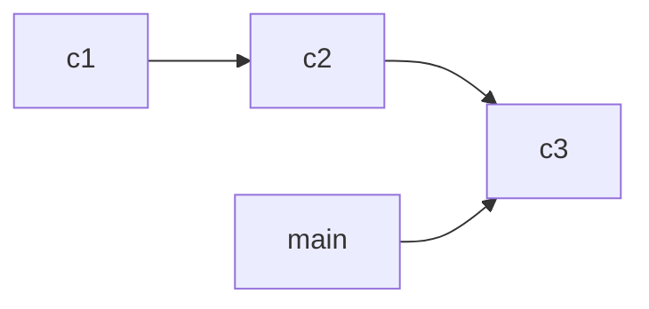

For the exam and the exercises here you work with **Git** – the version control system that keeps every change of your code. You do not have to be a Git pro, but you should know the terms – you meet every one of them in the task, on GitHub and in the Classroom50 release.

## The three places

Your project lives in three places:

1. **Working directory** – the files you are writing in right now.
2. **Staging area (index)** – the waiting area: what is to be saved next.
3. **Repository** – the store with all previous versions. Your local repo is on your laptop; the **remote** (often `origin`) is on GitHub.

A **commit** is a saved version: all changes since the previous commit, with a unique ID (hash), a commit message and you as the author. Commits hang together as a chain – that becomes the **history**.

## Branch, merge, conflict

A **branch** is a named line of the history – a label on a commit. **HEAD** points to the commit you are working in right now. **Merge** joins two branches again. If both branches change the same place in a file, there is a **conflict** that you have to resolve by hand – Git decides nothing for you.

## Data between laptop and GitHub

| Command | What happens |
|---|---|
| `git clone <url>` | get a copy of the remote repo including its history onto your computer |
| `git add <file>` | put changes into the staging area |
| `git commit -m "…" ` | write the staged content as a new commit into the local repo |
| `git push` | upload your own commits to the remote |
| `git pull` | get new commits from the remote (`fetch`) and take them into your own branch (`merge`) |
| `git fetch` | only get them, join nothing – for looking |
| `git status` | show which changes are not staged or committed yet |

:::merke
- **A commit stays local.** Only with `push` does it land on GitHub – and in the grading at Classroom50.
- `pull` = `fetch` + `merge`. Between school and home: `pull` before working, `push` after working.
- A conflict means: two people changed the same line – you decide what counts.
:::

## How it works for the exercises here

1. On the exercise page click **Aufgabe in Classroom50 annehmen** → you get your own **private repo** on GitHub (the template is already in it).
2. Get it with `git clone`, open it in IntelliJ IDEA and work in the given subproject.
3. `add`, `commit`, `push` – the grading tests run on every push; the result appears a few minutes later as a **release** in your repo.
4. On the other computer, `git pull` first, then keep working.

:::achtung Force push
A normal `push` cannot destroy anything – it only adds commits. **Force pushes** (`push --force`), however, overwrite the history of your repo. You never need them for a submission – leave them out.
:::
