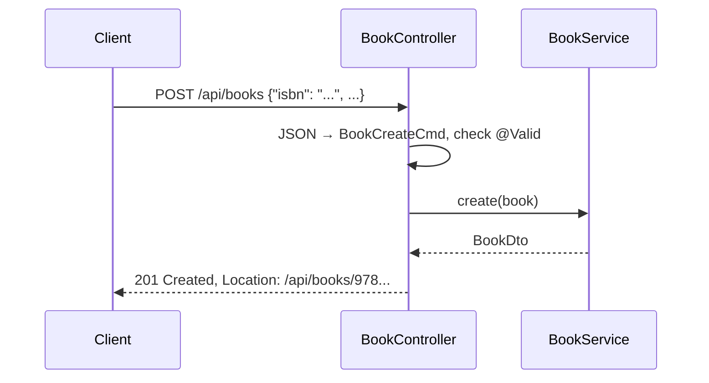

In Task 3 you build a **RESTful API**: endpoints that read and write JSON, with the right HTTP methods and status codes – and tests that prove it. The service behind it is only a stub; in the test you replace it with a mock.

## Resources and paths

A REST API talks about **resources**, not about actions. The path names the resource (plural), the HTTP method the action:

| Method | Path | Meaning | Success |
|---|---|---|---|
| `GET` | `/api/books` | read all books | `200 OK` |
| `GET` | `/api/books/{isbn}` | read one book | `200 OK` |
| `POST` | `/api/books` | create a book | `201 Created` + `Location` |
| `PUT` | `/api/books/{isbn}` | replace a book | `200 OK` |
| `PATCH` | `/api/books/{isbn}` | change a book partially | `200 OK` |
| `DELETE` | `/api/books/{isbn}` | delete a book | `204 No Content` |
| `GET` | `/api/books/{isbn}/loans` | the loans of a book | `200 OK` |

Paths with verbs are not RESTful: `/api/getBook?id=…`, `/api/books/delete/{isbn}`.

## One call from start to end

## Status codes you need

| Code | When |
|---|---|
| `200 OK` | read or changed, with a body |
| `201 Created` | newly created, with a `Location` header pointing to the new resource |
| `204 No Content` | deleted, without a body |
| `400 Bad Request` | invalid input (validation, broken JSON) |
| `404 Not Found` | the resource does not exist |
| `409 Conflict` | contradicts the current state, e.g. "already exists" |
| `500 Internal Server Error` | an error nobody handled – must not happen |

## How it is graded

| Grade | Expected |
|---|---|
| Genügend | endpoints and data classes defined correctly, details missing, tests rudimentary |
| Befriedigend | endpoints and data classes complete, the **good cases** are tested |
| Gut | the **edge cases** are tested too |
| Sehr gut | the **exception cases** are tested too |

Also expected: paths following REST principles, the right methods and status codes, handled exceptions, data classes for every JSON object and a service stub that is replaced by a mock in the test.

:::merke
- Path = resource in the plural, method = action.
- `201` with `Location` when creating, `204` when deleting, `404`/`400`/`409` for errors.
- Good grades come from the tests: good → edge → exception cases.
:::
