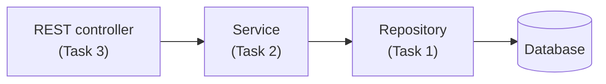

In Task 2 you program **business logic**: rules, calculations and evaluations over data that you create yourself in the test. There is no database and no REST interface – only Java, a service and tests.

## Where the service sits



In a real application the controller accepts a request, the service applies the rules, and the repository reads the data. In the exam you build each layer on its own: in Task 2 the data does not come from the database but from your tests.

## Two forms of the task

**1. The data is passed in.** The task shows data classes and the service in pseudocode:

```text
klasse RevenueAttributionService {
  RevenueAttributionService(Liste<Song> songs)
  Long streamingSecondsForArtist(Liste<StreamingLogEntry> entries, Artist artist)
}
```

On top of that come rules like "streams under 5 seconds are to be discarded". You write the data classes, the service and tests.

**2. There is a data access interface.** "A data access interface is to be assumed … The data access classes are to be mocked or replaced by stubs in the tests." The service gets an interface that you do not implement. In the test you replace it (unit 7). The task often demands a combined result, for example a `Map` of ratings with sorted lists (unit 4).

## How it is graded

| Grade | Expected |
|---|---|
| Genügend | data classes and service exist, but are not tested |
| Befriedigend | some basic business cases are tested |
| Gut | **all** business cases are tested and pass |
| Sehr gut | additionally the code is split into several classes |

So the tests count as much as the code. A service without tests is at most Genügend.

## The example in this module

The library from the JPA module charges late fees:

- The loan period is 28 days.
- Delays up to and including 2 days are free.
- After that every day of delay costs 20 cents – from the first day after the loan period.
- At most €10 per loan.
- Children pay half.

From this we build data classes, a service, an evaluation and the tests in the next units.

:::merke
- Task 2 = data classes + a service with business rules + tests, without a database and without REST.
- Data comes via the constructor/the parameters or via an interface that is replaced in the test.
- "Gut" means: all business cases tested. "Sehr gut": additionally split up sensibly.
:::
