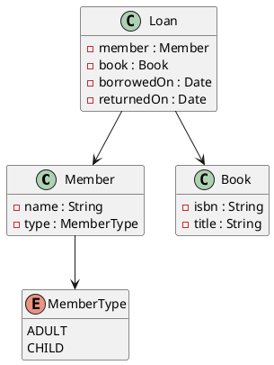

The task is not Java. It describes data classes in a diagram and the service in pseudocode. Your first job: translate both cleanly before you program a single rule.

## Data classes as records



The data classes have no identity and no behaviour: records fit exactly (module Stream API, unit 9).

```java
package businessservice.model;

public record Member(String name, MemberType type) {

    public Member {
        if (name == null) {
            throw new IllegalArgumentException("name must not be null");
        }
        if (type == null) {
            throw new IllegalArgumentException("type must not be null");
        }
    }
}

public record Book(String isbn, String title) {
}

/** returnedOn is null as long as the book is on loan. */
public record Loan(Member member, Book book, LocalDate borrowedOn, LocalDate returnedOn) {
}
```

| Task | Java |
|---|---|
| `String`, `Integer`, `Long` | `String`, `int`/`Integer`, `long`/`Long` |
| `Date` | `LocalDate` |
| `DateTime` | `LocalDateTime` |
| `Time` | `LocalTime` |
| `Liste<X>`, `X[*]` | `List<X>` |
| `«enum»` | `enum` |

An attribute that may be missing (here `returnedOn`) is documented – or you additionally offer a method with `Optional`:

```java
public Optional<LocalDate> returned() {
    return Optional.ofNullable(returnedOn);
}
```

## The service from the pseudocode

```text
class LateFeeService {
  ## All loans are passed in at the beginning
  LateFeeService(List<Loan> loans)

  ## Sum of the fees of a member in cents
  Integer feeFor(Member member, Date today)
}
```

```java
package businessservice.service;

public class LateFeeService {

    private final List<Loan> loans;

    public LateFeeService(List<Loan> loans) {
        if (loans == null) {
            throw new IllegalArgumentException("loans must not be null");
        }
        this.loans = List.copyOf(loans);
    }

    public int feeFor(Member member, LocalDate today) {
        return 0; // comes in unit 3
    }
}
```

- The constructor stores what the task "passes in at the beginning". `List.copyOf` protects the service from someone changing the list from outside.
- You take the method names from the task. You translate types according to the table above.
- The seed project has the subproject `Aufgabe2_BusinessService` with the package `businessservice.service` for this.

:::pruefung
"This pseudocode is meant as inspiration – adapt it to your programming language." A `Long` may become a `long`, a `Liste` a `List`. But stick to the names of the task so that the grader finds your code again.
:::

## Compile first, then rules

Create the data classes and the service with empty methods and write the first test that only creates a service and calls a method. Once that compiles, you have the skeleton – and every further step is a rule with its test.

:::merke
- Data classes → records, `Date` → `LocalDate`, `Liste` → `List`.
- The service constructor stores the data passed in (`List.copyOf`).
- Take names from the task, adapt types to Java.
:::
