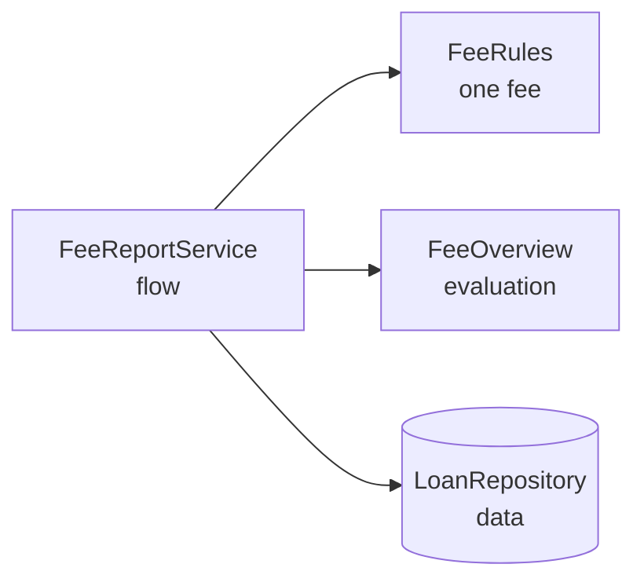

"Sehr gut" additionally demands that "the code is split into several classes and thus made more maintainable". A service with 150 lines in which rules, calculation and evaluation are mixed up does not fulfil that.

## Who does what?



| Class | Responsibility |
|---|---|
| `FeeRules` | the rules: delay, grace period, cap, children |
| `FeeOverview` | division into levels, sorting |
| `FeeReportService` | gets the data, calls rules and evaluation |

Every class has **one reason to change**: if the library changes the fee per day, only `FeeRules` changes.

## The rules as a class of their own

```java
public class FeeRules {

    static final int LOAN_DAYS = 28;
    static final int GRACE_DAYS = 2;
    static final int CENTS_PER_DAY = 20;
    static final int MAX_CENTS_PER_LOAN = 1000;

    public int fee(Loan loan, LocalDate today) {
        long late = daysLate(loan, today);
        if (late <= GRACE_DAYS) {
            return 0;
        }
        int cents = (int) Math.min(late * CENTS_PER_DAY, MAX_CENTS_PER_LOAN);
        return loan.member().type() == MemberType.CHILD ? cents / 2 : cents;
    }

    long daysLate(Loan loan, LocalDate today) { ... }
}
```

```java
@RequiredArgsConstructor
public class FeeReportService {

    private final LoanRepository loanRepository;
    private final FeeRules rules;
}
```

The service gets the rules in its constructor – just like the repository. `@RequiredArgsConstructor` generates `FeeReportService(LoanRepository loanRepository, FeeRules rules)`, in the order of the fields. In the test you pass `new FeeRules()`.

## Splitting the tests accordingly

- `FeeRulesTest`: all boundary values, without a repository, without a mock.
- `FeeOverviewTest`: levels and sorting with ready-made `MemberFee`s.
- `FeeReportServiceTest`: the interplay, with a stub or mock.

Every test class gets shorter, and a red test shows right away which part is broken.

## How far to split?

For the exam two to four classes besides the data classes are enough. Split by **tasks** (rules, calculation, evaluation), not by number of lines. One class per method does not make the code more maintainable.

:::merke
- Rules, evaluation and flow into classes of their own.
- Pass dependencies via the constructor.
- One test class per class.
:::
