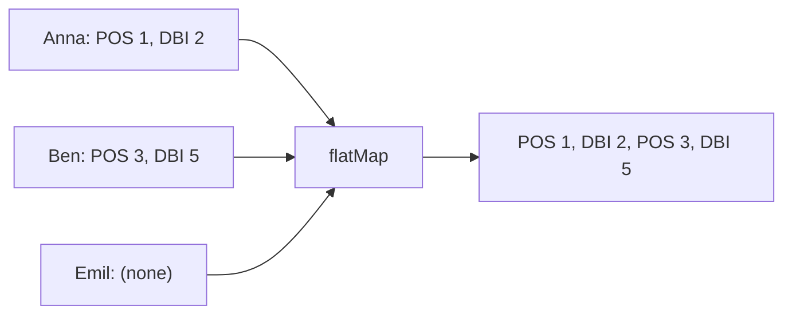

Every student has a list of grades. If you want **all** grades of all students, `map` gives you a list of lists:

```java
List<List<Grade>> nested = students.stream()
        .map(Student::grades)
        .toList();
// [[POS 1, DBI 2], [POS 3, DBI 5], [POS 2, DBI 2], [POS 4], []]
```

That is hard to work with. `flatMap` **flattens the lists**: every element becomes a stream, and all these streams are joined into one.

```java
List<Grade> allGrades = students.stream()
        .flatMap(s -> s.grades().stream())
        .toList();
// [POS 1, DBI 2, POS 3, DBI 5, POS 2, DBI 2, POS 4]
```



The difference in one sentence: `map` makes **one** new element out of **one** element, `flatMap` makes **any number** out of **one** element (even none – Emil contributes nothing).

Important: the lambda of `flatMap` has to return a **stream**, hence `s.grades().stream()`.

## Continuing after `flatMap`

Afterwards it is a completely normal stream of grades:

```java
// in which subjects are there grades?
students.stream()
        .flatMap(s -> s.grades().stream())
        .map(Grade::subject)
        .distinct()
        .sorted()
        .toList();
// [DBI, POS]
```

## Not losing the student

After `flatMap(s -> s.grades().stream())` you no longer know which student a grade belongs to. If you need both, combine them **inside** the lambda:

```java
students.stream()
        .flatMap(s -> s.grades().stream()
                .map(g -> s.name() + ": " + g.subject() + " " + g.value()))
        .toList();
// [Anna: POS 1, Anna: DBI 2, Ben: POS 3, ...]
```

## It also works without flatMap

For the question "Who has a failing grade?" you need no `flatMap` – a stream **inside** the filter is enough:

```java
students.stream()
        .filter(s -> s.grades().stream().anyMatch(g -> !g.isPositive()))
        .map(Student::name)
        .toList();
// [Ben]
```

:::merke
- `flatMap(x -> x.list().stream())` makes one stream out of many lists.
- `map`: 1 → 1, `flatMap`: 1 → 0..n.
- If you still need the outer object, combine inside the lambda of `flatMap`.
:::
