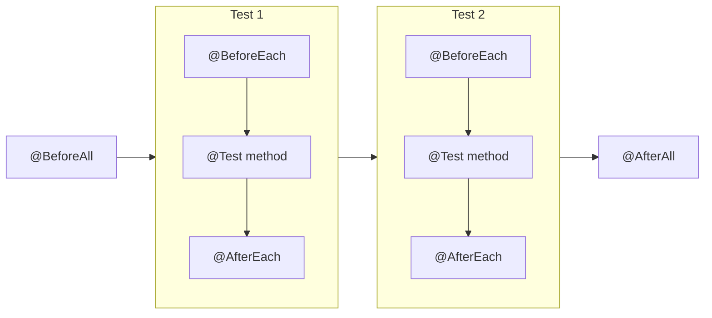

Many tests of a class need the same starting situation: an empty cart, some test data, a fresh service object. Instead of repeating that in every test, you put it into a **lifecycle method**.

## `@BeforeEach` and `@AfterEach`

A method with `@BeforeEach` runs **before every** test, one with `@AfterEach` **after every** test.

```java
import org.junit.jupiter.api.BeforeEach;
import org.junit.jupiter.api.Test;

import static org.assertj.core.api.Assertions.assertThat;

class CartTest {

    private Cart cart;

    @BeforeEach
    void setUp() {
        cart = new Cart();
        cart.add(new Item("Book", 20.0));
    }

    @Test
    void verify_total_of_one_item() {
        assertThat(cart.total()).isEqualTo(20.0);
    }

    @Test
    void verify_clear_empties_cart() {
        cart.clear();

        assertThat(cart.isEmpty()).isTrue();
    }
}
```

Because JUnit creates a new instance of `CartTest` for **every** test and calls `setUp()` before it, every test starts with exactly one book in the cart – no matter whether another test emptied the cart before.

## `@BeforeAll` and `@AfterAll`

These methods run **once** for the whole test class: before the first and after the last test. They have to be `static`, because at that point there is no instance of the test class yet.

```java
@BeforeAll
static void loadPriceList() {
    // expensive, e.g. reading a file – only once
}
```

The order for a class with two tests:



:::achtung Shared state
Whatever you put into a `static` field in `@BeforeAll` is shared by **all** tests. If one test changes this object, the next test sees the change. Mutable test data therefore belongs in `@BeforeEach`.
:::

## What do I need `@AfterEach` for?

Rarely in plain Java tests: the garbage collector cleans up the objects anyway. `@AfterEach` makes sense when a test changes something **outside** the object, e.g. creates a file or switches a static setting.

In `@DataJpaTest` tests you usually do not need it either: every test there runs in a transaction that is rolled back at the end.

:::pruefung
In Task 2 you have to create test data yourself. Build it in a `@BeforeEach` method or in helper methods (see the unit "Test data"), then the individual tests stay short and readable.
:::

:::merke
- `@BeforeEach` / `@AfterEach`: before or after **every** test.
- `@BeforeAll` / `@AfterAll`: **once** per test class, the method is `static`.
- Always create mutable test data anew in `@BeforeEach`.
:::
