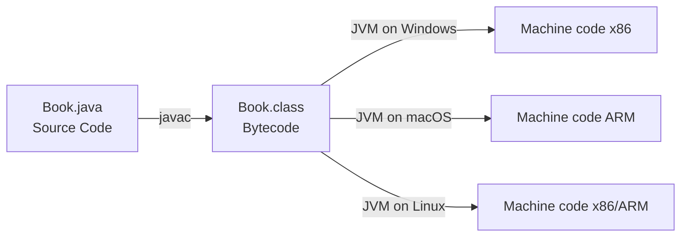

This is how the question could be asked:

> You ship the same `.jar` file to three customers – one on Windows, one on Linux, one on macOS. What happens between writing the source code and the moment the program runs on the customer's machine, and what does the customer need to have installed? How would that look if the application were written in TypeScript, or in a language like C, Rust or Go?

## Writing exercise

Take **5 minutes** and write your answer in key points. Only then read on.

## The knowledge behind it

1. **Compiling:** `javac` (in the Matura: Gradle) translates `.java` into **bytecode** (`.class`, packed as a `.jar`). Bytecode is not machine code for a particular processor, but code for an imaginary machine.
2. **Running:** the **JVM** (Java Virtual Machine) loads the bytecode, interprets it and translates frequently used parts into real machine code at runtime (**JIT compiler**, *just in time*). It also manages the memory (**garbage collector**).
3. **Platform-independent:** there is a JVM for every operating system and every processor. The same `.jar` runs wherever a matching JVM is installed: *"Write once, run anywhere."*
4. **Needed on the target system:** a **JRE/JDK** in a matching version (e.g. Java 25). Alternative: ship the runtime along (`jlink`, Docker image) or compile natively (GraalVM Native Image).
5. **C# / .NET:** exactly the same principle – C# → **IL code** (intermediate language) → **CLR** with JIT.

## Comparison

| | Java / C# | TypeScript | C, Rust, Go |
|---|---|---|---|
| translation | into bytecode/IL | **transpiled** into JavaScript (`tsc`), types are dropped | directly into **machine code** for one target system |
| execution | JVM/CLR, JIT | JavaScript engine (browser, Node.js – V8 with JIT) | directly by the processor |
| needed on the target system | Java runtime / .NET runtime | browser or Node.js | nothing (Go: statically linked; C: possibly libraries) |
| other platform | the same `.jar` | the same `.js` | **compile again** per operating system and processor (cross-compiling) |
| type checking | compile time + runtime | only when compiling | compile time |

## Sample answer

> Java source code is not translated directly into machine code by the compiler `javac`, but into **bytecode** (`.class` files, usually combined in a `.jar`). The **Java Virtual Machine** runs this bytecode: it interprets it and translates frequently used parts at runtime with the **JIT compiler** into machine code for the processor at hand. It also takes care of memory management (garbage collection). Because there is a JVM for each of Windows, Linux and macOS, the same `.jar` runs on all systems. For that, a **Java runtime (JRE/JDK)** in a matching version has to be installed on the target system. C# works the same way: translation into IL code, execution by the CLR.
>
> **TypeScript** is **transpiled** into JavaScript with `tsc`; the types no longer exist afterwards. The JavaScript is run by an engine in the browser or by Node.js – so a browser or Node has to be installed there. **C, Rust and Go**, on the other hand, are compiled directly into machine code for a particular operating system and processor architecture. The program needs no runtime environment and starts very quickly, but has to be **compiled separately** for every target platform.

:::pruefung
Checklist – have you …
- named and explained **bytecode** and **JVM**?
- mentioned **JIT** and the **garbage collector**?
- justified the **platform independence** (one JVM per platform, the same `.jar`)?
- said what has to be **installed** (JRE/JDK)?
- compared **TypeScript** (transpiled → JavaScript → browser/Node)?
- compared **C/Rust/Go** (native machine code, compile again per platform, no runtime)?
:::
