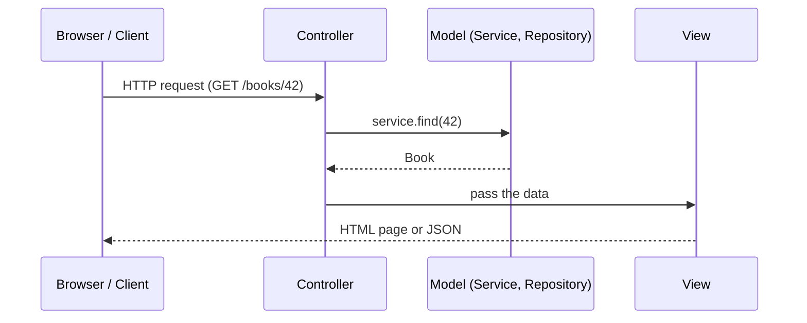

This is how the question could be asked:

> Many web frameworks split their code along the **Model View Controller** pattern. Describe what each of the three parts is responsible for and what happens, step by step, when a request comes in. Contrast a Spring application that returns JSON with one that builds finished HTML pages on the server – what is the view in each case? Where else do you come across the pattern?

## Writing exercise

Take **5 minutes** and write your answer in key points. Only then read on.

## The knowledge behind it

**MVC** is an architectural pattern that splits an application with a user interface into three responsibilities:

| Part | Job | Knows nothing about … |
|---|---|---|
| **Model** | data and business logic (entities, services, repositories) | the presentation |
| **View** | presentation for the user (HTML page, with REST: the JSON) | database, business rules |
| **Controller** | accepts requests, calls the model, chooses the view / builds the response | how data is stored |



**What for?** Separation of concerns: you can change the interface without touching the logic, and test every layer on its own (service with unit tests, controller with `@WebMvcTest` and a mocked service).

**Where?** Web frameworks like Spring MVC, ASP.NET MVC, Ruby on Rails, Laravel; originally desktop GUIs (Smalltalk).

### REST API (Task 3)

- **Controller:** `@RestController` with `@GetMapping`, `@PostMapping` … accepts the request, checks the input (`@Valid`) and calls the service.
- **Model:** the service layer and entities/repositories.
- **View:** there is no HTML page – the "view" is the **JSON representation** of the DTOs (records) that Jackson creates from the return value. That is why DTOs are kept separate from entities.

### Server-side rendering

- **Controller:** `@Controller` (without "Rest") puts data into a `Model` object and returns the **name of a template**.
- **View:** a template (e.g. Thymeleaf `books.html`) that the server renders with the data into finished HTML.

```java
@Controller
public class BookPageController {
    private final BookService service;
    // Konstruktor …

    @GetMapping("/books")
    public String list(Model model) {
        model.addAttribute("books", service.findAll());
        return "books";            // → templates/books.html
    }
}
```

## Sample answer

> **Model View Controller** is an architectural pattern that splits an application into three parts with separate jobs. The **model** contains the data and the business logic (entities, services, repositories), the **view** is responsible for the presentation, and the **controller** accepts user input or HTTP requests, calls the model and passes the result to the view. Model and view do not know each other directly; the controller mediates. That way interface and logic can be changed independently and tested separately. MVC is used above all in web frameworks (Spring MVC, ASP.NET MVC, Rails).
>
> In a **REST API** in Spring the controller is a class with `@RestController` and mappings like `@GetMapping("/api/books/{id}")`. It calls the service (model) and returns a DTO or `ResponseEntity`; the "view" is the JSON representation that Jackson creates. In a **server-side rendered** application you use `@Controller`: the method puts data into a `Model` object and returns the name of a template that, for example, Thymeleaf renders into HTML on the server and sends to the browser.

:::pruefung
Checklist – have you …
- described MVC as an **architectural pattern** with the goal *separation of concerns*?
- explained **all three parts** with their jobs?
- described the **flow** of a request (client → controller → model → view → client)?
- made **REST** concrete (`@RestController`, DTO/JSON as the view)?
- made **server-side rendering** concrete (`@Controller`, `Model`, template)?
- named the benefit (replaceability, testability)?
:::
