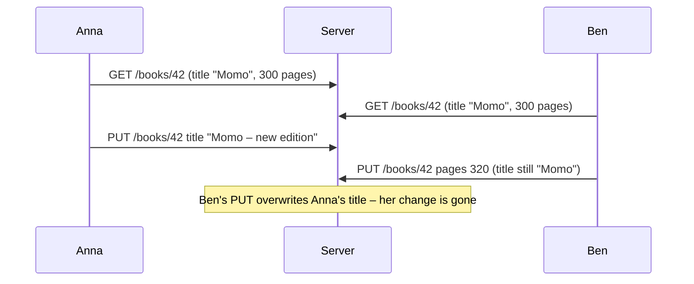

This is how the question could be asked:

> Two people open the same record in an application at the same time, change it and then save it via PUT or PATCH. What can go wrong? Which solutions do you know, and how do you implement them?

## Writing exercise

Take **5 minutes** and write your answer in key points. Only then read on.

## The knowledge behind it

**The problem: lost update.**



Nobody gets an error, but Anna's change is lost.

**Solutions:**

| Approach | Idea | Pros/cons |
|---|---|---|
| **Optimistic locking** | Every record has a **version number**. When saving, the DB checks `WHERE id = 42 AND version = 7` and increases it. If someone else has saved in the meantime, the version does not match → error. | no locking, scales well; the second person has to reload and change again. Standard in web applications. |
| **Pessimistic locking** | **Lock** the record when reading (`SELECT … FOR UPDATE`) until you are done. | conflicts impossible, but others wait; unsuitable for web clients that "never come back". |
| **PATCH instead of PUT** | only send changed fields. | reduces the problem when different fields are changed – does not solve it for the same field. |
| "last write wins" | do nothing | simple, but data loss. |

**In Spring / JPA:**

```java
@Entity
public class Book extends AbstractPersistable<Long> {
    @Version
    private Long version;
    // …
}
```

Hibernate increases `version` on every update and throws an `OptimisticLockException` (in Spring: `ObjectOptimisticLockingFailureException`) when the version no longer matches.

**Over HTTP:** the client gets the version (in the JSON or as an `ETag` header) and sends it back when changing (in the body or as an `If-Match` header). If it does not match, the server answers with **`409 Conflict`** (or `412 Precondition Failed` with `If-Match`), and the client reloads.

## Sample answer

> If two users load the same object and save it one after the other with PUT, the second overwrites the changes of the first without noticing (**lost update**). With PUT this is especially critical, because the whole object is always sent with the old state of the other fields; PATCH makes the problem smaller, but does not solve it when both change the same field.
>
> The usual solution is **optimistic locking**: every record gets a version number. When saving, it is checked whether the version is still the same as when loading, and it is increased. If someone else has saved in the meantime, the update fails; the server answers with `409 Conflict`, and the client has to reload and repeat the change. In JPA a field with `@Version` is enough; Hibernate then throws an `OptimisticLockException`, which I map to `409` in the `@RestControllerAdvice`. The version is given to the client in the JSON or as an `ETag` and sent back with the PUT/PATCH (or in the `If-Match` header).
>
> Alternatively there is **pessimistic locking**: the record is locked when it is loaded, until editing is finished. That prevents conflicts, but makes others wait and is unfavourable for web applications with long editing times.

:::pruefung
Checklist – have you …
- named the problem (**lost update**) and explained it?
- explained **optimistic locking** with a version number?
- named **JPA `@Version`** and the exception?
- described the **HTTP side** (`409 Conflict`, sending version/ETag along, reloading)?
- named **pessimistic locking** as an alternative with its disadvantage?
:::
