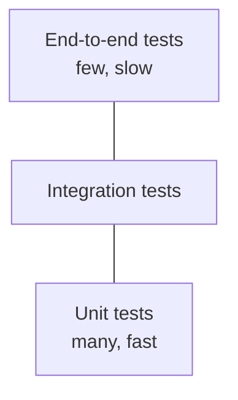

This is how the question could be asked:

> Which kinds of automated tests do you know? Explain for each kind what it checks and how it basically works, and name tools you use to write them in your technology stack.

You write three of these kinds of tests yourself in the Matura – you only have to be able to name them.

## Writing exercise

Take **5 minutes** and write your answer in key points. Only then read on.

## The knowledge behind it

The **test pyramid**: many small, fast tests at the bottom, few big, slow ones at the top.

| Kind of test | What is tested? | How? | In Java / Spring |
|---|---|---|---|
| **unit test** | one class/method **in isolation** | dependencies replaced by **mocks/stubs**, no server, no DB | JUnit 5, AssertJ, Mockito (`@Mock`, `@InjectMocks`) – **Task 2** |
| **integration test** | interplay of several parts, e.g. with a real DB | parts of the application are started | `@DataJpaTest` (JPA + H2) – **Task 1**; `@SpringBootTest` |
| **slice/web test** | only the web layer | controller with a mocked service, HTTP simulated | `@WebMvcTest`, MockMvc, `@MockitoBean` – **Task 3** |
| **end-to-end test** | the whole application from the user's point of view | browser or HTTP client against the running system | Playwright, Selenium, REST Assured |
| **acceptance test** | does the application meet the requirements? | scenarios in business language | Cucumber (Given/When/Then) |
| **load/performance test** | behaviour under many simultaneous requests | simulated users | JMeter, Gatling, k6 |
| **regression test** | does old functionality still work after changes? | run all existing tests again automatically | CI pipeline (GitHub Actions) |

Every test is structured as **arrange – act – assert** (prepare – execute – check).

## Sample answer

> Automated tests are often shown as a **test pyramid**: many fast unit tests, fewer integration tests, few end-to-end tests. Every test follows the pattern arrange – act – assert.
>
> **Unit tests** check a single class in isolation; dependencies are replaced by mocks or stubs. In Java I use JUnit 5 with AssertJ (`assertThat(…).isEqualTo(…)`) and Mockito (`@Mock`, `@InjectMocks`, `when(…).thenReturn(…)`), e.g. for the business logic in the service. Parameterised tests (`@ParameterizedTest`, `@CsvSource`) cover many cases.
>
> **Integration tests** check the interplay of several components, such as entities and repositories with a real (in-memory) database: in Spring with `@DataJpaTest`. **Web tests** only test the controller layer: `@WebMvcTest` with MockMvc sends simulated HTTP requests, the service is replaced with `@MockitoBean`, and status codes and JSON (`jsonPath`) are checked. `@SpringBootTest` starts the whole application.
>
> **End-to-end tests** test the entire system from the user's point of view, e.g. with Playwright in the browser. Beyond that there are **acceptance tests** (Cucumber), **load and performance tests** (JMeter, Gatling) and **regression tests**, where all tests run automatically in a CI pipeline after every change.

:::pruefung
Checklist – have you …
- named and distinguished at least **unit, integration and end-to-end tests**?
- explained **how they work** (in isolation with mocks / several parts with a DB / the whole system)?
- named the **Spring tools** (JUnit 5, AssertJ, Mockito, `@DataJpaTest`, `@WebMvcTest` + MockMvc, `@SpringBootTest`)?
- mentioned the **test pyramid** or arrange–act–assert?
- named further kinds (load, acceptance, regression tests, CI)?
:::
