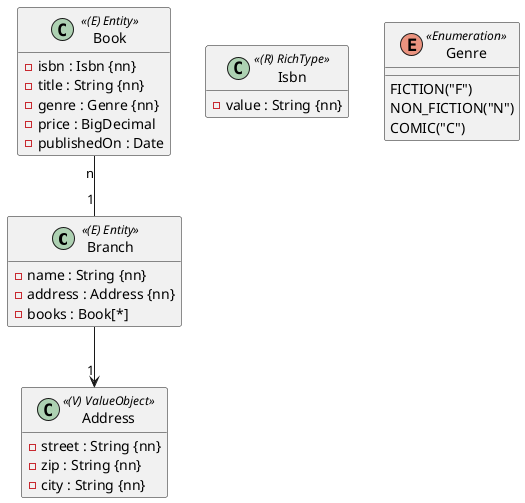

Aufgabe 1 der Matura beginnt immer gleich: ein UML-Klassendiagramm, ein paar Sätze Text darunter und der Auftrag, das Modell mit JPA umzusetzen, in eine Datenbank abzubilden und zu testen. Bevor du die erste Annotation schreibst, musst du das Diagramm richtig lesen. Darum geht es in dieser Einheit.

In diesem Modul verwenden wir durchgehend eine kleine Bibliothek:

## Die vier Stereotypen

Der Stereotyp in den spitzen Klammern sagt dir, **wie** eine Klasse in die Datenbank kommt:

| Stereotyp | In Java | In der Datenbank | Einheit |
|---|---|---|---|
| `«Entity»` | Klasse mit `@Entity` und Id | eigene Tabelle | 2 |
| `«ValueObject»` | `@Embeddable` (Klasse oder Record), keine Id | Spalten in der Tabelle des Besitzers | 7 |
| `«RichType»` | Record mit Regeln, `AttributeConverter` | **eine** Spalte | 8 |
| `«Enumeration»` | `enum`, `AttributeConverter` | eine Spalte mit Code | 6 |

Ein Entity hat eine **Identität**: Zwei Bücher mit demselben Titel sind trotzdem zwei Bücher. Ein Value Object hat keine: Zwei Adressen mit denselben Werten sind dieselbe Adresse.

:::achtung Die Id steht nicht im Diagramm
Technische Attribute wie `id` fehlen im UML-Diagramm. Jedes Entity braucht trotzdem einen Primary Key – den ergänzt du selbst.
:::

## Attribute lesen

`- title : String {nn}` heißt: ein privates Feld `title` vom Typ `String`, das nie `null` sein darf. `{nn}` steht für *not null*.

| Im Diagramm | In Java |
|---|---|
| `String`, `Integer`, `Boolean` | `String`, `Integer`, `boolean` |
| `Date` | `LocalDate` |
| `DateTime` | `LocalDateTime` |
| `BigDecimal` (Geldbeträge) | `BigDecimal` |
| `Book[*]` | `List<Book>` |
| `address : Address` | ein Feld vom Typ des Value Objects |

Ist der Typ eines Attributs eine andere Klasse aus dem Diagramm, ist es **keine** einfache Spalte, sondern eine Beziehung, ein Value Object oder ein Rich Type – je nach Stereotyp dieser Klasse.

## Linien und Multiplizitäten

| Linie | Bedeutung | Einheit |
|---|---|---|
| `Book "n" -- "1" Branch` | ohne Pfeil: beide Seiten kennen sich (bidirektional). Viele Bücher gehören zu einer Filiale | 9, 10 |
| `Branch --> "1" Address` | mit Pfeil: nur `Branch` kennt `Address` | 7 |
| `"0,1"` oder `"0..1"` | optional: darf fehlen | 9 |
| `"1"` | Pflicht: genau eins | 9 |

Eine Linie mit leerem Dreieck (`A <|-- B`) bedeutet Vererbung: `B` erbt von `A` (Einheit 14).

## So gehst du die Angabe durch

1. **Zählen:** Wie viele Entities, Value Objects, Rich Types und Enums gibt es? Die Angabe nennt die Zahl oft im Text („fünf Entities, ein ValueObject sowie ein RichType“) – vergleiche.
2. **Pro Klasse:** Attribute mit Typ notieren, `{nn}` markieren.
3. **Pro Linie:** Wer kennt wen, und wie viele?
4. **Text unter dem Diagramm:** Dort stehen Regeln für Rich Types (z. B. erlaubte Werte), Längen, eindeutige Werte und die geforderten Abfragen.
5. **Zugriffsklassen:** Jedes Entity bekommt ein Repository und einen Test. Value Objects und Rich Types bekommen kein Repository – sie werden mit ihrem Entity gespeichert.

:::pruefung
Die Beurteilung verlangt, dass die Klassen „mit richtigem Namen und Attributen“ umgesetzt sind und die Charakterisierung als Entity, Value Object, Rich Type oder Enumeration stimmt. Übernimm Namen exakt aus dem Diagramm, auch wenn sie dir nicht gefallen.
:::

:::merke
- `«Entity»` → Tabelle mit Id, `«ValueObject»` → Spalten beim Besitzer, `«RichType»` → eine Spalte, `«Enumeration»` → Code in einer Spalte.
- `{nn}` = darf nicht `null` sein.
- Die Id steht nicht im Diagramm, du brauchst sie trotzdem.
- Ein Attribut mit einer Klasse aus dem Diagramm als Typ ist eine Beziehung, kein einfacher Wert.
:::
