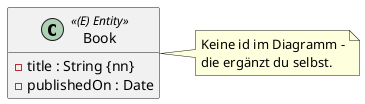

Ein Entity ist eine ganz normale Java-Klasse, die JPA in eine Tabelle abbildet. Dafür braucht sie genau zwei Dinge: die Annotation `@Entity` und einen Primary Key.

So sieht ein Entity im Diagramm aus:



## Variante 1: die Id selbst schreiben

```java
import jakarta.persistence.Entity;
import jakarta.persistence.GeneratedValue;
import jakarta.persistence.Id;
import jakarta.persistence.Table;

@Entity
@Table(name = "books")
public class Book {

    @Id
    @GeneratedValue
    private Long id;

    private String title;
    private LocalDate publishedOn;

    // Konstruktoren und Getter: Einheit 3
}
```

- `@Entity` macht die Klasse zum Entity. Alle Annotationen kommen aus `jakarta.persistence`.
- `@Id` markiert den Primary Key. Nimm `Long`, nicht `long`: Ein neues Objekt hat noch keine Id, und das zeigt `null` an.
- `@GeneratedValue` lässt die Datenbank die Id vergeben. Du setzt sie nie selbst.
- `@Table` ist optional, aber empfohlen. Ohne `@Table` heißt die Tabelle wie die Klasse: `book`.

Spring Boot macht aus Namen in camelCase Namen mit Unterstrich. Aus dem Feld `publishedOn` wird die Spalte `published_on`:

```sql
create table books (
    published_on date,
    id bigint not null,
    title varchar(255),
    primary key (id)
)
```

## Variante 2: `AbstractPersistable`

Spring Data bringt eine fertige Basisklasse mit, die dir die Id abnimmt:

```java
import jakarta.persistence.Entity;
import jakarta.persistence.Table;
import org.springframework.data.jpa.domain.AbstractPersistable;

@Entity
@Table(name = "books")
public class Book extends AbstractPersistable<Long> {

    private String title;
    private LocalDate publishedOn;
}
```

Das Typargument ist der Typ der Id. Du bekommst geschenkt:

| Methode | Liefert |
|---|---|
| `getId()` | die Id, vor dem Speichern `null` |
| `isNew()` | `true`, solange die Id `null` ist |
| `equals` / `hashCode` | gleich, wenn Klasse und Id gleich sind |
| `toString()` | `Entity of type ormapping.model.Book with id: 1` |

In diesem Modul verwenden wir ab jetzt `AbstractPersistable<Long>`. Die Musterlösungen der Matura machen es genauso.

:::achtung equals und hashCode
Die Beurteilung verlangt `equals` und `hashCode` für die Modellklassen. Schreibst du die Id selbst (Variante 1), musst du sie auch selbst implementieren. Ohne `equals` ist ein Buch, das du neu aus der Datenbank liest, **nicht** gleich dem Objekt, das du gespeichert hast. Mit `AbstractPersistable` ist es gleich, weil die Id übereinstimmt.
:::

## Wie die Id vergeben wird

Ohne weitere Angabe verwendet Hibernate eine **Sequence** mit dem Namen `<tabelle>_seq`, hier `books_seq`. Die Sequence zählt in Schritten von 50: Hibernate holt sich 50 Ids auf einmal und vergibt sie dann selbst. Deshalb schreibt Hibernate ein neues Objekt erst beim nächsten **Flush** in die Tabelle, nicht schon beim Speichern. Das wird in Einheit 4 wichtig.

Mit `@GeneratedValue(strategy = GenerationType.IDENTITY)` vergibt stattdessen die Tabelle die Id (`id bigint generated by default as identity`), und Hibernate muss sofort einfügen, um sie zu erfahren. Für die Prüfung reicht der Standard.

:::merke
- Ein Entity braucht `@Entity` und eine Id mit `@Id`.
- `@Table(name = "...")` ist optional, aber empfohlen.
- `extends AbstractPersistable<Long>` liefert Id, `isNew()`, `equals` und `hashCode`.
- Spaltennamen: `publishedOn` → `published_on`.
:::
