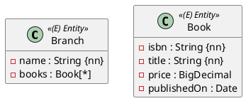

`@Entity` und eine Id reichen, damit Hibernate eine Tabelle anlegt. Für die volle Punktzahl braucht ein Entity aber noch mehr: die richtigen Konstruktoren, Getter und gut gekapselte Listen.



Die Reihenfolge der Attribute im Diagramm ist die Reihenfolge der Parameter im fachlichen Konstruktor: `Book(isbn, title, price, publishedOn)`. Listen wie `books : Book[*]` kommen nicht in den Konstruktor.

## Zwei Konstruktoren

```java
@Entity
@Table(name = "books")
public class Book extends AbstractPersistable<Long> {

    private String isbn;
    private String title;
    private BigDecimal price;
    private LocalDate publishedOn;

    protected Book() {
        // für JPA
    }

    public Book(String isbn, String title, BigDecimal price, LocalDate publishedOn) {
        this.isbn = isbn;
        this.title = title;
        this.price = price;
        this.publishedOn = publishedOn;
    }

    public String getIsbn() {
        return isbn;
    }

    public String getTitle() {
        return title;
    }

    public BigDecimal getPrice() {
        return price;
    }

    public LocalDate getPublishedOn() {
        return publishedOn;
    }
}
```

- Der **Konstruktor ohne Parameter** ist für JPA: Beim Lesen erzeugt Hibernate zuerst ein leeres Objekt und füllt dann die Felder. Er ist `protected`, damit dein eigener Code ihn nicht verwendet.
- Der **fachliche Konstruktor** nimmt alle Attribute in der Reihenfolge des Diagramms, außer Listen. Die Id gehört nicht dazu.

:::achtung Fehlt der Konstruktor ohne Parameter, merkst du es spät
Hibernate startet trotzdem und schreibt nur eine Info ins Log. Auch das Speichern klappt. Erst beim **Lesen** aus der Datenbank fliegt `InstantiationException: No default constructor for entity`. Ein Test, der direkt nach dem Speichern liest, bekommt aber das Objekt aus dem Speicher statt aus der Datenbank (Einheit 5) – und bemerkt den Fehler nicht.
:::

## Getter ja, Setter nur wenn nötig

Hibernate liest und schreibt die **Felder** direkt, weil die Id-Annotation auf einem Feld sitzt. Setter braucht JPA deshalb nicht. Schreib Getter für alle Attribute und Setter nur dort, wo sich ein Wert fachlich ändern darf.

Für `boolean`-Felder heißt der Getter `isElectric()` statt `getElectric()`.

## Was ein Entity nicht sein darf

- **Kein Record.** Records sind unveränderlich, Hibernate kann die Id nach dem Speichern nicht setzen: `persist` scheitert mit `Can not set final java.lang.Long field ... id`. Records passen dafür perfekt für Value Objects und Rich Types.
- **Nicht `final`**, und auch die gespeicherten Felder nicht. Die JPA-Spezifikation verbietet es, und Hibernate braucht Unterklassen für Lazy Loading.

## Listen kapseln

Hat ein Entity eine Liste (z. B. die Bücher einer Filiale), gib die Liste nie direkt heraus. Sonst kann jeder von außen Elemente hinzufügen oder löschen, ohne dass das Entity davon erfährt:

```java
private List<Book> books = new ArrayList<>();

public List<Book> getBooks() {
    return Collections.unmodifiableList(books);
}

public void addBook(Book book) {
    books.add(book);
}
```

- Die Liste wird gleich beim Feld angelegt, so ist sie nie `null`.
- Der Getter liefert eine unveränderliche Sicht. `getBooks().add(...)` wirft eine `UnsupportedOperationException`.
- Ändern geht nur über Methoden wie `addBook`. In Einheit 10 halten diese Methoden auch die Gegenseite einer Beziehung aktuell.

## Abkürzung: Lombok

Konstruktoren und Getter sind viel Tipparbeit. **Lombok** erzeugt sie beim Kompilieren aus Annotationen. Lombok ist im Prüfungsprojekt nicht eingebunden; du ergänzt es in `Aufgabe1_ORMapping/build.gradle.kts` (die Version kommt von Spring Boot):

```kotlin
dependencies {
    // ... was schon da ist
    compileOnly("org.projectlombok:lombok")
    annotationProcessor("org.projectlombok:lombok")
}
```

Dann sieht `Book` so aus – mit denselben Konstruktoren und Gettern wie oben:

```java
import lombok.AccessLevel;
import lombok.AllArgsConstructor;
import lombok.Getter;
import lombok.NoArgsConstructor;

@Entity
@Table(name = "books")
@Getter
@NoArgsConstructor(access = AccessLevel.PROTECTED)
@AllArgsConstructor
public class Book extends AbstractPersistable<Long> {

    private String isbn;
    private String title;
    private BigDecimal price;
    private LocalDate publishedOn;
}
```

| Annotation | Erzeugt |
|---|---|
| `@Getter` | einen Getter pro Feld (`getTitle()`, bei `boolean` `isElectric()`) |
| `@Setter` | einen Setter pro Feld – an der Klasse selten sinnvoll, besser einzeln an Feldern |
| `@NoArgsConstructor(access = AccessLevel.PROTECTED)` | den `protected` Konstruktor ohne Parameter für JPA |
| `@AllArgsConstructor` | einen `public` Konstruktor mit **allen** Feldern der Klasse, in der Reihenfolge im Code |

Schreibst du eine Methode selbst, erzeugt Lombok sie nicht. So bleibt ein eigenes `getBooks()` mit `Collections.unmodifiableList` neben `@Getter` erhalten.

:::achtung `@NoArgsConstructor` und `@AllArgsConstructor` brauchen eigene Felder
`@AllArgsConstructor` nimmt nur die Felder der **eigenen** Klasse. Hat eine Klasse keine eigenen Felder, ist das ein Konstruktor ohne Parameter – genau wie der von `@NoArgsConstructor`. Das passiert bei Vererbung (Einheit 14), wenn ein Kind-Entity keine zusätzlichen Attribute hat:

```java
@Entity
@NoArgsConstructor(access = AccessLevel.PROTECTED)
@AllArgsConstructor
public class InUse extends Location {
}
```

Der Code kompiliert nicht: `Konstruktor InUse() ist bereits in Klasse InUse definiert`. Lass in diesem Fall `@AllArgsConstructor` weg und schreib den Konstruktor selbst, der die Attribute an `super(...)` weitergibt. Dasselbe gilt für ein Kind-Entity **mit** eigenen Feldern: `@AllArgsConstructor` erzeugt dort nur `InUse(String exam)` – die Attribute der Elternklasse kannst du damit nicht setzen.
:::

Zwei weitere Fallen:

- `@AllArgsConstructor` nimmt auch Listen in den Konstruktor auf (`Branch(String name, Address address, List<Book> books)`) und speichert die übergebene Liste direkt. Für Entities mit Listen schreibst du den fachlichen Konstruktor besser selbst.
- **Kein `@Data` auf Entities.** `@Data` erzeugt einen `public` Konstruktor ohne Parameter, Setter für alle Felder und ein eigenes `equals`/`hashCode` über alle Felder, das das von `AbstractPersistable` ersetzt. Lombok warnt dabei: `Generating equals/hashCode implementation but without a call to superclass`.

:::merke
- `protected` Konstruktor ohne Parameter für JPA, `public` Konstruktor mit allen Attributen für dich.
- Getter für alle Attribute, Setter nur, wenn nötig.
- Ein Entity ist kein Record und nicht `final`.
- Listen: beim Feld anlegen, unveränderlich herausgeben, über `add`-Methoden ändern.
- Lombok: `@Getter`, `@NoArgsConstructor(access = AccessLevel.PROTECTED)`, `@AllArgsConstructor` – aber nicht beide Konstruktor-Annotationen ohne eigene Felder, und kein `@Data`.
:::
