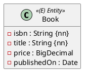

`@Entity` und eine Id reichen, damit Hibernate eine Tabelle anlegt. Für die volle Punktzahl braucht ein Entity aber noch mehr: einen Konstruktor für JPA, einen fachlichen Konstruktor, Getter und Setter. Das meiste davon schreibst du nicht selbst – **Lombok** erzeugt es beim Kompilieren aus vier Annotationen.



## Die vier Annotationen

So sieht in diesem Kurs jedes Entity ohne Beziehungen aus:

```java
import lombok.AccessLevel;
import lombok.AllArgsConstructor;
import lombok.Getter;
import lombok.NoArgsConstructor;
import lombok.Setter;

@Entity
@Table(name = "books")
@Getter
@Setter
@NoArgsConstructor(access = AccessLevel.PROTECTED)
@AllArgsConstructor
public class Book extends AbstractPersistable<Long> {

    @NotNull
    private String isbn;
    @NotNull
    private String title;
    private BigDecimal price;
    private LocalDate publishedOn;
}
```

| Annotation | Erzeugt | Hier |
|---|---|---|
| `@Getter` | einen Getter pro Feld | `getIsbn()`, `getTitle()`, … |
| `@Setter` | einen Setter pro Feld | `setTitle(String title)`, … |
| `@NoArgsConstructor(access = AccessLevel.PROTECTED)` | den Konstruktor ohne Parameter für JPA | `protected Book()` |
| `@AllArgsConstructor` | einen `public` Konstruktor mit **allen** Feldern, in der Reihenfolge im Code | `Book(isbn, title, price, publishedOn)` |

Die Annotationen kommen aus dem Paket `lombok`, `AccessLevel` auch.

## Was Lombok für dich schreibt

Ohne Lombok müsstest du das hier selbst tippen – das ist genau der Code, den Lombok erzeugt:

```java
protected Book() {
}

public Book(String isbn, String title, BigDecimal price, LocalDate publishedOn) {
    this.isbn = isbn;
    this.title = title;
    this.price = price;
    this.publishedOn = publishedOn;
}

public String getIsbn() {
    return isbn;
}

public void setIsbn(String isbn) {
    this.isbn = isbn;
}

// … und dasselbe für title, price und publishedOn
```

- Den **Konstruktor ohne Parameter** braucht JPA: Beim Lesen erzeugt Hibernate zuerst ein leeres Objekt und füllt dann die Felder. Er ist `protected`, damit dein eigener Code ihn nicht verwendet.
- Den **fachlichen Konstruktor** verwendest du selbst: `new Book("9783161484100", "Dune", new BigDecimal("12.90"), LocalDate.of(1965, 8, 1))`.
- Die **Id** gehört nicht dazu: Sie ist ein Feld von `AbstractPersistable`, und `@AllArgsConstructor` nimmt nur die Felder der eigenen Klasse.
- Für ein `boolean`-Feld `electric` heißt der Getter `isElectric()`, nicht `getElectric()`.

:::achtung Fehlt der Konstruktor ohne Parameter, merkst du es spät
Hibernate startet trotzdem und schreibt nur eine Info ins Log. Auch das Speichern klappt. Erst beim **Lesen** aus der Datenbank fliegt `InstantiationException: No default constructor for entity`. Ein Test, der direkt nach dem Speichern liest, bekommt aber das Objekt aus dem Speicher statt aus der Datenbank (Einheit 5) – und bemerkt den Fehler nicht.
:::

## Die Reihenfolge der Felder zählt

`@AllArgsConstructor` nimmt die Felder in der Reihenfolge, in der sie im Code stehen. Schreib die Felder deshalb **in der Reihenfolge des Diagramms** – dann passt der Konstruktor zur Angabe: `new Book(isbn, title, price, publishedOn)`.

Vertauschst du `isbn` und `title` im Code, wird daraus `Book(String title, String isbn, …)`. Das kompiliert weiterhin, weil beide `String` sind – aber jedes Buch hat dann die ISBN als Titel.

## Entities mit Beziehungen: Konstruktor selbst schreiben

`@AllArgsConstructor` nimmt **jedes** Feld auf – auch Listen und Beziehungen (Einheiten 9 bis 12). Der fachliche Konstruktor soll aber nur die **Attribute** aus dem Diagramm nehmen, keine Beziehungen: So erwarten es die Tests der Beurteilung, z. B. `new Station("Westbahnhof", address, 24)` ohne die Liste der Räder.

Hat ein Entity eine Beziehung, lässt du `@AllArgsConstructor` deshalb weg und schreibst den fachlichen Konstruktor selbst:

```java
@Entity
@Table(name = "branches")
@Getter
@Setter
@NoArgsConstructor(access = AccessLevel.PROTECTED)
public class Branch extends AbstractPersistable<Long> {

    @NotNull
    private String name;
    @OneToMany(mappedBy = "branch")
    private List<Book> books = new ArrayList<>();

    public Branch(String name) {
        this.name = name;
    }

    public List<Book> getBooks() {
        return Collections.unmodifiableList(books);
    }

    public void addBook(Book book) {
        books.add(book);
        book.setBranch(this);
    }
}
```

- Der **Konstruktor** nimmt nur `name`. Die Liste wird beim Feld angelegt, so ist sie nie `null`.
- Der **Getter der Liste** ist auch selbst geschrieben: Er gibt eine unveränderliche Sicht heraus, `getBooks().add(...)` wirft eine `UnsupportedOperationException`. Schreibst du eine Methode selbst, erzeugt Lombok sie nicht – alle anderen Getter und Setter kommen weiter von Lombok.
- Geändert wird die Liste nur über Methoden wie `addBook`. Sie halten auch die Gegenseite aktuell (Einheit 10); `book.setBranch(...)` erzeugt `@Setter` in `Book`.
- Dasselbe gilt für die **andere Seite**: `Book` hat das Feld `branch` und deshalb auch keinen `@AllArgsConstructor`, sondern einen eigenen Konstruktor ohne `branch`. Die Filiale setzt `addBook` oder `book.setBranch(branch)`.

| Das Entity hat … | Fachlicher Konstruktor |
|---|---|
| nur Attribute (auch Enums, Value Objects) | `@AllArgsConstructor` |
| mindestens eine Beziehung (`@ManyToOne`, `@OneToMany`, `@ManyToMany`, `@OneToOne`, `@ElementCollection`) | selbst schreiben, nur mit den Attributen |

## Was ein Entity nicht sein darf

- **Kein Record.** Records sind unveränderlich, Hibernate kann die Id nach dem Speichern nicht setzen: `persist` scheitert mit `Can not set final java.lang.Long field ... id`. Records passen dafür perfekt für Value Objects und Rich Types.
- **Nicht `final`**, und auch die gespeicherten Felder nicht. Die JPA-Spezifikation verbietet es, und Hibernate braucht Unterklassen für Lazy Loading.
- **Kein `@Data`.** `@Data` erzeugt einen `public` Konstruktor ohne Parameter und ein eigenes `equals`/`hashCode` über alle Felder, das das von `AbstractPersistable` ersetzt. Lombok warnt dabei: `Generating equals/hashCode implementation but without a call to superclass`.

## Lombok im Projekt

Im Prüfungsprojekt ist Lombok in jedem Subprojekt schon eingebunden, die Version steht in `gradle/libs.versions.toml`:

```kotlin
dependencies {
    compileOnly(libs.lombok)
    annotationProcessor(libs.lombok)
    testCompileOnly(libs.lombok)
    testAnnotationProcessor(libs.lombok)
    // ...
}
```

IntelliJ kennt Lombok von Haus aus. Fragt es beim ersten Öffnen nach *Annotation Processing*, bestätige mit *Enable*.

Schreibst du eine Methode oder einen Konstruktor selbst, behält Lombok deine Version. Das brauchst du bei Beziehungen (siehe oben) und bei Vererbung.

:::achtung Vererbung: Kind-Entities brauchen einen eigenen Konstruktor
`@AllArgsConstructor` nimmt nur die Felder der **eigenen** Klasse. Bei einem Kind-Entity (Einheit 14) wären die Attribute der Elternklasse also nicht dabei. Schreib den fachlichen Konstruktor des Kinds deshalb selbst und gib die Attribute der Elternklasse an `super(...)` weiter:

```java
@Entity
@Getter
@Setter
@NoArgsConstructor(access = AccessLevel.PROTECTED)
public class Reading extends LibraryEvent {

    private String authorName;

    public Reading(String title, LocalDate heldOn, String authorName) {
        super(title, heldOn);
        this.authorName = authorName;
    }
}
```

Hat das Kind gar keine eigenen Felder, darfst du `@AllArgsConstructor` nicht zusätzlich verwenden: Beide Annotationen erzeugen dann einen Konstruktor ohne Parameter, und der Code kompiliert nicht (`Konstruktor Reading() ist bereits in Klasse Reading definiert`).
:::

## Lombok in Services und Controllern

Ein Service oder Controller bekommt seine Abhängigkeiten über den Konstruktor. Den erzeugt `@RequiredArgsConstructor`: einen Konstruktor mit allen `final` Feldern.

```java
@Service
@RequiredArgsConstructor
public class LoanService {

    private final LoanRepository loanRepository;
}
```

Spring ruft diesen Konstruktor auf und übergibt das Repository. Mehr dazu in den Modulen Service-Schicht und REST-Controller.

:::merke
- Jedes Entity: `@Getter`, `@Setter`, `@NoArgsConstructor(access = AccessLevel.PROTECTED)` – und ohne Beziehungen `@AllArgsConstructor`.
- Felder in der Reihenfolge des Diagramms – das ist die Reihenfolge der Parameter im Konstruktor.
- Mit Beziehungen: kein `@AllArgsConstructor`, sondern ein eigener Konstruktor nur mit den Attributen; Listen beim Feld anlegen und mit einem eigenen Getter unveränderlich herausgeben.
- Ein Entity ist kein Record, nicht `final` und hat kein `@Data`.
- Kind-Entities: fachlichen Konstruktor mit `super(...)` selbst schreiben.
- Services und Controller: `@RequiredArgsConstructor` mit `final` Feldern.
:::
