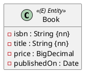

Ohne weitere Angaben wird jeder `String` zu `varchar(255)` und jede Spalte darf `null` sein. Die Angabe verlangt aber meistens mehr: Pflichtfelder, Höchstlängen, eindeutige Werte, Geldbeträge mit zwei Nachkommastellen. Das legst du mit Annotationen am Feld fest.

Die Regeln stehen in der Angabe an zwei Stellen: `{nn}` im Diagramm, Längen und Eindeutigkeit meist im Text darunter.



> `isbn` hat genau 13 Zeichen und ist eindeutig, `title` höchstens 120 Zeichen. `price` hat 6 Stellen, davon 2 Nachkommastellen.

## `@Column`

```java
@Column(length = 13, nullable = false, unique = true)
private String isbn;

@Column(length = 120, nullable = false)
private String title;

@Column(precision = 6, scale = 2)
private BigDecimal price;
```

| Attribut | Wirkung | Spalte |
|---|---|---|
| `length = 120` | höchstens 120 Zeichen (nur für Strings) | `varchar(120)` |
| `nullable = false` | Pflichtfeld | `not null` |
| `unique = true` | kein Wert doppelt | `unique` |
| `precision = 6, scale = 2` | 6 Stellen, davon 2 nach dem Komma: höchstens `9999.99` | `numeric(6,2)` |
| `name = "build_year"` | eigener Spaltenname | `build_year` |

Ohne `precision` wird ein `BigDecimal` zu `numeric(38,2)`.

## Bean Validation: `@NotNull`, `@NotBlank`, `@Size`

Die Annotationen aus `jakarta.validation.constraints` prüfen den Wert in Java, bevor Hibernate ihn an die Datenbank schickt. Hibernate übernimmt sie auch in die Tabelle:

```java
@NotNull
private String firstName;      // varchar(255) not null

@NotBlank
private String lastName;       // varchar(255) not null, außerdem nicht "" oder "  "

@Size(max = 30)
private String nickName;       // varchar(30)

@NotNull
@Size(min = 2, max = 20)
private String city;           // varchar(20) not null
```

Für `{nn}` im Diagramm schreibst du `@NotNull`. So machen es auch die Musterlösungen.

:::achtung Primitive Typen sind immer not null
`int`, `long` und `boolean` können in Java nicht `null` sein. Hibernate legt die Spalte deshalb immer mit `not null` an, auch ohne Annotation. Steht im Diagramm kein `{nn}`, nimm den Wrapper-Typ (`Integer`), damit `null` möglich bleibt.
:::

## Wann der Fehler auftritt

Beide Wege melden einen Verstoß mit verschiedenen Exceptions:

| Verstoß gegen | Wer meldet ihn | Exception |
|---|---|---|
| `@NotNull`, `@NotBlank`, `@Size` | Bean Validation, bevor das SQL abgeschickt wird | `jakarta.validation.ConstraintViolationException` |
| `nullable`, `length`, `unique` | die Datenbank beim Einfügen | `org.springframework.dao.DataIntegrityViolationException` |

Beides passiert aber erst, wenn Hibernate das Objekt wirklich einfügt – und das ist mit der Standard-Id-Vergabe erst beim **Flush** (Einheit 2), nicht schon bei `save`. Ein Test, der nur `save` aufruft, sieht deshalb gar keinen Fehler. Verwende im Test `saveAndFlush`:

```java
@Test
void verify_isbn_is_unique() {
    bookRepository.saveAndFlush(book("9783161484100", "Erstes Buch"));

    assertThatThrownBy(() -> bookRepository.saveAndFlush(book("9783161484100", "Zweites Buch")))
            .isInstanceOf(DataIntegrityViolationException.class);
}

private static Book book(String isbn, String title) {
    return new Book(isbn, title, new BigDecimal("19.90"), LocalDate.of(2024, 5, 1));
}
```

## Reservierte Wörter

Manche Feldnamen sind in SQL Schlüsselwörter. Hibernate schreibt sie ungeschützt in das `create table`, und H2 bricht beim Start des Tests mit einem Syntaxfehler ab. In H2 betrifft das unter anderem:

`year`, `month`, `day`, `hour`, `minute`, `second`, `from`, `to`, `order`, `group`, `user`, `value`, `key`, `end`, `row`, `limit`

Nicht betroffen sind zum Beispiel `name`, `type`, `date`, `time`, `number`, `status`, `level` und `until`. Die Lösung ist ein eigener Spaltenname – das Feld in Java behält seinen Namen aus dem Diagramm:

```java
@NotNull
@Column(name = "build_year")
private Integer year;

@NotNull
@Column(name = "valid_from")
private LocalDateTime from;
```

:::pruefung
`from` und `until` kamen schon in einer Matura-Angabe vor (`DividerBoxLocation`). `from` braucht einen eigenen Spaltennamen, `until` nicht.
:::

## Felder, die nicht gespeichert werden

Ein Feld mit `@Transient` bekommt keine Spalte, z. B. ein Wert, der jedes Mal neu berechnet wird.

:::merke
- `@Column(length, nullable, unique, precision, scale, name)` legt die Spalte fest.
- `@NotNull`, `@NotBlank`, `@Size` prüfen schon in Java und wirken auch auf die Tabelle.
- Verstöße fallen erst beim Flush auf, nicht bei `save` → im Test `saveAndFlush`.
- Reservierte Wörter wie `year` oder `from`: `@Column(name = "...")`.
:::
