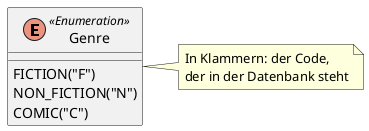

Ein Enum sieht harmlos aus: ein Feld `private Genre genre;` und fertig. Doch genau hier verlieren viele Punkte, denn das Standardverhalten von JPA ist für die Prüfung falsch.

```java
public enum Genre {
    FICTION, NON_FICTION, COMIC
}
```

## Das Ordinal-Problem

Ohne Annotation speichert JPA die **Position** des Werts im Enum, das *Ordinal*: `FICTION` = 0, `NON_FICTION` = 1, `COMIC` = 2.

```sql
genre tinyint check ((genre between 0 and 2))
```

Das funktioniert genau so lange, bis jemand das Enum ändert. Fügt eine Kollegin `BIOGRAPHY` am Anfang ein, ist `FICTION` plötzlich 1 – und jeder gespeicherte Roman ist in der Datenbank ein Sachbuch. Außerdem kann niemand in der Tabelle lesen, was `2` bedeutet.

## Besser: `@Enumerated(EnumType.STRING)`

```java
@Enumerated(EnumType.STRING)
private Genre genre;
```

Jetzt steht der **Name** in der Datenbank (`'FICTION'`). In H2 legt Hibernate dafür eine eigene Enum-Spalte an: `genre enum ('FICTION','NON_FICTION','COMIC')`. Die Reihenfolge im Enum ist egal, aber Umbenennen bricht die Daten immer noch.

:::achtung Laut Cheat Sheet kostet das Punkte
Auf dem Cheat Sheet steht zu Enums: entweder `@Enumerated(EnumType.STRING)` „and lose some points“ oder ein null-sicherer Converter. Für die volle Punktzahl nimmst du den Converter. Und Achtung, Tippfehler im Cheat Sheet: Es heißt `EnumType.STRING`, nicht `EnumerationType.STRING`.
:::

## Am besten: Codes mit `AttributeConverter`



Im Diagramm stehen oft Codes neben den Werten, z. B. `FICTION("F")`. Das Enum bekommt dafür ein Feld und eine Methode, die zu einem Code den Wert findet:

```java
public enum Genre {
    FICTION("F"), NON_FICTION("N"), COMIC("C");

    private final String code;

    Genre(String code) {
        this.code = code;
    }

    public String getCode() {
        return code;
    }

    public static Genre fromCode(String code) {
        for (Genre genre : values()) {
            if (genre.code.equals(code)) {
                return genre;
            }
        }
        throw new IllegalArgumentException("unknown genre code: " + code);
    }
}
```

Der Converter übersetzt in beide Richtungen:

```java
import jakarta.persistence.AttributeConverter;
import jakarta.persistence.Converter;

@Converter(autoApply = true)
public class GenreConverter implements AttributeConverter<Genre, String> {

    @Override
    public String convertToDatabaseColumn(Genre genre) {
        return genre == null ? null : genre.getCode();
    }

    @Override
    public Genre convertToEntityAttribute(String code) {
        return code == null ? null : Genre.fromCode(code);
    }
}
```

- `AttributeConverter<Genre, String>`: links der Typ in Java, rechts der Typ in der Datenbank.
- `autoApply = true` wendet den Converter auf **jedes** Feld vom Typ `Genre` an. Im Entity steht dann nur noch `private Genre genre;`. Ohne `autoApply` schreibst du am Feld `@Convert(converter = GenreConverter.class)`.
- Hibernate legt die Spalte als `varchar(255)` mit `check (genre in ('C','F','N'))` an.

:::achtung Null-sicher ist Pflicht
Hibernate ruft den Converter auch mit `null` auf, in beide Richtungen – etwa für ein Buch ohne Genre. Ohne die `null`-Prüfung fliegt eine Exception: `genre.getCode()` wirft eine `NullPointerException`, `fromCode(null)` eine `IllegalArgumentException`. Das Cheat Sheet verlangt ausdrücklich einen *null-sicheren* Converter.
:::

Ein Code kann auch ein einzelnes Zeichen sein („Map to Character D, T, Q, P“). Dann ist der Datenbanktyp `Character`, das Feld im Enum ein `char`, und die Spalte wird `char(1)`.

## Testen

Der Lifecycle-Test prüft, dass das Enum wieder richtig herauskommt. Wer ganz sicher gehen will, schaut mit einem `JdbcTemplate` nach, was wirklich in der Spalte steht:

```java
@Autowired
private JdbcTemplate jdbcTemplate;

@Test
void verify_genre_is_stored_as_code() {
    bookRepository.saveAndFlush(book(Genre.COMIC));

    String stored = jdbcTemplate.queryForObject("select genre from books", String.class);
    assertThat(stored).isEqualTo("C");
}
```

:::achtung „Check constraint invalid“ beim Einfügen
H2 2.4.240 – die Version, die Spring Boot 4.1 mitbringt – hat einen Fehler: Jedes Einfügen in eine Spalte mit so einem `check (... in (...))` scheitert im `@DataJpaTest` mit `Check constraint invalid` (deutsch: „Ungültige Bedingung“), obwohl der Wert stimmt. In den Vorlagen der Lernwerkstatt ist deshalb H2 2.5.252 eingetragen. Triffst du den Fehler woanders (etwa bei der Prüfung), hilft diese Annotation an der Testklasse:

```java
import org.springframework.boot.jdbc.test.autoconfigure.AutoConfigureTestDatabase;

@DataJpaTest
@AutoConfigureTestDatabase(replace = AutoConfigureTestDatabase.Replace.NONE)
class BookRepositoryTest { ... }
```
:::

:::merke
- Ohne Annotation: Ordinal – bricht, sobald sich die Reihenfolge ändert.
- `@Enumerated(EnumType.STRING)`: lesbar, kostet laut Cheat Sheet aber Punkte.
- Volle Punkte: Enum mit Code, `fromCode`, `@Converter(autoApply = true)` mit `AttributeConverter<Enum, String>`.
- Converter immer null-sicher in beide Richtungen.
:::
