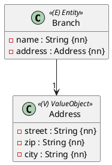
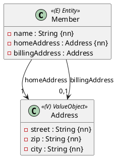

Eine Adresse besteht aus Straße, Postleitzahl und Ort. Sie hat keine eigene Identität: Zwei Adressen mit denselben Werten sind dieselbe Adresse. Im Diagramm ist sie ein `«ValueObject»`. In der Datenbank bekommt sie keine eigene Tabelle – ihre Werte landen als Spalten in der Tabelle des Entities, das sie besitzt.



## `@Embeddable` und `@Embedded`

Am kürzesten schreibst du ein Value Object als Record:

```java
import jakarta.persistence.Embeddable;

@Embeddable
public record Address(
        @NotNull @Size(max = 64) String street,
        @NotNull @Size(min = 4, max = 5) String zip,
        @NotNull @Size(max = 64) String city) {
}
```

Im Entity bettest du es mit `@Embedded` ein:

```java
@Entity
@Table(name = "branches")
public class Branch extends AbstractPersistable<Long> {

    @NotNull
    @Size(max = 40)
    private String name;

    @Embedded
    private Address address;
}
```

```sql
create table branches (
    id bigint not null,
    name varchar(40) not null,
    city varchar(255),
    street varchar(255),
    zip varchar(255),
    primary key (id)
)
```

- Ein Value Object hat **keine** Id und kein Repository.
- Record oder Klasse: beides geht. Eine Klasse braucht wie ein Entity einen `protected` Konstruktor ohne Parameter, ein Record nicht.
- Records liefern `equals` und `hashCode` über alle Werte gleich mit – genau das, was ein Value Object braucht.
- Die Spalten heißen wie die Attribute des Records: `street`, `zip`, `city`.
- Sind alle Spalten `null`, liest Hibernate für `address` wieder `null`.

## Validierung im Value Object: `@Valid`

Schau dir die Tabelle oben genau an: `street` ist `varchar(255)`, obwohl im Record `@Size(max = 64)` steht. Hibernate schaut ohne weitere Angabe nicht in das Value Object hinein. Mit `@Valid` am Feld ändert sich das:

```java
@Valid
@Embedded
private Address address;
```

Jetzt prüft Bean Validation auch die Werte der Adresse, bevor Hibernate sie einfügt, und die Spalten werden `varchar(64)`, `varchar(5)` und `varchar(64)`.

:::achtung `@NotNull` im Value Object wird nicht zu `not null`
Auch mit `@Valid` bleiben die Spalten eines Value Objects in der Tabelle nullable, denn die ganze Adresse darf ja fehlen. `@NotNull` wirkt aber in Java: Gibt es eine Adresse, darf `street` nicht `null` sein. Ist das Value Object selbst Pflicht (`address : Address {nn}`), schreibst du zusätzlich `@NotNull` an das Feld im Entity.
:::

## Zwei Adressen in einem Entity



Ein Mitglied hat eine Wohnadresse und eine Rechnungsadresse. Bettest du beide einfach ein, gibt es die Spalte `street` zweimal, und Hibernate bricht beim Start ab:

```text
MappingException: Column 'street' is duplicated in mapping for entity 'Member'
```

Du musst die Spalten also umbenennen. Dafür gibt es zwei Wege.

**`@EmbeddedColumnNaming`** (aus Hibernate) setzt ein Präfix vor alle Spalten:

```java
import org.hibernate.annotations.EmbeddedColumnNaming;

@Embedded
@EmbeddedColumnNaming("home_%s")
private Address homeAddress;
```

Das ergibt `home_street`, `home_zip`, `home_city`. Das `%s` steht für den ursprünglichen Namen und ist Pflicht – im Cheat Sheet fehlt es (`"contact_"`).

**`@AttributeOverrides`** (Standard-JPA) benennt jede Spalte einzeln:

```java
@Embedded
@AttributeOverrides({
        @AttributeOverride(name = "street", column = @Column(name = "billing_street")),
        @AttributeOverride(name = "zip", column = @Column(name = "billing_zip")),
        @AttributeOverride(name = "city", column = @Column(name = "billing_city"))
})
private Address billingAddress;
```

`name` ist das Attribut im Value Object, `column` die Spalte in der Tabelle. Mehr Schreibarbeit, aber du kannst jede Spalte frei benennen und z. B. auch `length` setzen.

:::pruefung
Eine Liste von Value Objects (`logEntries : DividerBoxLogBook[*]`) wird nicht mit `@Embedded`, sondern mit `@ElementCollection` umgesetzt und bekommt eine eigene Tabelle. Das kommt in Einheit 13.
:::

:::merke
- Value Object: `@Embeddable`, am besten als Record, ohne Id und Repository.
- Im Entity: `@Embedded`, die Spalten landen in der Tabelle des Entities.
- `@Valid` am Feld, damit `@Size` und Co. im Value Object geprüft werden.
- Dasselbe Value Object zweimal: `@EmbeddedColumnNaming("home_%s")` oder `@AttributeOverrides`.
:::
