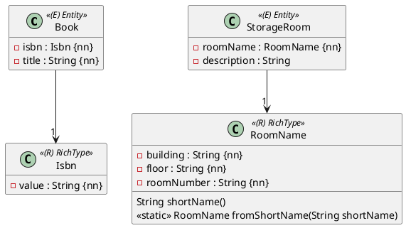

Eine ISBN ist mehr als ein `String`: Sie hat genau 13 Ziffern. Ein Raumname wie `B307` besteht aus Gebäude, Stockwerk und Raumnummer, und für jeden Teil gibt es Regeln. Solche Werte mit eigenen Regeln heißen im Diagramm `«RichType»`. In Java sind sie ein eigener Typ, in der Datenbank **eine** Spalte.



Auch wenn ein Rich Type wie `RoomName` mehrere Attribute hat: In der Datenbank ist er **eine** Spalte.

## Der Typ: ein Record mit Regeln

```java
public record Isbn(String value) {

    public Isbn {
        Objects.requireNonNull(value, "value");
        if (!value.matches("\\d{13}")) {
            throw new IllegalArgumentException("ISBN must have 13 digits: " + value);
        }
    }
}
```

Der **kompakte Konstruktor** (ohne Parameterliste) läuft bei jedem `new Isbn(...)`. Eine ungültige ISBN kann es deshalb gar nicht geben – weder im Code noch beim Lesen aus der Datenbank. Im Entity steht jetzt `private Isbn isbn;` statt `private String isbn;`.

## Die Übersetzung: ein Converter

Wie bei den Enums in Einheit 6 übersetzt ein `AttributeConverter` zwischen Java und Datenbank:

```java
@Converter(autoApply = true)
public class IsbnConverter implements AttributeConverter<Isbn, String> {

    @Override
    public String convertToDatabaseColumn(Isbn isbn) {
        return isbn == null ? null : isbn.value();
    }

    @Override
    public Isbn convertToEntityAttribute(String value) {
        return value == null ? null : new Isbn(value);
    }
}
```

```java
@NotNull
@Column(length = 13, unique = true)
private Isbn isbn;
```

`@Column` und `@NotNull` funktionieren wie bei einem `String`: Die Spalte wird `isbn varchar(13) not null unique`.

## Mehrere Teile, eine Spalte

Spannender ist ein Rich Type mit mehreren Attributen. Aus einer Matura-Angabe:

> `RoomName.building` kann nur `A`, `B`, `C` oder `D` sein, `floor` nur `E`, `H`, `1` bis `5`, `roomNumber` besteht immer aus zwei Ziffern. Der `shortName` ist aus `building`, `floor` und `roomNumber` zusammenzusetzen.

```java
public record RoomName(String building, String floor, String roomNumber) {

    public RoomName {
        Objects.requireNonNull(building, "building");
        Objects.requireNonNull(floor, "floor");
        Objects.requireNonNull(roomNumber, "roomNumber");
        if (!building.matches("[ABCD]")) {
            throw new IllegalArgumentException("invalid building: " + building);
        }
        if (!floor.matches("[EH1-5]")) {
            throw new IllegalArgumentException("invalid floor: " + floor);
        }
        if (!roomNumber.matches("\\d{2}")) {
            throw new IllegalArgumentException("invalid room number: " + roomNumber);
        }
    }

    public String shortName() {
        return building + floor + roomNumber;
    }

    public static RoomName fromShortName(String shortName) {
        Objects.requireNonNull(shortName, "shortName");
        if (shortName.length() != 4) {
            throw new IllegalArgumentException("invalid short name: " + shortName);
        }
        return new RoomName(shortName.substring(0, 1), shortName.substring(1, 2), shortName.substring(2));
    }
}
```

Die beiden Methoden aus dem Diagramm sind genau das, was der Converter braucht: `shortName()` in die Datenbank, `fromShortName(...)` heraus. In der Spalte steht dann `B307`.

```java
@Converter(autoApply = true)
public class RoomNameConverter implements AttributeConverter<RoomName, String> {

    @Override
    public String convertToDatabaseColumn(RoomName roomName) {
        return roomName == null ? null : roomName.shortName();
    }

    @Override
    public RoomName convertToEntityAttribute(String shortName) {
        return shortName == null ? null : RoomName.fromShortName(shortName);
    }
}
```

## Converter oder `@Embeddable`?

Das Cheat Sheet zeigt für Rich Types beide Wege. Mit `@Embeddable` bekäme `RoomName` aber **drei** Spalten (`building`, `floor`, `room_number`) – das wäre ein Value Object. Ein Rich Type ist laut Definition auf eine einzelne Spalte abzubilden. Mit einem Converter bist du auf der sicheren Seite.

## Testen

Ein Rich Type hat Regeln, also testest du sie – ganz ohne Datenbank, mit einem normalen Unit-Test:

```java
@ParameterizedTest
@ValueSource(strings = {"E307", "B607", "B37", "B3077"})
void verify_invalid_short_names_are_rejected(String shortName) {
    assertThatThrownBy(() -> RoomName.fromShortName(shortName))
            .isInstanceOf(IllegalArgumentException.class);
}
```

Dazu kommt im Repository-Test der Lifecycle-Test: speichern, `flush`/`clear`, lesen, `getRoomName()` vergleichen. Weil `RoomName` ein Record ist, reicht `isEqualTo(new RoomName("B", "3", "07"))`.

:::merke
- Rich Type = eigener Typ mit Regeln, als Record mit kompaktem Konstruktor.
- Eine Spalte über `@Converter(autoApply = true)` und `AttributeConverter<RichType, String>`, null-sicher.
- Mehrere Teile: zu einem String zusammensetzen (`shortName`) und wieder zerlegen (`fromShortName`).
- Die Regeln mit eigenen Unit-Tests prüfen.
:::
