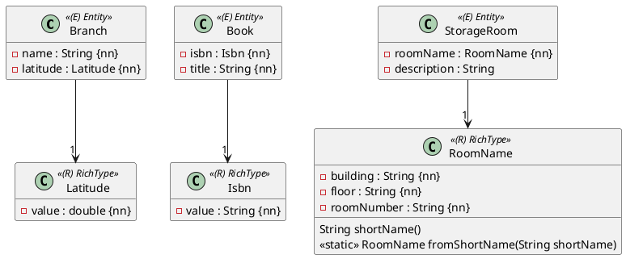

Ein Breitengrad ist mehr als ein `double`: Er liegt immer zwischen −90 und 90. Eine ISBN ist mehr als ein `String`: Sie hat genau 13 Ziffern. Ein Raumname wie `B307` besteht aus Gebäude, Stockwerk und Raumnummer, und für jeden Teil gibt es Regeln. Solche Werte mit eigenen Regeln heißen im Diagramm `«RichType»`. In Java sind sie ein eigener Typ, in der Datenbank **eine** Spalte.



Auch wenn ein Rich Type wie `RoomName` mehrere Attribute hat: In der Datenbank ist er **eine** Spalte.

## Der Typ: ein Record mit Regeln

Der einfachste Rich Type ist eine Zahl mit Grenzen. Die Angabe sagt: „Der Breitengrad (`latitude`) liegt zwischen −90 und 90 Grad, beide Grenzen sind erlaubt.“

```java
public record Latitude(double value) {

    public Latitude {
        if (value < -90 || value > 90) {
            throw new IllegalArgumentException("latitude must be between -90 and 90: " + value);
        }
    }
}
```

Der **kompakte Konstruktor** (ohne Parameterliste) läuft bei jedem `new Latitude(...)`. Ein ungültiger Breitengrad kann es deshalb gar nicht geben – weder im Code noch beim Lesen aus der Datenbank. Im Entity steht jetzt `private Latitude latitude;` statt `private double latitude;`.

Achte auf die Grenzen: „zwischen −90 und 90, beide erlaubt“ heißt, **nur** Werte `< -90` oder `> 90` sind falsch. Mit `<=` statt `<` würdest du den Südpol (−90) ablehnen. Genau diese Grenzwerte testest du später.

## Die Übersetzung: ein Converter

Wie bei den Enums in Einheit 6 übersetzt ein `AttributeConverter` zwischen Java und Datenbank. Der zweite Typparameter ist der Typ der Spalte – hier `Double`:

```java
@Converter(autoApply = true)
public class LatitudeConverter implements AttributeConverter<Latitude, Double> {

    @Override
    public Double convertToDatabaseColumn(Latitude latitude) {
        return latitude == null ? null : latitude.value();
    }

    @Override
    public Latitude convertToEntityAttribute(Double value) {
        return value == null ? null : new Latitude(value);
    }
}
```

```java
@NotNull
private Latitude latitude;
```

Die Spalte `latitude` bekommt einen Kommazahl-Typ, genau wie bei einem `double`-Feld. `@NotNull` funktioniert wie gewohnt.

## Text mit Regeln: die ISBN

Bei einem `String` prüfst du zuerst auf `null`, dann die Länge, dann jedes Zeichen:

```java
public record Isbn(String value) {

    public Isbn {
        if (value == null) {
            throw new IllegalArgumentException("ISBN must not be null");
        }
        if (value.length() != 13) {
            throw new IllegalArgumentException("ISBN must have 13 digits: " + value);
        }
        for (char c : value.toCharArray()) {
            if (!Character.isDigit(c)) {
                throw new IllegalArgumentException("ISBN must have 13 digits: " + value);
            }
        }
    }
}
```

Die Reihenfolge ist wichtig: Wäre `value` `null`, würde schon `value.length()` eine `NullPointerException` werfen.

:::info Kürzer mit einem regulären Ausdruck
`String.matches(...)` prüft einen Text gegen ein Muster (regulärer Ausdruck, „Regex“). Länge und Ziffern gehen dann in einer Zeile:

```java
if (!value.matches("\\d{13}")) {
    throw new IllegalArgumentException("ISBN must have 13 digits: " + value);
}
```

`\d` heißt „eine Ziffer“, `{13}` „genau 13-mal“. Im Java-String schreibst du den Backslash doppelt: `"\\d{13}"`. Die `null`-Prüfung brauchst du trotzdem. Beide Lösungen sind richtig – nimm die, die du sicher beherrschst.
:::

Der Converter für die ISBN sieht aus wie der für `Latitude`, nur mit `String` als Spaltentyp:

```java
@Converter(autoApply = true)
public class IsbnConverter implements AttributeConverter<Isbn, String> {

    @Override
    public String convertToDatabaseColumn(Isbn isbn) {
        return isbn == null ? null : isbn.value();
    }

    @Override
    public Isbn convertToEntityAttribute(String value) {
        return value == null ? null : new Isbn(value);
    }
}
```

```java
@NotNull
@Column(length = 13, unique = true)
private Isbn isbn;
```

`@Column` und `@NotNull` funktionieren wie bei einem `String`: Die Spalte wird `isbn varchar(13) not null unique`.

## Mehrere Teile, eine Spalte

Spannender ist ein Rich Type mit mehreren Attributen. Aus einer Matura-Angabe:

> `RoomName.building` kann nur `A`, `B`, `C` oder `D` sein, `floor` nur `E`, `H`, `1` bis `5`, `roomNumber` besteht immer aus zwei Ziffern. Der `shortName` ist aus `building`, `floor` und `roomNumber` zusammenzusetzen.

Die erlaubten Werte für Gebäude und Stockwerk schreibst du einfach als Liste auf und fragst, ob der Wert darin vorkommt:

```java
public record RoomName(String building, String floor, String roomNumber) {

    private static final List<String> BUILDINGS = List.of("A", "B", "C", "D");
    private static final List<String> FLOORS = List.of("E", "H", "1", "2", "3", "4", "5");

    public RoomName {
        if (building == null || floor == null || roomNumber == null) {
            throw new IllegalArgumentException("building, floor and roomNumber are required");
        }
        if (!BUILDINGS.contains(building)) {
            throw new IllegalArgumentException("invalid building: " + building);
        }
        if (!FLOORS.contains(floor)) {
            throw new IllegalArgumentException("invalid floor: " + floor);
        }
        if (roomNumber.length() != 2
                || !Character.isDigit(roomNumber.charAt(0))
                || !Character.isDigit(roomNumber.charAt(1))) {
            throw new IllegalArgumentException("invalid room number: " + roomNumber);
        }
    }

    public String shortName() {
        return building + floor + roomNumber;
    }

    public static RoomName fromShortName(String shortName) {
        if (shortName == null || shortName.length() != 4) {
            throw new IllegalArgumentException("invalid short name: " + shortName);
        }
        return new RoomName(shortName.substring(0, 1), shortName.substring(1, 2), shortName.substring(2));
    }
}
```

`fromShortName` muss nur die Länge prüfen und zerlegen. Ob die Teile gültig sind, prüft danach der Konstruktor – die Regeln stehen nur an **einer** Stelle.

:::info Dieselben Regeln als Regex
Mit regulären Ausdrücken werden die drei Prüfungen kürzer:

```java
if (!building.matches("[ABCD]")) { ... }      // genau ein Zeichen aus A, B, C, D
if (!floor.matches("[EH1-5]")) { ... }        // E, H oder eine Ziffer von 1 bis 5
if (!roomNumber.matches("\\d{2}")) { ... }    // genau zwei Ziffern
```

`[...]` heißt „genau ein Zeichen aus dieser Menge“, `1-5` ist ein Bereich, `\d` eine Ziffer, `{2}` „genau zweimal“. `matches` prüft immer den **ganzen** Text: `"BB".matches("[ABCD]")` ist `false`.
:::

Die beiden Methoden aus dem Diagramm sind genau das, was der Converter braucht: `shortName()` in die Datenbank, `fromShortName(...)` heraus. In der Spalte steht dann `B307`.

```java
@Converter(autoApply = true)
public class RoomNameConverter implements AttributeConverter<RoomName, String> {

    @Override
    public String convertToDatabaseColumn(RoomName roomName) {
        return roomName == null ? null : roomName.shortName();
    }

    @Override
    public RoomName convertToEntityAttribute(String shortName) {
        return shortName == null ? null : RoomName.fromShortName(shortName);
    }
}
```

## Converter oder `@Embeddable`?

Das Cheat Sheet zeigt für Rich Types beide Wege. Mit `@Embeddable` bekäme `RoomName` aber **drei** Spalten (`building`, `floor`, `room_number`) – das wäre ein Value Object. Ein Rich Type ist laut Definition auf eine einzelne Spalte abzubilden. Mit einem Converter bist du auf der sicheren Seite.

## Testen

Ein Rich Type hat Regeln, also testest du sie – ganz ohne Datenbank, mit einem normalen Unit-Test. Bei Zahlen gehören die Grenzen selbst (−90, 90) und die Werte knapp daneben (−90.1, 90.1) immer dazu:

```java
@ParameterizedTest
@ValueSource(doubles = {-90, 0, 48.2, 90})
void verify_valid_latitudes_are_accepted(double value) {
    assertThat(new Latitude(value).value()).isEqualTo(value);
}

@ParameterizedTest
@ValueSource(doubles = {-90.1, 90.1, 180})
void verify_invalid_latitudes_are_rejected(double value) {
    assertThatThrownBy(() -> new Latitude(value))
            .isInstanceOf(IllegalArgumentException.class);
}

@ParameterizedTest
@ValueSource(strings = {"E307", "B607", "B37", "B3077"})
void verify_invalid_short_names_are_rejected(String shortName) {
    assertThatThrownBy(() -> RoomName.fromShortName(shortName))
            .isInstanceOf(IllegalArgumentException.class);
}
```

Dazu kommt im Repository-Test der Lifecycle-Test: speichern, `flush`/`clear`, lesen, `getRoomName()` vergleichen. Weil `RoomName` ein Record ist, reicht `isEqualTo(new RoomName("B", "3", "07"))`.

:::merke
- Rich Type = eigener Typ mit Regeln, als Record mit kompaktem Konstruktor.
- Regeln mit `if` prüfen und eine `IllegalArgumentException` werfen: Zahlen mit `<`/`>`, Texte mit `null`, Länge und Zeichen.
- Eine Spalte über `@Converter(autoApply = true)` und `AttributeConverter<RichType, Spaltentyp>` (`String`, `Double`, …), null-sicher.
- Mehrere Teile: zu einem String zusammensetzen (`shortName`) und wieder zerlegen (`fromShortName`).
- Die Regeln mit eigenen Unit-Tests prüfen.
:::
