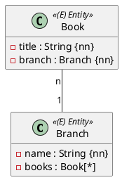
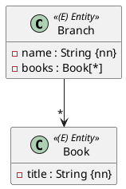

In Einheit 9 kennt jedes Buch seine Filiale. Im Diagramm `Book "n" -- "1" Branch` fehlt aber die Pfeilspitze, und `Branch` hat ein Attribut `books : Book[*]`: Auch die Filiale kennt ihre Bücher. Die Beziehung ist **bidirektional**.



## `mappedBy`: eine Beziehung, zwei Seiten

```java
@Entity
@Table(name = "branches")
public class Branch extends AbstractPersistable<Long> {

    // name, address, ...

    @OneToMany(mappedBy = "branch")
    private List<Book> books = new ArrayList<>();
}
```

In der Datenbank gibt es weiterhin nur **eine** Spalte: `branch_id` in `books`. `mappedBy = "branch"` sagt Hibernate: „Diese Liste ist dieselbe Beziehung wie das Feld `branch` in `Book`. Dort steht der Fremdschlüssel.“

- Die Seite mit `@ManyToOne` und dem Fremdschlüssel ist die **besitzende Seite** (*owning side*).
- Die Seite mit `mappedBy` ist die **Gegenseite** (*inverse side*). Was nur in ihrer Liste steht, speichert Hibernate nicht.

:::achtung Ohne `mappedBy` entsteht eine zweite Beziehung
Fehlt `mappedBy`, hält Hibernate die Liste für eine eigene Beziehung und legt eine Zwischentabelle `branches_books` an. Dann gibt es zwei unabhängige Wege von Filiale zu Buch, die auseinanderlaufen können.
:::

## Hilfsmethoden halten beide Seiten synchron

Hibernate schaut beim Speichern nur auf die besitzende Seite, also auf `book.branch`. Dein Java-Code sieht aber beide Seiten. Damit sie zusammenpassen, ändert man die Beziehung nur über Hilfsmethoden, die **beide** Seiten setzen:

```java
// in Branch
public List<Book> getBooks() {
    return Collections.unmodifiableList(books);
}

public void addBook(Book book) {
    books.add(book);
    book.setBranch(this);
}

public void removeBook(Book book) {
    books.remove(book);
    book.setBranch(null);
}
```

```java
// in Book
void setBranch(Branch branch) {
    this.branch = branch;
}
```

`setBranch` ist package-private (ohne `public`): Nur Klassen im selben Package, also `Branch`, können sie aufrufen.

Was ohne Hilfsmethode schiefgeht:

| Du setzt nur … | Folge |
|---|---|
| `books.add(book)` (Gegenseite) | `branch_id` bleibt `null`. Nach dem nächsten Lesen hat die Filiale keine Bücher mehr. |
| `book.setBranch(branch)` (besitzende Seite) | In der Datenbank stimmt alles, aber `branch.getBooks()` ist leer, bis die Filiale neu gelesen wird. |

## Cascade und `orphanRemoval`

```java
@OneToMany(mappedBy = "branch", cascade = CascadeType.ALL, orphanRemoval = true)
private List<Book> books = new ArrayList<>();
```

- `cascade = CascadeType.ALL`: Speichern, Ändern und Löschen der Filiale wirken auch auf ihre Bücher. Ein `branchRepository.save(branch)` speichert die neuen Bücher mit.
- `CascadeType.PERSIST` allein gibt nur das Speichern weiter – so machen es die Musterlösungen.
- `orphanRemoval = true`: Ein Buch, das aus der Liste entfernt wird, wird gelöscht. Passt nur, wenn ein Buch ohne Filiale keinen Sinn ergibt.

Überlege bei jeder Beziehung, ob Cascade fachlich passt: Löschst du eine Filiale, sollen ihre Bücher wirklich mit verschwinden?

## Testen

```java
@Test
void verify_branch_with_books() {
    Branch branch = new Branch("Hauptbücherei", address);
    branch.addBook(book("9783161484100"));
    branch.addBook(book("9783161484117"));
    branchRepository.save(branch);

    entityManager.flush();
    entityManager.clear();

    Branch reread = branchRepository.findById(branch.getId()).orElseThrow();
    assertThat(reread.getBooks())
            .hasSize(2)
            .allSatisfy(b -> assertThat(b.getBranch().getId()).isEqualTo(branch.getId()));
}
```

Erst nach `flush` und `clear` zeigt der Test, dass beide Bücher wirklich mit der Filiale verbunden in der Datenbank stehen.

## Variante: unidirektional mit `@JoinColumn`



Kennt laut Diagramm nur die Filiale ihre Bücher (`Branch --> "*" Book`), hat `Book` kein Feld `branch`. Dann setzt du `@JoinColumn` direkt an die Liste, und der Fremdschlüssel landet trotzdem in `books`:

```java
@OneToMany
@JoinColumn(name = "branch_id")
private List<Book> books = new ArrayList<>();
```

Ohne `@JoinColumn` entstünde auch hier eine Zwischentabelle.

:::merke
- Bidirektional: `@ManyToOne` auf der „viele“-Seite (besitzt den Fremdschlüssel), `@OneToMany(mappedBy = "...")` auf der anderen.
- Hibernate speichert nur, was auf der besitzenden Seite steht.
- Hilfsmethoden `addBook`/`removeBook` setzen immer beide Seiten.
- `cascade` gibt Speichern/Löschen weiter, `orphanRemoval` löscht entfernte Kinder.
:::
