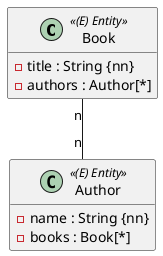

Ein Buch kann mehrere Autorinnen und Autoren haben, und eine Autorin schreibt mehrere Bücher. Im Diagramm stehen an beiden Enden Multiplizitäten mit `*` oder `n`:



Eine Spalte `author_id` in `books` reicht dafür nicht: Ein Buch hätte dann nur eine Autorin. Die Datenbank braucht eine **Zwischentabelle** mit zwei Fremdschlüsseln.

## Die besitzende Seite

```java
@Entity
@Table(name = "books")
public class Book extends AbstractPersistable<Long> {

    // isbn, title, price, ...

    @ManyToMany
    @JoinTable(name = "book_authors",
            joinColumns = @JoinColumn(name = "book_id"),
            inverseJoinColumns = @JoinColumn(name = "author_id"))
    private Set<Author> authors = new HashSet<>();
}
```

Hibernate erzeugt daraus:

```sql
create table book_authors (
    author_id bigint not null,
    book_id bigint not null,
    primary key (author_id, book_id)
)
```

- `joinColumns` ist die Spalte, die auf die **eigene** Klasse zeigt (`book_id`), `inverseJoinColumns` die Spalte für die andere Seite (`author_id`).
- Weil `authors` ein `Set` ist, wird das Paar zum Primary Key: Dasselbe Buch kann dieselbe Autorin nicht zweimal haben.
- Beide Spalten bekommen einen Fremdschlüssel auf `books` bzw. `authors`.

Ohne `@JoinTable` heißt die Tabelle `books_authors` (Tabelle des Besitzers + `_` + Feldname), die Spalten bei der bidirektionalen Beziehung unten `books_id` und `authors_id` – benannt nach den Feldern beider Seiten. Das funktioniert, aber die Namen aus der Angabe setzt du besser selbst.

## Die Gegenseite mit `mappedBy`

Ist die Beziehung bidirektional, bekommt `Author` eine Menge `books` – mit `mappedBy`, genau wie bei `@OneToMany` in Einheit 10:

```java
@Entity
@Table(name = "authors")
public class Author extends AbstractPersistable<Long> {

    private String name;

    @ManyToMany(mappedBy = "authors")
    private Set<Book> books = new HashSet<>();
}
```

Welche Seite besitzt, entscheidest du. Nimm die Seite, über die du die Beziehung im Code änderst: Ein Buch bekommt Autoren, nicht umgekehrt.

:::achtung Nur die besitzende Seite zählt
Fügst du ein Buch nur in `author.books` ein, schreibt Hibernate **keine** Zeile in `book_authors`. Nach dem nächsten Lesen ist die Verbindung weg.
:::

Die Hilfsmethoden setzen daher wie in Einheit 10 immer beide Seiten:

```java
// in Book
public Set<Author> getAuthors() {
    return Collections.unmodifiableSet(authors);
}

public void addAuthor(Author author) {
    authors.add(author);
    author.addBookInternal(this);
}

public void removeAuthor(Author author) {
    authors.remove(author);
    author.removeBookInternal(this);
}
```

```java
// in Author: package-private, nur Book ruft sie auf
void addBookInternal(Book book) {
    books.add(book);
}

void removeBookInternal(Book book) {
    books.remove(book);
}
```

## `Set` statt `List`

Mit `List` funktioniert das Mapping auch, aber:

- Die Zwischentabelle hat **keinen** Primary Key. Dieselbe Verbindung kann doppelt drinstehen.
- Entfernst du einen Eintrag, löscht Hibernate **alle** Zeilen des Buchs und fügt die übrigen wieder ein. Bei einem `Set` ist es genau ein `delete`.

```sql
-- List: authors.remove(a)
delete from shelf_tags where shelf_id=?
insert into shelf_tags (shelf_id, tags_id) values (?, ?)
insert into shelf_tags (shelf_id, tags_id) values (?, ?)

-- Set: authors.remove(a)
delete from book_authors where book_id=? and author_id=?
```

Steht im Diagramm `Set<…>` oder ist die Reihenfolge egal, nimm `Set`. Damit `contains` und `remove` funktionieren, braucht das Entity `equals`/`hashCode` – `AbstractPersistable` liefert sie über die Id.

## Speichern und Löschen

- Autoren, die noch nicht gespeichert sind, lehnt Hibernate beim Flush ab: `TransientPropertyValueException … references an unsaved transient instance of 'Author'`. Speichere sie vorher oder setze `cascade = CascadeType.PERSIST`.
- Löschst du ein **Buch** (besitzende Seite), entfernt Hibernate seine Zeilen in `book_authors` automatisch.
- Löschst du eine **Autorin**, die noch in `book.authors` steht, scheitert der Flush. Nimm sie vorher mit `book.removeAuthor(author)` aus allen Büchern.

:::achtung Kein `CascadeType.REMOVE` bei `@ManyToMany`
Eine Autorin gehört nicht einem einzelnen Buch. Würde das Löschen eines Buchs auch seine Autoren löschen, fehlten sie bei allen anderen Büchern.
:::

## Testen

```java
@Test
void verify_book_with_authors() {
    Author bachmann = authorRepository.save(new Author("Ingeborg Bachmann"));
    Author celan = authorRepository.save(new Author("Paul Celan"));
    Book book = new Book("9783518000000", "Herzzeit", new BigDecimal("28.00"), LocalDate.of(2008, 8, 1));
    book.addAuthor(bachmann);
    book.addAuthor(celan);
    bookRepository.save(book);

    entityManager.flush();
    entityManager.clear();

    Book reread = bookRepository.findById(book.getId()).orElseThrow();
    assertThat(reread.getAuthors()).extracting(Author::getName)
            .containsExactlyInAnyOrder("Ingeborg Bachmann", "Paul Celan");
    assertThat(authorRepository.findById(celan.getId()).orElseThrow().getBooks())
            .extracting(Book::getTitle).containsExactly("Herzzeit");
}
```

Der Test liest **beide** Richtungen: Die Gegenseite stimmt nach `clear` nur, wenn die Zeilen in `book_authors` wirklich geschrieben wurden.

:::merke
- `@ManyToMany` + `@JoinTable(name, joinColumns, inverseJoinColumns)` auf der besitzenden Seite.
- Gegenseite: `@ManyToMany(mappedBy = "…")`. Hibernate speichert nur, was auf der besitzenden Seite steht.
- `Set` statt `List`: Primary Key in der Zwischentabelle, gezielte `delete`s.
- Kein `CascadeType.REMOVE`; Hilfsmethoden setzen beide Seiten.
:::
