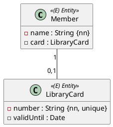

Jedes Mitglied der Bücherei hat genau einen Leseausweis, und jeder Ausweis gehört genau einem Mitglied:



## Ein Fremdschlüssel mit `unique`

```java
@Entity
@Table(name = "members")
public class Member extends AbstractPersistable<Long> {

    private String name;

    @OneToOne(cascade = CascadeType.PERSIST)
    @JoinColumn(name = "card_id", foreignKey = @ForeignKey(name = "fk_member_card"))
    private LibraryCard card;
}
```

```sql
create table members (
    card_id bigint unique,
    id bigint not null,
    name varchar(255),
    primary key (id)
)
```

Das sieht aus wie `@ManyToOne` aus Einheit 9 – mit einem Unterschied: Die Spalte `card_id` ist **`unique`**. Zwei Mitglieder mit demselben Ausweis lehnt die Datenbank ab (`ConstraintViolationException` beim Flush).

Wo der Fremdschlüssel liegt, entscheidest du: Er gehört in die Tabelle der Klasse, die die andere **kennt** oder **braucht**. Hier kennt das Mitglied seinen Ausweis.

## Bidirektional mit `mappedBy`

Soll auch der Ausweis sein Mitglied kennen, bekommt `LibraryCard` die Gegenseite:

```java
@Entity
@Table(name = "library_cards")
public class LibraryCard extends AbstractPersistable<Long> {

    @Column(unique = true)
    private String number;
    private LocalDate validUntil;

    @OneToOne(mappedBy = "card")
    private Member member;

    void setMember(Member member) {
        this.member = member;
    }
}
```

```java
// in Member
public void setCard(LibraryCard card) {
    this.card = card;
    card.setMember(this);
}
```

Wie bei `@OneToMany` speichert Hibernate nur die besitzende Seite (`member.card`). Die Hilfsmethode hält auch hier beide Seiten synchron.

## Wann `@OneToOne`, wann `@Embedded`?

| | `@Embedded` (Einheit 7) | `@OneToOne` |
|---|---|---|
| Diagramm | `«ValueObject»` | `«Entity»` auf beiden Seiten |
| Tabelle | Spalten in der Tabelle des Besitzers | eigene Tabelle mit eigener Id |
| Eigenes Repository | nein | ja |

Ist die andere Klasse ein Value Object, ist `@Embedded` richtig – auch wenn die Multiplizität `1` ist.

:::achtung Eager per Default
`@OneToOne` und `@ManyToOne` laden die andere Seite sofort mit (`FetchType.EAGER`). In der Übung ist das kein Problem. Bei großen Modellen setzt man oft `fetch = FetchType.LAZY`.
:::

## Testen

```java
@Test
void verify_member_with_card() {
    Member member = new Member("Anna Berger");
    member.setCard(new LibraryCard("C-0001", LocalDate.of(2027, 6, 30)));
    memberRepository.save(member);

    entityManager.flush();
    entityManager.clear();

    LibraryCard card = libraryCardRepository.findByNumber("C-0001").orElseThrow();
    assertThat(card.getMember().getName()).isEqualTo("Anna Berger");
}
```

`cascade = CascadeType.PERSIST` speichert den neuen Ausweis mit dem Mitglied. Ohne Cascade musst du ihn vorher selbst speichern.

:::merke
- `@OneToOne` + `@JoinColumn`: Fremdschlüssel mit `unique`.
- Gegenseite: `@OneToOne(mappedBy = "…")`, Hilfsmethode setzt beide Seiten.
- Value Object → `@Embedded`, nicht `@OneToOne`.
:::
