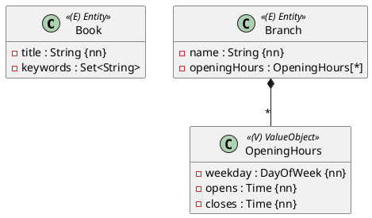

Nicht jede Liste enthält Entities. Ein Buch hat Schlagwörter (`String`), eine Filiale hat Öffnungszeiten (ein Value Object):



Eine Liste von Werten passt in keine Spalte. Sie bekommt eine eigene Tabelle – aber kein eigenes Entity und kein Repository.

## Eine Menge von Strings

```java
@ElementCollection
@CollectionTable(name = "book_keywords", joinColumns = @JoinColumn(name = "book_id"))
@Column(name = "keyword", length = 30)
private Set<String> keywords = new HashSet<>();
```

```sql
create table book_keywords (
    book_id bigint not null,
    keyword varchar(30),
    unique (book_id, keyword)
)
```

- `@CollectionTable` legt Tabelle und Fremdschlüssel-Spalte fest.
- `@Column` gilt hier für die Spalte mit dem **Wert**.
- Bei einem `Set` ist das Paar `(book_id, keyword)` eindeutig.

## Eine Liste von Value Objects

```java
@Embeddable
public record OpeningHours(@Enumerated(EnumType.STRING) DayOfWeek weekday,
                           LocalTime opens, LocalTime closes) {
}
```

```java
// in Branch
@ElementCollection
@CollectionTable(name = "opening_hours", joinColumns = @JoinColumn(name = "branch_id"))
private List<OpeningHours> openingHours = new ArrayList<>();
```

```sql
create table opening_hours (
    closes time(0),
    opens time(0),
    branch_id bigint not null,
    weekday enum ('FRIDAY','MONDAY','SATURDAY','SUNDAY','THURSDAY','TUESDAY','WEDNESDAY')
)
```

Die Felder des `@Embeddable` werden zu Spalten der Collection-Tabelle. Das Feld heißt `weekday`, nicht `day`: `day` ist in H2 ein reserviertes Wort (Einheit 4).

## Was anders ist als bei `@OneToMany`

- Die Elemente haben **keine Id**. Sie gehören ganz zum Entity: Speichern und Löschen gehen immer mit (wie Cascade ALL + orphanRemoval).
- Ändert sich eine `List`, löscht Hibernate **alle** Zeilen des Besitzers und schreibt die übrigen neu:

```sql
-- branch.removeOpeningHours(...)
delete from opening_hours where branch_id=?
insert into opening_hours (branch_id, weekday, opens, closes) values (?, ?, ?, ?)
insert into opening_hours (branch_id, weekday, opens, closes) values (?, ?, ?, ?)
```

Für ein paar Öffnungszeiten ist das egal. Brauchen die Elemente eine eigene Identität, eigene Beziehungen oder eigene Abfragen, mach sie zum Entity mit `@OneToMany`.

:::pruefung
In der Angabe erkennst du eine Element Collection an einem Attribut wie `keywords : Set<String>` oder an einer Liste von `«ValueObject»`s. Ein `«Entity»` am anderen Ende bedeutet dagegen `@OneToMany` oder `@ManyToMany`.
:::

## Testen

```java
@Test
void verify_branch_with_opening_hours() {
    Branch branch = new Branch("Hauptbücherei", address);
    branch.addOpeningHours(new OpeningHours(DayOfWeek.MONDAY, LocalTime.of(11, 0), LocalTime.of(19, 0)));
    branch.addOpeningHours(new OpeningHours(DayOfWeek.TUESDAY, LocalTime.of(11, 0), LocalTime.of(19, 0)));
    branchRepository.save(branch);

    entityManager.flush();
    entityManager.clear();

    assertThat(branchRepository.findById(branch.getId()).orElseThrow().getOpeningHours())
            .extracting(OpeningHours::weekday)
            .containsExactlyInAnyOrder(DayOfWeek.MONDAY, DayOfWeek.TUESDAY);
}
```

Ohne `@OrderColumn` merkt sich die Datenbank die Reihenfolge der Liste nicht. Prüfe deshalb mit `containsExactlyInAnyOrder`.

:::merke
- `@ElementCollection` + `@CollectionTable(name, joinColumns)` für Listen und Mengen von Werten.
- Elemente: einfache Typen oder `@Embeddable`s, ohne Id und ohne Repository.
- Sie werden immer mit dem Entity gespeichert und gelöscht.
:::
