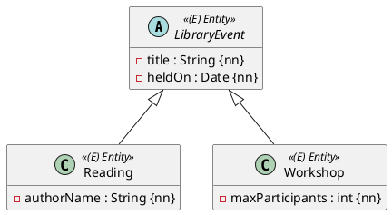

Die Bücherei veranstaltet Lesungen und Workshops. Beide haben einen Titel und ein Datum; eine Lesung hat zusätzlich eine Autorin, ein Workshop eine Höchstzahl an Teilnehmenden:



In Java ist das normale Vererbung. JPA muss zusätzlich wissen, wie die Hierarchie in Tabellen landet.

## Der Default: `SINGLE_TABLE`

```java
@Entity
@Table(name = "library_events")
public abstract class LibraryEvent extends AbstractPersistable<Long> {

    private String title;
    private LocalDate heldOn;

    protected LibraryEvent() {
    }

    protected LibraryEvent(String title, LocalDate heldOn) {
        this.title = title;
        this.heldOn = heldOn;
    }
}
```

```java
@Entity
public class Reading extends LibraryEvent {

    private String authorName;

    protected Reading() {
    }

    public Reading(String title, LocalDate heldOn, String authorName) {
        super(title, heldOn);
        this.authorName = authorName;
    }
}
```

`Workshop` sieht genauso aus, mit `private int maxParticipants`. Ohne weitere Angabe landet die ganze Hierarchie in **einer** Tabelle:

```sql
create table library_events (
    held_on date,
    max_participants integer,
    id bigint not null,
    dtype varchar(31) not null check ((dtype in ('Reading','Workshop'))),
    author_name varchar(255),
    title varchar(255),
    primary key (id),
    check (dtype <> 'Workshop' or (max_participants is not null))
)
```

- Die Spalte `dtype` (*discriminator type*) speichert, welche Klasse die Zeile ist: `'Reading'` oder `'Workshop'`.
- Die Spalten der Unterklassen müssen `null` sein dürfen – eine Lesung hat keine `max_participants`. Für das primitive `int` erzeugt Hibernate deshalb eine `check`-Regel, die nur für Workshops gilt.
- Die Oberklasse ist `abstract`: Es gibt kein „allgemeines“ Event.

:::achtung Kein `nullable = false` in Unterklassen
`@Column(nullable = false)` an einem Feld von `Reading` macht die Spalte `not null` – dann lässt sich **kein Workshop** mehr speichern (`NULL nicht zulässig für Feld "AUTHOR_NAME"`). Nimm in Unterklassen `@NotNull`: Bean Validation prüft es in Java, die Spalte bleibt nullable.
:::

Den Diskriminator kannst du benennen und kürzer machen:

```java
@Entity
@Inheritance(strategy = InheritanceType.SINGLE_TABLE)
@DiscriminatorColumn(name = "event_type", discriminatorType = DiscriminatorType.STRING, length = 1)
public abstract class LibraryEvent extends AbstractPersistable<Long> { ... }

@Entity
@DiscriminatorValue("R")
public class Reading extends LibraryEvent { ... }
```

## Repositories und polymorphe Abfragen

```java
public interface LibraryEventRepository extends JpaRepository<LibraryEvent, Long> { }
public interface ReadingRepository extends JpaRepository<Reading, Long> { }
```

- `libraryEventRepository.findAll()` liefert Lesungen **und** Workshops – jeweils als Objekt der richtigen Unterklasse.
- `readingRepository.findAll()` liefert nur Lesungen (`where dtype='Reading'`).

```java
@Test
void verify_events_keep_their_type() {
    libraryEventRepository.save(new Reading("Malina", LocalDate.of(2026, 11, 5), "Ingeborg Bachmann"));
    libraryEventRepository.save(new Workshop("Buchbinden", LocalDate.of(2026, 11, 12), 12));
    entityManager.flush();
    entityManager.clear();

    assertThat(libraryEventRepository.findAll())
            .extracting(e -> e.getClass().getSimpleName())
            .containsExactlyInAnyOrder("Reading", "Workshop");
    assertThat(readingRepository.findAll()).hasSize(1);
}
```

## Die anderen Strategien

| Strategie | Tabellen | Vorteil | Nachteil |
|---|---|---|---|
| `SINGLE_TABLE` (Default) | eine für alle | schnell, einfache Abfragen | Spalten der Unterklassen nullable |
| `JOINED` | eine pro Klasse, Unterklasse mit Fremdschlüssel `id` auf die Oberklasse | sauberes Schema, `not null` möglich | Joins bei jedem Lesen |
| `TABLE_PER_CLASS` | eine pro **konkreter** Klasse, mit allen geerbten Spalten | keine Joins für eine Unterklasse | Abfragen über die Oberklasse brauchen `union` |

```java
@Entity
@Inheritance(strategy = InheritanceType.JOINED)
public abstract class LibraryEvent extends AbstractPersistable<Long> { ... }
```

Ohne besonderen Grund in der Angabe bleib bei `SINGLE_TABLE`.

## `@MappedSuperclass`: erben ohne Entity

Manchmal willst du nur gemeinsame Felder erben, aber nie über die Oberklasse abfragen:

```java
@MappedSuperclass
public abstract class Stamped extends AbstractPersistable<Long> {
    private LocalDateTime createdAt;
}

@Entity
public class Notice extends Stamped {
    private String text;
}
```

`Stamped` hat keine Tabelle und kein Repository. `notice` bekommt die Spalten `id`, `created_at` und `text`. `AbstractPersistable` selbst ist genau so eine `@MappedSuperclass`.

:::pruefung
Steht im Diagramm `<|--` zwischen zwei `«Entity»`s, ist das Vererbung mit `@Entity` auf beiden Seiten. Hat eine Unterklasse keine eigenen Attribute, braucht sie trotzdem einen `protected` Konstruktor ohne Parameter – und Lombok hilft dann nicht (Einheit 3).
:::

:::merke
- Oberklasse `@Entity` (oft `abstract`), Unterklassen `@Entity`; Default ist `SINGLE_TABLE` mit Spalte `dtype`.
- `@DiscriminatorColumn`/`@DiscriminatorValue` benennen den Diskriminator.
- Repository der Oberklasse liefert alle Unterklassen, mit dem richtigen Typ.
- `@MappedSuperclass`: nur Felder erben, keine Tabelle.
:::
