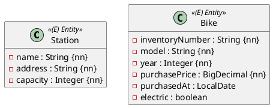

Ein Fahrradverleih betreibt mehrere **Stationen**, an denen **Fahrräder** ausgeliehen werden. In dieser Aufgabe legst du die ersten beiden Entities an – noch ohne Beziehung zwischen ihnen. Die Beziehung kommt in einer späteren Aufgabe dazu.

Du brauchst dafür die Einheiten 1–5 im Modul Spring Data JPA.

## Das Modell

## Implementierung

Lege beide Klassen im Package `ormapping.model` an und leite sie von `AbstractPersistable<Long>` ab. Jede Klasse bekommt

- einen `protected` Konstruktor ohne Parameter (für JPA),
- einen öffentlichen Konstruktor mit allen Attributen,
- Getter für alle Attribute.

Für die Spalten gelten diese Regeln:

| Attribut | Regel |
|---|---|
| `Station.name` | höchstens 40 Zeichen, eindeutig |
| `Station.address` | höchstens 120 Zeichen |
| `Bike.inventoryNumber` | genau 8 Zeichen, eindeutig |
| `Bike.model` | höchstens 64 Zeichen |
| `Bike.year` | Spalte heißt `build_year` |
| `Bike.purchasePrice` | 7 Stellen, davon 2 Nachkommastellen |

Alle Attribute mit `{nn}` dürfen in der Datenbank nicht `null` sein.

:::achtung Reservierte Wörter
`year` ist in H2 ein reserviertes Wort. Eine Spalte mit diesem Namen führt beim Start des Tests zu einem Fehler beim Anlegen der Tabelle. Deshalb bekommt die Spalte einen eigenen Namen.
:::

## Repositories

Lege im Package `ormapping.persistence` die Interfaces `StationRepository` und `BikeRepository` an. Sie erweitern `JpaRepository` mit dem passenden Entity und dem Typ `Long` für die Id.

## Tests

Schreibe für jedes Repository einen `@DataJpaTest`:

1. Ein Objekt anlegen und speichern.
2. Prüfen, dass es eine Id bekommen hat.
3. Es über `findById` wieder lesen und die Attribute vergleichen.

:::pruefung
Die Bewertungstests verwenden genau die Namen aus dieser Angabe: Packages, Klassen, Konstruktoren und Repositories. Wenn ein Name abweicht, kompiliert der Bewertungstest nicht und die Abgabe bekommt 0 Punkte.
:::
