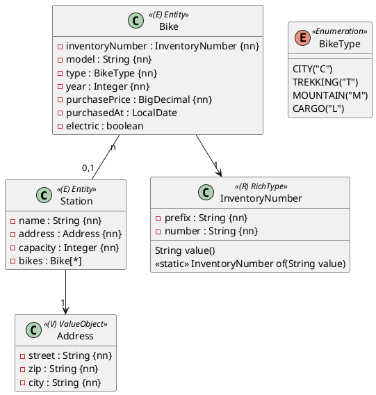

In der ersten Übung hast du `Station` und `Bike` angelegt – noch ohne Beziehung. Jetzt bekommt die Station eine richtige Adresse, jedes Fahrrad einen Typ und eine geprüfte Inventarnummer, und die Fahrräder werden ihren Stationen zugeordnet.

Du brauchst dafür die Einheiten 6–10 im Modul Spring Data JPA. Die Vorlage enthält die Klassen, Repositories und Tests aus der ersten Übung. Du erweiterst sie.

## Das Modell



## Value Object `Address`

`Address` ersetzt das bisherige `String`-Attribut `address` von `Station`. Lege es als `@Embeddable` im Package `ormapping.model` an (Record oder Klasse).

| Attribut | Regel |
|---|---|
| `street` | höchstens 64 Zeichen |
| `zip` | 4 bis 5 Zeichen |
| `city` | höchstens 40 Zeichen |

Die Regeln müssen beim Speichern einer Station geprüft werden. Die Spalten heißen `street`, `zip` und `city` und liegen in der Tabelle `station`.

## Enumeration `BikeType`

Speichere in der Spalte `type` den Code aus dem Diagramm (`"C"`, `"T"`, `"M"`, `"L"`), nicht das Ordinal und nicht den Namen. Der Converter heißt `BikeTypeConverter` und muss null-sicher sein.

## Rich Type `InventoryNumber`

Die Inventarnummer aus der ersten Übung wird zu einem eigenen Typ. Sie besteht aus einem Präfix aus **vier Großbuchstaben** und einer Nummer aus **vier Ziffern**, z. B. `CITY0001`.

- `new InventoryNumber("CITY", "0001")` und `InventoryNumber.of("CITY0001")` erzeugen denselben Wert.
- `value()` liefert `"CITY0001"`.
- Ungültige Werte werfen eine `IllegalArgumentException`, z. B. `CITY001`, `city0001` oder `CIT10001`.

In der Datenbank steht die Inventarnummer in **einer** Spalte `inventory_number`, weiterhin eindeutig und mit 8 Zeichen.

## Beziehung `Station` – `Bike`

Ein Fahrrad steht an höchstens einer Station; ein Fahrrad, das gerade unterwegs ist, hat keine. Die Station kennt ihre Fahrräder.

- Die Fremdschlüssel-Spalte heißt `station_id`, der Fremdschlüssel `fk_bike_station`.
- `Station` bekommt `getBikes()`, `addBike(Bike)` und `removeBike(Bike)`. Die Liste ist von außen nicht veränderbar, die beiden Methoden setzen immer beide Seiten.
- `Bike` bekommt `getStation()`.
- Speicherst du eine neue Station, werden ihre neuen Fahrräder mitgespeichert.
- Ein Fahrrad, das mit `removeBike` von der Station genommen wird, bleibt in der Datenbank – es ist nur ausgeliehen.

## Konstruktoren

```java
public Station(String name, Address address, Integer capacity)

public Bike(InventoryNumber inventoryNumber, String model, BikeType type, Integer year,
            BigDecimal purchasePrice, LocalDate purchasedAt, boolean electric)
```

Die Station wird nicht im Konstruktor von `Bike` übergeben, sondern mit `station.addBike(bike)` gesetzt.

## Tests

Passe die Tests aus der ersten Übung an die neuen Konstruktoren an und ergänze:

1. Station mit Adresse speichern und nach `flush`/`clear` vergleichen.
2. Prüfen, dass `type` und `inventoryNumber` als Code bzw. als eine Spalte gespeichert werden.
3. Gültige und ungültige Inventarnummern (ohne Datenbank, gerne parametrisiert).
4. Eine Station mit zwei Fahrrädern speichern, neu lesen und die Fahrräder prüfen.
5. Ein Fahrrad von der Station nehmen und prüfen, dass es erhalten bleibt.

:::pruefung
Die Bewertungstests verwenden genau die Namen aus dieser Angabe: Packages, Klassen, Konstruktoren, Methoden, Spalten und den Namen des Fremdschlüssels. Wenn ein Name abweicht oder einer deiner eigenen Tests nicht kompiliert, bekommt die Abgabe 0 Punkte.

Das Package `ormapping.grading` ist für die Bewertungstests reserviert und wird bei jeder Abgabe ersetzt.
:::
