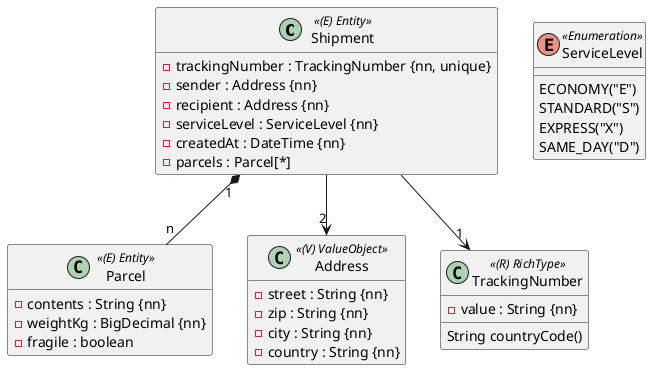

Ein Paketdienst verwaltet Sendungen. Jede Sendung hat eine Sendungsnummer, einen Absender, einen Empfänger und eine Versandart. Zu einer Sendung gehören ein oder mehrere Pakete.

Du brauchst dafür die Einheiten 2–10 im Modul Spring Data JPA. Die Vorlage ist das leere Projekt; du legst alle Klassen selbst an.

## Das Modell



Alle Klassen liegen im Package `ormapping.model`, die Repositories `ShipmentRepository` und `ParcelRepository` in `ormapping.persistence`. Die Tabellen heißen `shipment` und `parcel`.

## Value Object `Address`

Lege `Address` als `@Embeddable` an (Record oder Klasse).

| Attribut | Regel |
|---|---|
| `street` | höchstens 64 Zeichen |
| `zip` | 4 bis 5 Zeichen |
| `city` | höchstens 40 Zeichen |
| `country` | genau 2 Zeichen, z. B. `AT` |

Eine Sendung hat **zwei** Adressen. Die Spalten heißen `sender_street`, `sender_zip`, `sender_city`, `sender_country` und `recipient_street`, `recipient_zip`, `recipient_city`, `recipient_country`. Die Regeln müssen beim Speichern einer Sendung für beide Adressen geprüft werden.

## Enumeration `ServiceLevel`

Speichere in der Spalte `service_level` den Code aus dem Diagramm (`"E"`, `"S"`, `"X"`, `"D"`). `getCode()` liefert den Code, `ServiceLevel.fromCode(String)` das passende Enum und wirft bei einem unbekannten Code eine `IllegalArgumentException`. Der Converter heißt `ServiceLevelConverter` und muss null-sicher sein.

## Rich Type `TrackingNumber`

Sendungsnummern haben das internationale Format der Post: **zwei Großbuchstaben, neun Ziffern, zwei Großbuchstaben** für das Land, z. B. `RR123456789AT`.

- `new TrackingNumber("RR123456789AT")` erzeugt den Wert, `value()` liefert ihn zurück.
- `countryCode()` liefert die letzten zwei Buchstaben, hier `"AT"`.
- Ungültige Werte werfen eine `IllegalArgumentException`, z. B. `RR12345678AT`, `rr123456789AT` oder `RR123456789at`.

In der Datenbank steht die Sendungsnummer in **einer** Spalte `tracking_number` mit 13 Zeichen, eindeutig.

## `Parcel`

| Attribut | Regel |
|---|---|
| `contents` | höchstens 64 Zeichen |
| `weightKg` | Spalte `weight_kg` mit Precision 5 und Scale 2 (bis 999,99 kg) |
| `fragile` | |

## Beziehung `Shipment` – `Parcel`

Ein Paket gehört immer zu genau einer Sendung und existiert nicht ohne sie (Komposition).

- Die Fremdschlüssel-Spalte heißt `shipment_id` und ist Pflicht, der Fremdschlüssel heißt `fk_parcel_shipment`. Ein Paket ohne Sendung wird abgelehnt.
- `Shipment` bekommt `getParcels()`, `addParcel(Parcel)` und `removeParcel(Parcel)`. Die Liste ist von außen nicht veränderbar, die beiden Methoden setzen immer beide Seiten.
- `Parcel` bekommt `getShipment()`.
- Speicherst du eine neue Sendung, werden ihre Pakete mitgespeichert. Löschst du die Sendung, werden ihre Pakete mitgelöscht.
- Ein Paket, das mit `removeParcel` aus der Sendung genommen wird, wird **gelöscht**.

## Konstruktoren

```java
public Shipment(TrackingNumber trackingNumber, Address sender, Address recipient,
                ServiceLevel serviceLevel, LocalDateTime createdAt)

public Parcel(String contents, BigDecimal weightKg, boolean fragile)
```

Dazu jeweils ein `protected` Konstruktor ohne Parameter und Getter für alle Attribute (`isFragile()` für das `boolean`).

## Tests

1. Eine Sendung speichern und nach `flush`/`clear` mit beiden Adressen vergleichen.
2. Prüfen, dass `service_level` und `tracking_number` als Code bzw. als eine Spalte gespeichert werden, und dass eine ungültige Adresse abgelehnt wird.
3. Gültige und ungültige Sendungsnummern (ohne Datenbank, gerne parametrisiert) und den Converter mit `null`.
4. Eine Sendung mit zwei Paketen speichern, neu lesen und die Pakete prüfen.
5. Ein Paket entfernen und prüfen, dass es gelöscht ist; eine Sendung löschen und prüfen, dass ihre Pakete weg sind.

:::pruefung
Die Bewertungstests verwenden genau die Namen aus dieser Angabe: Packages, Klassen, Konstruktoren, Methoden, Spalten und den Namen des Fremdschlüssels. Wenn ein Name abweicht oder einer deiner eigenen Tests nicht kompiliert, bekommt die Abgabe 0 Punkte.

Das Package `ormapping.grading` ist für die Bewertungstests reserviert und wird bei jeder Abgabe ersetzt.
:::
