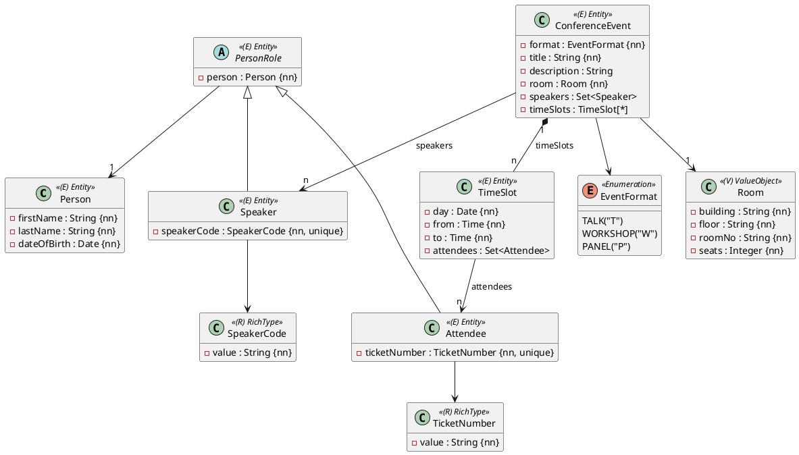

Eine Schule organisiert eine Fachtagung. Vortragende (Speaker) halten Events – Vorträge, Workshops und Podiumsdiskussionen – in Räumen der Schule. Jedes Event findet in einem oder mehreren Zeitfenstern statt, und Teilnehmende (Attendees) melden sich für einzelne Zeitfenster an.

Die Übung hat die Größe von Aufgabe 1 der Matura und deckt das ganze Modul Spring Data JPA ab (Einheiten 1–18). Die Vorlage ist das leere Projekt.

## Das Modell



Alle Klassen liegen im Package `ormapping.model`, die Repositories und Records in `ormapping.persistence`. Zu jedem Entity gibt es ein Repository: `PersonRepository`, `PersonRoleRepository`, `SpeakerRepository`, `AttendeeRepository`, `ConferenceEventRepository` und `TimeSlotRepository`.

## Personen und Rollen

- `Person`: `firstName` und `lastName` mit höchstens 64 Zeichen.
- `PersonRole` ist eine abstrakte Oberklasse, `Speaker` und `Attendee` erben von ihr. Die Strategie wählst du selbst.
- Die Spalte für `person` heißt `person_id`. Speicherst du eine Rolle mit einer neuen Person, wird die Person mitgespeichert.
- `PersonRoleRepository.findAll()` liefert Speaker und Attendees, jeweils mit der richtigen Klasse.
- Eine Person kann mehrere Rollen haben.

### Rich Types

| Typ | Format | Beispiel |
|---|---|---|
| `SpeakerCode` | 2 bis 4 Großbuchstaben | `FRM` |
| `TicketNumber` | 3 Großbuchstaben, dann 6 Ziffern | `VIE000123` |

Beide haben einen Konstruktor mit dem Wert und `value()`. Ungültige Werte werfen eine `IllegalArgumentException`. In der Datenbank steht jeder Wert in einer Spalte, eindeutig.

## Events

- `EventFormat` wird in der Spalte `format` als Code gespeichert (`"T"`, `"W"`, `"P"`), über einen null-sicheren `EventFormatConverter`. `getCode()` liefert den Code.
- `title` hat höchstens 100 Zeichen, `description` höchstens 1000.
- `Room` ist ein `@Embeddable` mit den Spalten `building`, `floor`, `room_no` und `seats` in der Tabelle `conference_event`.
- Die Speaker eines Events stehen in der Tabelle `event_speakers` mit den Spalten `event_id` und `speaker_id`. Die Speaker kennen ihre Events nicht.

## Zeitfenster

- Die Attribute heißen wie im Diagramm `day`, `from` und `to`. Die Spalten heißen `slot_day`, `time_from` und `time_to` – warum wohl?
- Ein Zeitfenster gehört immer zu genau einem Event (Spalte `event_id`, Pflicht). Speichern und Löschen des Events wirken auf seine Zeitfenster, ein entferntes Zeitfenster wird gelöscht.
- Die Teilnehmenden eines Zeitfensters stehen in der Tabelle `slot_attendees` mit den Spalten `slot_id` und `attendee_id`.

## Methoden und Konstruktoren

```java
public Person(String firstName, String lastName, LocalDate dateOfBirth)
public Speaker(Person person, SpeakerCode speakerCode)
public Attendee(Person person, TicketNumber ticketNumber)
public ConferenceEvent(EventFormat format, String title, String description, Room room)
public TimeSlot(LocalDate day, LocalTime from, LocalTime to)
```

| Klasse | Methoden |
|---|---|
| `PersonRole` | `getPerson()` |
| `ConferenceEvent` | `getSpeakers()`, `addSpeaker(Speaker)`, `removeSpeaker(Speaker)`, `getTimeSlots()`, `addTimeSlot(TimeSlot)`, `removeTimeSlot(TimeSlot)` |
| `TimeSlot` | `getEvent()`, `getAttendees()`, `addAttendee(Attendee)`, `removeAttendee(Attendee)` |

Dazu Getter für alle Attribute (`getSpeakerCode()`, `getTicketNumber()`, `getDay()`, `getFrom()`, …). Listen und Mengen sind von außen nicht veränderbar.

## Abfragen

1. `PersonRepository.findByLastNameIgnoreCase(String lastName)`: alle Personen mit diesem Nachnamen, unabhängig von der Groß-/Kleinschreibung.
2. `ConferenceEventRepository.findOverview()`: eine `List<EventOverview>`, sortiert nach Titel, mit
   `record EventOverview(EventFormat format, String title, String room, int seats)`.
   `room` ist die Raumnummer aus `building`, `floor` und `roomNo`, getrennt durch Punkte, z. B. `"C.E.01"`.
3. `ConferenceEventRepository.findByRoomFloor(String floor)`: alle Events in einem Stockwerk.
4. `ConferenceEventRepository.findAttendeeCounts()`: eine `List<AttendeeCount>`, sortiert nach Titel, mit
   `record AttendeeCount(String title, long attendees)`. Gezählt wird, wie viele **verschiedene** Teilnehmende sich für mindestens ein Zeitfenster des Events angemeldet haben. Events ohne Anmeldungen erscheinen mit 0.

## Tests

Stelle durch Tests sicher, dass sich jede Klasse speichern und lesen lässt, dass **jede Verbindung** gespeichert wird (Einheit 15) und dass jede Abfrage das richtige Ergebnis liefert – mit Testdaten, die auch Treffer ausschließen.

:::achtung Bestehende Person, neue Rolle
`cascade = CascadeType.PERSIST` speichert eine **neue** Person mit. Eine Person, die schon in einer früheren Transaktion gespeichert wurde, ist *detached*: `save` einer neuen Rolle scheitert dann mit `Detached entity passed to persist`. Im normalen `@DataJpaTest` (eine Transaktion pro Test) passiert das nicht.
:::

:::pruefung
Die Bewertungstests verwenden genau die Namen aus dieser Angabe: Packages, Klassen, Konstruktoren, Methoden, Records, Tabellen und Spalten. Wenn ein Name abweicht oder einer deiner eigenen Tests nicht kompiliert, bekommt die Abgabe 0 Punkte.

Das Package `ormapping.grading` ist für die Bewertungstests reserviert und wird bei jeder Abgabe ersetzt.
:::
