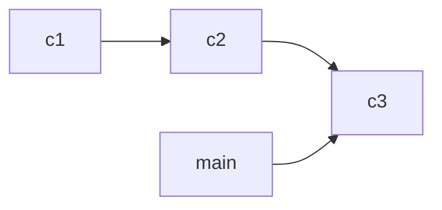

Für die Prüfung und die Aufgaben hier arbeitest du mit **Git** – der Versionsverwaltung, die jede Änderung deines Codes aufbewahrt. Du musst kein Git-Profi sein, aber die Begriffe kennen – in der Angabe, auf GitHub und im Classroom50-Release begegnet dir jeder davon.

## Die drei Orte

Dein Projekt lebt an drei Stellen:

1. **Arbeitsverzeichnis (Working Directory)** – die Dateien, in denen du gerade schreibst.
2. **Staging Area (Index)** – der Wartebereich: was als Nächstes gespeichert werden soll.
3. **Repository** – der Speicher mit allen bisherigen Ständen. Dein lokales Repo liegt auf deinem Laptop; das **Remote** (oft `origin`) liegt auf GitHub.

Ein **Commit** ist ein gespeicherter Stand: alle Änderungen seit dem vorigen Commit, mit eindeutiger ID (Hash), Commit-Nachricht und dir als Autor. Commits hängen als Kette aneinander – daraus wird die **History**.

## Branch, Merge, Konflikt

Ein **Branch** ist ein benannter Zweig der History – ein Label auf einem Commit. **HEAD** zeigt auf den Commit, in dem du gerade arbeitest. **Merge** fügt zwei Zweige wieder zusammen. Ändern beide Zweige dieselbe Stelle in einer Datei, entsteht ein **Konflikt**, den du von Hand auflösen musst – Git entscheidet nichts für dich.

## Daten zwischen Laptop und GitHub

| Befehl | Was passiert |
|---|---|
| `git clone <url>` | Kopie des Remote-Repos inkl. History auf deinen Rechner holen |
| `git add <datei>` | Änderungen in die Staging Area legen |
| `git commit -m "…" ` | Staging-Inhalt als neuen Commit ins lokale Repo schreiben |
| `git push` | Eigene Commits zum Remote hochladen |
| `git pull` | Neue Commits vom Remote holen (`fetch`) und in den eigenen Zweig übernehmen (`merge`) |
| `git fetch` | Nur holen, nichts verbinden – zum Anschauen |
| `git status` | Zeigen, welche Änderungen noch nicht gestaged oder committet sind |

:::merke
- **Ein Commit bleibt lokal.** Erst mit `push` landet er auf GitHub – und bei Classroom50 in der Bewertung.
- `pull` = `fetch` + `merge`. Zwischen Schule und Zuhause: vor dem Arbeiten `pull`, nach dem Arbeiten `push`.
- Konflikt heißt: zwei haben dieselbe Zeile geändert – du entscheidest, was gilt.
:::

## So läuft es bei den Aufgaben hier

1. Auf der Seite der Aufgabe **Aufgabe in Classroom50 annehmen** klicken → du bekommst ein eigenes **privates Repo** auf GitHub (die Vorlage ist schon drin).
2. Mit `git clone` holen, in IntelliJ IDEA öffnen und im angegebenen Subprojekt arbeiten.
3. `add`, `commit`, `push` – bei jedem Push laufen die Bewertungstests; das Ergebnis steht ein paar Minuten später als **Release** in deinem Repo.
4. Am anderen Rechner erst `git pull`, dann weiterarbeiten.

:::achtung Force-Push
Ein normaler `push` kann nichts zerstören – er ergänzt nur Commits. **Force-Pushes** (`push --force`) dagegen überschreiben die History deines Repos. Für eine Abgabe brauchst du sie nie – lass sie weg.
:::
