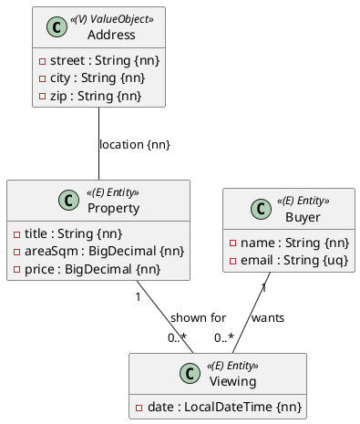

Eine kleine Probeprüfung wie den ersten Teil der Matura: **eine OR-Mapping-Aufgabe, 90 Minuten,
17 Punkte**, automatisch bewertet. Du brauchst die Einheiten 1–10 aus dem JPA-Modul.
Der Ablauf steht in [So läuft eine Probeprüfung](/pruefungen/ablauf).

## Aufgabe 1 – Ein Maklermodell in die Datenbank (17 Punkte)

Ein Immobilienmakler verwaltet **Objekte** und **Interessenten**. Jedes Objekt hat eine Lage
(Adresse als Value Object), eine Fläche und einen Preis; Interessenten melden sich mit
E-Mail (Rich Type) und wollen Besichtigungen buchen.

:::achtung Entwurf
Die vollständige Angabe mit allen Attributen, Längen, Precision-Werten und exakten Namen
(Benennung der Tabellen, Foreign Keys, abgeleitete Query) kommt in Phase E2 auf diese Seite.
Diese Skizze zeigt nur die Struktur.
:::

## Was du baust

- Entities `Property`, `Buyer`, `Viewing` im Package `ormapping.model`, Address als `@Embeddable`.
- Repositories und je ein `@DataJpaTest`, der Speichern und Wiederlesen prüft (flush/clear nicht
  vergessen).
- Constraints aus dem Diagramm: `not null`, unique E-Mail, `precision/scale` bei `BigDecimal`.

Erwartete Ergebnisse und Bewertung siehe unten bei **Beurteilung** – nach der Abgabe schätzt du
dich selbst ein; die Punkte kommen aus dem Autograding-Release in deinem Repository.
