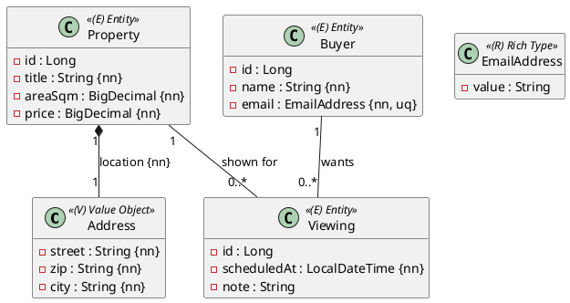

Eine kleine Probeprüfung wie der erste Teil der Matura: **eine OR-Mapping-Aufgabe, 90 Minuten,
17 Punkte**, automatisch bewertet. Du brauchst die Einheiten 1–10 und 16 (abgeleitete Queries)
aus dem JPA-Modul. Der Ablauf steht in [So läuft eine Probeprüfung](/pruefungen/ablauf).

## Aufgabe 1 – Ein Maklermodell in die Datenbank (17 Punkte)

Ein Immobilienmakler verwaltet **Objekte** und **Interessenten**. Zu jedem Objekt gehören eine
Lage (Value Object), eine Fläche und ein Kaufpreis. Interessenten melden sich mit einer E-Mail-
Adresse (Rich Type). Jede **Besichtigung** gehört genau zu einem Objekt und genau zu einem
Interessenten.



Die Spalten gelten diese Regeln – wie in den Einheiten: `title` höchstens 80 Zeichen;
`areaSqm` Precision 6, Scale 2 (Fläche in m²); `price` Precision 10, Scale 2;
die Lage wird als **embedded** in denselben Spalten wie das Objekt gespeichert (`street`
höchstens 60, `zip` höchstens 5, `city` höchstens 40 Zeichen, alle Pflicht);
`name` höchstens 80; `email` wird über einen **null-sicheren `AttributeConverter`** als String
mit höchstens 120 Zeichen gespeichert und ist eindeutig; `note` höchstens 200 Zeichen.

Die Fremdschlüssel der Besichtigungen bekommen Namen: `fk_viewing_property` und
`fk_viewing_buyer`, Spalten `property_id` und `buyer_id`.

## Implementierung

Lege alle Klassen im Package `ormapping.model` an, die Repositories in `ormapping.persistence`.
`Address` und `EmailAddress` sind **Records**; `EmailAddress` hat die Komponente `value` und
einen Converter `EmailAddressConverter` mit `@Converter(autoApply = true)`.
Jedes Entity erbt von `AbstractPersistable<Long>` und hat einen `protected` No-Args-Konstruktor,
einen öffentlichen Konstruktor ohne `id` (Attribute in Reihenfolge des Diagramms) und Getter.

Hilfsmethoden für die Beziehungen – beide setzen **immer beide Seiten**:

- `Property.addViewing(Viewing v)` / `removeViewing`, `Buyer.addViewing(Viewing v)` / `removeViewing`
- `getViewings()` bei Property und Buyer: gekapselte (unveränderliche) Liste
- Gespeichert wird über die Property: sie kaskiert `PERSIST` auf ihre Viewings. Der Buyer wird
  **zuerst gespeichert** und dann dem Viewing zugeordnet – ein Viewing ohne Buyer und ohne
  Property kann nicht gespeichert werden.

Dazu eine abgeleitete Query in `PropertyRepository`:

```java
List<Property> findByAreaSqmGreaterThan(BigDecimal areaSqm);
```

Repositories: `PropertyRepository`, `BuyerRepository`, `ViewingRepository`
(alle `JpaRepository<…, Long>`).

## Tests

Schreibe für ein Repository einen `@DataJpaTest`, der Speichern und Wiederlesen prüft
(`saveAndFlush`, dann `findById` nach `flush()` und `clear()`). Die Bewertungstests prüfen
unter anderem: alle Pflichtfelder, die Precision-Werte über `INFORMATION_SCHEMA`,
den eindeutigen E-Mail-Wert, die benannten Fremdschlüssel und die Kaskade der Property.

:::pruefung
Erwartete Ergebnisse: UML vollständig umgesetzt, Spaltennamen und Constraints stimmen,
Hilfsmethoden pflegen beide Seiten, alle Bewertungstests bestehen. Ein Viewing, das ohne
gesetzten Buyer oder ohne gesetzte Property gespeichert wird, scheitert an den
`not null`-Bedingungen der Fremdschlüssel – genau das prüfen die Tests.
:::
