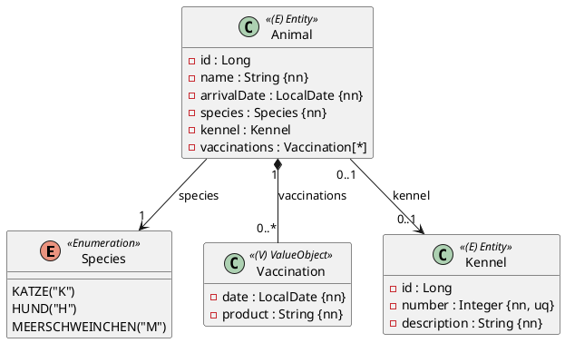

Eine kleine Probeprüfung, **eine OR-Mapping-Aufgabe, 90 Minuten, 17 Punkte**, automatisch
bewertet. Die Besonderheit dieser Prüfung: ein **Enum, das als Code gespeichert wird**, und eine
**eingebettete Sammlung von Wertobjekten**. Du brauchst die Einheiten 1–13 aus dem JPA-Modul
(insbesondere 12 OneToOne, 13 ElementCollection). Der Ablauf steht in
[So läuft eine Probeprüfung](/pruefungen/ablauf).

## Aufgabe 1 – Tiere, Boxen und Impfungen (17 Punkte)

Ein Tierheim vermittelt Tiere. Jedes Tier hat einen Namen, ein Ankunftsdatum und eine Art.
Jede **Box** hat eine Nummer und eine Beschreibung; ein Tier bewohnt höchstens eine Box, und
in jeder Box wohnt **höchstens ein Tier**. Zu jedem Tier führt das Tierheim einen **Impfpass**: eine
Sammlung von Einträgen mit Datum und Präparat.

Regeln: `name` höchstens 60 Zeichen, `description` höchstens 120, `product` höchstens 60.
Die Tier-Box-Beziehung ist **einseitig**: nur `Animal` kennt die Box; eine Box kann auch
ohne Tier existieren.
Die **Art wird als Code gespeichert**: `Species` ist ein Enum mit `KATZE("K")`, `HUND("H")`,
`MEERSCHWEINCHEN("M")`, `String getCode()` und `static Species fromCode(String)`
(wirft `IllegalArgumentException` für unbekannte Codes). Der `SpeciesConverter` implementiert
`AttributeConverter<Species, String>` mit `@Converter(autoApply = true)` und ist in **beiden
Richtungen null-sicher**. Die Spalte `species` hat Länge 1.

`Vaccination` ist ein **Record** mit den Komponenten `date` und `product`, als
`@ElementCollection` in der Tabelle **`animal_vaccinations`** (Fremdschlüsselspalte `animal_id`) – ohne
eigene Entity und ohne eigenes Repository.

Die Tier-Box-Beziehung: `@OneToOne` auf der `Animal`-Seite, Spalte `kennel_id`, Fremdschlüssel
**`fk_animal_kennel`**, ohne Kaskade – **die Box wird zuerst gespeichert**, dann dem Tier über
`assignKennel(kennel)` zugeordnet.

## Implementierung

Package `ormapping.model`, Repositories `AnimalRepository` und `KennelRepository` in
`ormapping.persistence` (JpaRepository über `Long`). Entities erben von
`AbstractPersistable<Long>`, mit `protected` No-Args-Konstruktor, öffentlichem Konstruktor ohne
`id` (Animal: name, arrivalDate, species – Box und Impfungen kommen über Hilfsmethoden) und
Gettern. `assignKennel(Kennel)` und `addVaccination(Vaccination)`; `getVaccinations()` liefert
eine **unveränderliche** Liste.

## Tests

Ein `@DataJpaTest` pro Repository, der Speichern und Wiederlesen prüft. Die Bewertungstests
prüfen zusätzlich: Codes in der Datenbank, null-sicherer Converter, eindeutige Boxnummer,
Tabelle `animal_vaccinations`, benannter Fremdschlüssel, unveränderliche Impf-Liste.

:::pruefung
Erwartete Ergebnisse: Alle Klassen (`Species`, `SpeciesConverter`, `Animal` mit Collection-Table,
`Kennel`, `Vaccination`) korrekt abgebildet; die Box lässt sich ohne Tier speichern, das Tier auch ohne Box.
Wer die Impfungen als eigene Entity statt `@ElementCollection` anlegt, verfehlt die
erwarteten Ergebnisse dieser Angabe.
:::
