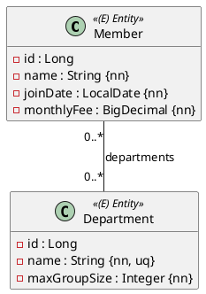

Eine kleine Probeprüfung, **eine OR-Mapping-Aufgabe, 90 Minuten, 17 Punkte**, automatisch
bewertet. Die Besonderheit dieser Prüfung: eine **viele-zu-viele-Beziehung**. Du brauchst die
Einheiten 1–11 und 16 aus dem JPA-Modul. Der Ablauf steht in
[So läuft eine Probeprüfung](/pruefungen/ablauf).

## Aufgabe 1 – Mitglieder und Abteilungen (17 Punkte)

Ein Sportverein führt seine **Mitglieder** und seine **Abteilungen**. Ein Mitglied zahlt einen
monatlichen Beitrag und tritt einem oder mehreren Abteilungen bei; eine Abteilung hat
null oder viele Mitglieder.



Regeln: `name` beim Mitglied höchstens 80 Zeichen, `monthlyFee` Precision 6 Scale 2;
Abteilungsname höchstens 50 Zeichen und **eindeutig**, `maxGroupSize` Pflicht.

Die Beziehung: **besitzende Seite ist `Member`**, `@ManyToMany(cascade = PERSIST)` mit
`@JoinTable(name = "member_departments", joinColumns = member_id, inverseJoinColumns =
department_id)`; beide Fremdschlüssel benannt: `fk_member_departments_member` und
`fk_member_departments_department`. Auf der `Department`-Seite `mappedBy = "departments"`.

Hilfsmethoden: `Member.addDepartment(Department d)` / `removeDepartment` – sie setzen
**beide Seiten**; `getDepartments()` (Member) und `getMembers()` (Department) liefern
**unveränderliche** Listen. Ein Department kann leer sein (ohne Mitglieder gespeichert werden).

## Implementierung

Packages `ormapping.model` und `ormapping.persistence`; Entities erben von
`AbstractPersistable<Long>`, `protected` No-Args-Konstruktor, öffentlicher Konstruktor ohne `id`
(Member: name, joinDate, monthlyFee; Department: name, maxGroupSize), Getter wie üblich.

Abgeleitete Query in `MemberRepository`:

```java
List<Member> findByMonthlyFeeGreaterThan(BigDecimal monthlyFee);
```

Dazu `DepartmentRepository` (JpaRepository über `Long`).

## Tests

Je Repository ein `@DataJpaTest` für Speichern und Wiederlesen. Die Bewertungstests prüfen
zusätzlich: beide Seiten der m:n-Beziehung nach `flush()` und `clear()`, Name der Join-Tabelle
und beider Fremdschlüssel über `INFORMATION_SCHEMA`, `getMembers()` unveränderlich,
`findByMonthlyFeeGreaterThan`.

:::pruefung
Erwartete Ergebnisse: m:n über die **benannte** Join-Tabelle, Beiträge mit korrekter
Präzision, eindeutige Abteilungsnamen, beide Sammlungen gekapselt. Wer `addDepartment` nur
auf einer Seite implementiert, scheitert an den Tests, die beide Seiten nach dem Neuladen
prüfen.
:::
