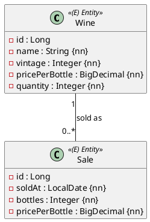

Eine kleine Probeprüfung, **eine OR-Mapping-Aufgabe, 90 Minuten, 17 Punkte**, automatisch
bewertet. Die Besonderheit dieser Prüfung: **JPQL-Abfragen mit Aggregaten und einer Projektion**.
Du brauchst die Einheiten 1–9 und 16–18 aus dem JPA-Modul. Der Ablauf steht in
[So läuft eine Probeprüfung](/pruefungen/ablauf).

## Aufgabe 1 – Bestand und Verkäufe (17 Punkte)

Ein Weingut lagert **Weine** (Name, Jahrgang, Flaschenpreis, Bestand in Flaschen) und notiert
**Verkäufe**: jeder Verkauf hat ein Datum, eine Flaschenzahl und den erzielten Flaschenpreis –
und gehört zu genau einem Wein.



Regeln: Weinname höchstens 80 Zeichen; `pricePerBottle` bei **beiden** Entities Precision 6,
Scale 2; Fremdschlüssel-Spalte `wine_id`, benannt `fk_sale_wine`. Der Wein wird **zuerst
gespeichert** und ist dann bereits vorhanden, wenn der Verkauf entsteht – dieser
Verweis hat keine Kaskade.

## Abfragen

In `WineRepository` und `SaleRepository` (Packages wie in den anderen Probeprüfungen) sind drei `@Query`-Methoden
gefordert – exakt diese Signaturen:

```java
// WineRepository – Projektion als Record ormapping.model.StockRow(name, totalValue)
@Query("select new ormapping.model.StockRow(w.name, w.pricePerBottle * w.quantity) from Wine w")
List<StockRow> stockRows();

// SaleRepository
@Query("select sum(s.bottles) from Sale s")
Long totalBottles();

@Query("select avg(s.pricePerBottle) from Sale s where s.wine.vintage = :vintage")
Double averagePriceByVintage(@Param("vintage") int vintage);
```

`StockRow` ist ein **Record** in `ormapping.model` mit den Komponenten `name`
(`String`) und `totalValue` (`BigDecimal`).

:::merke
- `sum` über **keine Zeilen** liefert `null`, nicht 0 – der Rückgabetyp `Long`
  (nicht `long`) muss das aushalten.
- `avg` über eine leere Auswahl liefert ebenfalls `null`.
- Zahlen aus Aggregaten: `sum(int)` → `Long`, `avg` → `Double`.
:::

## Implementierung und Tests

`Wine` und `Sale` wie üblich: `AbstractPersistable<Long>`, `protected` No-Args-Konstruktor,
öffentlicher Konstruktor ohne `id` (Wine: name, vintage, pricePerBottle, quantity; Sale: soldAt,
bottles, pricePerBottle, wine), Getter. Je ein `@DataJpaTest`, der Speichern und Wiederlesen
sowie eine der Abfragen prüft. Die Bewertungstests kontrollieren zusätzlich Precision-Werte,
Pflichtfelder, benannten Fremdschlüssel und die drei Abfragen gegen bekannte Beispieldaten.

:::pruefung
Erwartete Ergebnisse: beide Entities korrekt, Join-Spalte `wine_id` mit dem Namen
`fk_sale_wine`, die drei JPQL-Methoden exakt wie angegeben. Eine Projektion als
`Object[]`-Liste statt Record erfüllt die erwarteten Ergebnisse nicht.
:::
