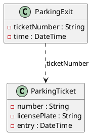

Diese mittlere Probeprüfung dauert **180 Minuten**: zwei unabhängige Aufgaben zu je 17 Punkten –
wie Teil 2 und 3 der Matura. Du brauchst das Service-Modul (Einheiten 1–8) für Aufgabe B und
das REST-Modul (Einheiten 1–12) für Aufgabe C. Der Ablauf steht in
[So läuft eine Probeprüfung](/pruefungen/ablauf).

| Aufgabe | Thema | Punkte | Zeit |
|---|---|---|---|
| B | Business-Service: Parkhaus | 17 | 90 min |
| C | REST-API: Projekt-Tasks | 17 | 90 min |

Beide Aufgaben bearbeitest du in einem Projekt: Aufgabe B im Subprojekt
`Aufgabe2_BusinessService`, Aufgabe C in `Aufgabe3_RestfulApi`. Bei jedem Push laufen deine
eigenen Tests; schlagen sie fehl, siehst du das an der Abgabe.

## Aufgabe B – Parkhaus (17 Punkte)

Ein Parkhaus rechnet bei der Ausfahrt ab. Du schreibst den Service, der die Gebühr für eine
Ausfahrt berechnet und die Einnahmen pro Tag zusammenfasst. Ohne Datenbank, ohne Spring – nur
Java und Tests.



### Tarif

- Die Parkdauer wird ab der Einfahrt in **Blöcke zu 30 Minuten** geteilt; ein angefangener Block
  zählt voll. Zeiten sind minutengenau.
- Ein Block kostet **150 Cent**, wenn er zwischen 6:00 und 22:00 Uhr **beginnt**, sonst
  **50 Cent** (Nachttarif). Ein Block, der um 21:30 beginnt, kostet also 150 Cent.
- Wer höchstens **15 Minuten** parkt, zahlt nichts.
- **Tagesdeckel:** Pro angefangene 24 Stunden ab der Einfahrt kostet das Parken höchstens
  **1800 Cent**. Nach 24 Stunden beginnt ein neuer Zeitraum mit eigenem Deckel.
- **Dauerparker** (ihre Kennzeichen werden dem Service übergeben) zahlen nie etwas.
- Alle Beträge in Cent.

### Der Service (Pseudocode)

```text
klasse ParkingFeeService {
  ## Die ausgegebenen Parkscheine und die Kennzeichen der Dauerparker werden zu Beginn übergeben
  ParkingFeeService(Liste<ParkingTicket> tickets, Menge<String> subscriberPlates)

  ## Gebühr für eine Ausfahrt in Cent
  Long feeCents(ParkingExit exit)

  ## Einnahmen pro Tag der Ausfahrt, nach Datum aufsteigend sortiert
  Map<Datum, Long> revenuePerDay(Liste<ParkingExit> exits)
}
```

Fehlerfälle:

- Gehört eine Ausfahrt zu keinem bekannten Parkschein, wirft der Service eine
  `UnknownTicketException` mit der Nummer in der Meldung.
- Kommt in `revenuePerDay` dieselbe Parkscheinnummer zweimal vor, wirft er eine
  `DuplicateExitException`.
- Eine Ausfahrt vor der Einfahrt ist ungültig (`IllegalArgumentException`). Datenklassen ohne
  Nummer, Kennzeichen oder Zeit werden schon beim Erzeugen abgelehnt.

Lege die Datenklassen als Records im Package `businessservice.model` und den Service in
`businessservice.service` an.

### Tests

Stelle durch Tests sicher, dass jede Tarifregel stimmt – auch an ihren Grenzen: genau 15 und
16 Minuten, genau 30 und 31 Minuten, Blöcke um 21:30/22:00 und 5:30/6:00, genau 24 Stunden und
eine Minute mehr. Teste auch, dass Dauerparker nichts zahlen, die Tage richtig sortiert sind
und jeder Fehlerfall seine Exception wirft.

## Aufgabe C – Projekt-Tasks-API (17 Punkte)

Ein Team verwaltet seine Projekte und deren Tasks über eine REST-API. Alle Endpunkte liegen
unter **`/api/projects`**, das Datenformat ist JSON. Controller und Fehlerbehandlung gehören ins
Package `restfulapi.presentation`, der Service und die Datenklassen nach `restfulapi.service`.

### Schnittstellenobjekte

```json
// projectView
{ "key": "WEB", "name": "Website-Relaunch", "owner": "Lena Berger", "open-tasks": 3 }
```

```json
// projectCreate
{ "key": "WEB", "name": "Website-Relaunch", "owner": "Lena Berger" }
```

```json
// taskView
{ "number": "WEB-12", "title": "Startseite", "assignee": "Max Huber", "status": "OPEN", "due": "2030-03-01" }
```

```json
// taskCreate
{ "title": "Startseite", "assignee": "Max Huber", "due": "2030-03-01" }
```

```json
// taskStatusChange
{ "status": "DONE" }
```

Regeln für die Eingaben:

- `projectCreate`: `key` besteht aus 2 bis 5 Großbuchstaben, `name` ist nicht leer und höchstens
  80 Zeichen lang, `owner` ist nicht leer. Alle Felder sind Pflicht.
- `taskCreate`: `title` ist nicht leer und höchstens 120 Zeichen lang, `due` ist Pflicht und
  liegt nicht in der Vergangenheit. `assignee` ist optional – ein Task darf unzugewiesen sein.
- `taskStatusChange`: `status` ist Pflicht und einer der Werte `OPEN`, `IN_PROGRESS`, `DONE`.

Die Task-Nummer (`WEB-12`) vergibt der Service. Eingehende Objekte sind Commands
(`ProjectCreateCmd`, `TaskCreateCmd`, `TaskStatusCmd`), ausgehende heißen `ProjectView` und
`TaskView`.

### Endpunkte

- Alle Projekte lesen
- Ein Projekt anhand seines Keys lesen
- Ein Projekt anlegen
- Ein Projekt löschen – nur, wenn es keine offenen Tasks mehr hat
- Die Tasks eines Projekts lesen, optional gefiltert nach Status (`?status=OPEN`)
- Einen Task eines Projekts lesen
- Einen Task zu einem Projekt anlegen
- Den Status eines Tasks ändern (nur der Status, nicht der ganze Task)

Halte dich an die REST-Prinzipien: Pfade für Ressourcen und Unterressourcen, passende
HTTP-Methoden, Statuscodes wie `200`, `201` mit `Location`, `204`, `400`, `404` und `409`.

### Der Service

Lege einen `ProjectService` mit `@Service` als **Stub** an. Er meldet Fehler mit eigenen
Exceptions:

- Projekt nicht gefunden, Task nicht gefunden (auch: der Task gehört zu einem anderen Projekt)
- Projekt-Key existiert schon
- Projekt hat noch offene Tasks („project WEB still has 3 open tasks“)
- Statuswechsel nicht erlaubt („task WEB-12: DONE -> OPEN is not allowed“) – ein erledigter Task
  bleibt erledigt

### Fehler

Jeder Fehler bekommt eine **eindeutige Referenz**: Sie steht in der Antwort (als `ProblemDetail`
mit dem Feld `reference`), und die Exception wird mit dieser Referenz geloggt. Bei
Validierungsfehlern nennt `detail` jedes fehlerhafte Feld. Auch unerwartete Fehler werden so
beantwortet – mit `500`, ohne Springs eigene Fehler (`400`, `404`, `405`, `415`) zu verfälschen.

### Tests

Stelle mit `@WebMvcTest` und einem `@MockitoBean` des Service sicher, dass alle Endpunkte
funktionieren – mit Good Cases, Edge Cases (leere Liste, Task ohne `assignee`, Filter ohne
Treffer) und Exception Cases (ungültige Eingaben, unbekannter Status im Filter, `404`, `409`).
Bei ungültigen Eingaben darf der Service gar nicht aufgerufen werden.

:::pruefung
Bei jedem Push läuft `./gradlew test`. Ob deine Tests grün sind, siehst du im Repository; die
Beurteilung macht deine Lehrkraft nach den Kriterien unten.
:::
