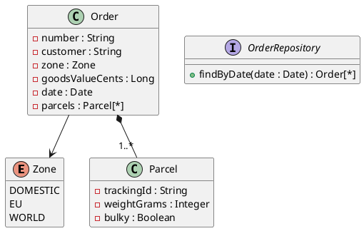

Diese mittlere Probeprüfung dauert **180 Minuten**: zwei unabhängige Aufgaben zu je 17 Punkten.
Du brauchst das Service-Modul (Einheiten 1–8, besonders 4 und 7) für Aufgabe B und das
REST-Modul (Einheiten 1–14, besonders HATEOAS und Pagination) für Aufgabe C. Der Ablauf steht in
[So läuft eine Probeprüfung](/pruefungen/ablauf).

| Aufgabe | Thema | Punkte | Zeit |
|---|---|---|---|
| B | Business-Service: Versandkosten | 17 | 90 min |
| C | REST-API: Produktkatalog | 17 | 90 min |

Beide Aufgaben bearbeitest du in einem Projekt: Aufgabe B im Subprojekt
`Aufgabe2_BusinessService`, Aufgabe C in `Aufgabe3_RestfulApi`. Bei jedem Push laufen deine
eigenen Tests; schlagen sie fehl, siehst du das an der Abgabe.

## Aufgabe B – Versandkostenrechner (17 Punkte)

Ein Versandhändler berechnet das Porto seiner Bestellungen. Du schreibst den Service, der die
Kosten jedes Pakets berechnet und die Bestellungen eines Tages pro Zone zusammenfasst.



Es ist eine Datenzugriffsschnittstelle `OrderRepository` anzunehmen, die alle Bestellungen eines
Tages liefert. Sie wird nicht implementiert; in den Tests ersetzt du sie durch einen Mock.

### Tarif

Das Porto eines Pakets hängt von der Zone der Bestellung und vom Gewicht ab (Beträge in Cent):

| Gewicht bis einschließlich | `DOMESTIC` | `EU` | `WORLD` |
|---|---|---|---|
| 2 kg | 490 | 990 | 1690 |
| 5 kg | 690 | 1390 | 2490 |
| 10 kg | 990 | 1890 | 3490 |
| 31,5 kg | 1490 | 2890 | 5490 |

- Ein Paket über 31,5 kg wird nicht befördert: Der Service wirft eine `ParcelTooHeavyException`
  mit der Paketnummer in der Meldung.
- **Sperrgut** (`bulky`) kostet pro Paket **1000 Cent** Zuschlag.
- Bestellungen innerhalb Österreichs (`DOMESTIC`) ab einem Warenwert von **50 €** (5000 Cent)
  sind **portofrei**; der Sperrgutzuschlag bleibt.
- Eine Bestellung ohne Pakete, ein Paket mit 0 g oder weniger und ein negativer Warenwert werden
  schon beim Erzeugen der Datenklassen abgelehnt (`IllegalArgumentException`).

### Der Service (Pseudocode)

```text
klasse ShippingService {
  ShippingService(OrderRepository repository)

  ## Kosten jedes Pakets der Bestellung (Paketnummer -> Cent), in der Reihenfolge der Pakete
  Map<String, Long> parcelCosts(Order order)

  ## Summe aller Pakete der Bestellung in Cent
  Long shippingCents(Order order)

  ## Für jede Zone: Anzahl Bestellungen, Anzahl Pakete und Summe der Versandkosten des Tages
  Map<Zone, ZoneSummary> summaryByZone(Datum date)
}
```

- `ZoneSummary` enthält `orders`, `parcels` und `shippingCents`.
- Die Map von `summaryByZone` enthält **immer alle drei Zonen**, auch wenn an dem Tag keine
  Bestellung dorthin ging.
- Liefert das Repository Bestellungen eines anderen Tages mit, werden sie ignoriert.

Lege die Datenklassen als Records im Package `businessservice.model`, das Interface in
`businessservice.persistence` und den Service in `businessservice.service` an.

### Tests

Stelle durch Tests sicher, dass jede Gewichtsstufe stimmt – genau auf der Stufe und knapp
darüber –, dass Zuschlag und Gratisgrenze (4999 und 5000 Cent) richtig wirken und dass die
Zusammenfassung alle Zonen enthält. Mocke das Repository mit Mockito.

## Aufgabe C – Produktkatalog-API (17 Punkte)

Ein Onlineshop stellt seinen Katalog als **Hypermedia-API** bereit: Jede Antwort enthält Links
im HAL-Format (`_links`, `_embedded`). Alle Endpunkte liegen unter `/api/products` und
`/api/categories`. Controller und Fehlerbehandlung gehören ins Package `restfulapi.presentation`,
der Service und die Datenklassen nach `restfulapi.service`.

### Schnittstellenobjekte

```json
// productView – mit Links self und category
{
  "sku": "KB-1001",
  "name": "Funk-Tastatur",
  "price-cents": 3990,
  "category": "peripherals",
  "in-stock": true,
  "_links": {
    "self": { "href": "http://localhost/api/products/KB-1001" },
    "category": { "href": "http://localhost/api/categories/peripherals" }
  }
}
```

```json
// categoryView – mit Links self und products
{ "slug": "peripherals", "name": "Peripheriegeräte", "product-count": 12, "_links": { … } }
```

```json
// productCreate
{ "sku": "KB-1001", "name": "Funk-Tastatur", "price-cents": 3990, "in-stock": true }
```

Regeln für `productCreate`: `sku` besteht aus zwei Großbuchstaben, Bindestrich und vier Ziffern
(`KB-1001`), `name` ist nicht leer und höchstens 100 Zeichen lang, `price-cents` ist größer als 0,
`in-stock` ist Pflicht. Das eingehende Objekt heißt `ProductCreateCmd`, die ausgehenden
`ProductView` und `CategoryView`.

### Endpunkte

- **Alle Produkte seitenweise lesen:** `page`, `size` und `sort` als `Pageable`; ohne Angaben
  Seite 0, 20 Einträge, sortiert nach Name. Die Antwort ist ein `PagedModel` mit den Produkten
  unter `_embedded.products`, Links `first`, `prev`, `next`, `last` (nur wenn es sie gibt) und den
  Seitenangaben unter `page`.
- **Ein Produkt lesen** – mit den Links `self` und `category`
- **Alle Kategorien lesen** – jede mit den Links `self` und `products`, dazu ein `self`-Link
  der Liste
- **Eine Kategorie lesen**
- **Die Produkte einer Kategorie seitenweise lesen** (wie oben)
- **Ein Produkt in einer Kategorie anlegen** – `201` mit `Location` auf das neue Produkt

Halte dich an die REST-Prinzipien und an die Statuscodes `200`, `201`, `400`, `404` und `409`.

### Der Service

Lege einen `CatalogService` mit `@Service` als **Stub** an. Seiten liefert er als `Page<…>`.
Fehler meldet er mit eigenen Exceptions: Produkt nicht gefunden, Kategorie nicht gefunden (auch
beim Anlegen), SKU existiert schon. Jeder Fehler wird als `ProblemDetail` mit einer eindeutigen
Referenz (`reference`) beantwortet und mit ihr geloggt.

:::achtung `Page` nicht direkt zurückgeben
Ein Controller, der `Page<ProductView>` direkt zurückgibt, liefert kein stabiles JSON (Spring
warnt: „Serializing PageImpl instances as-is is not supported“). Nimm den
`PagedResourcesAssembler`.
:::

### Tests

Teste mit `@WebMvcTest` und einem `@MockitoBean` des Service. Prüfe neben Status und Feldern auch
die Links (`$._links…`) – auf der ersten, einer mittleren und der letzten Seite –, die leere
Seite und dass `page`, `size` und `sort` richtig als `Pageable` beim Service ankommen.

:::pruefung
Bei jedem Push läuft `./gradlew test`. Ob deine Tests grün sind, siehst du im Repository; die
Beurteilung macht deine Lehrkraft nach den Kriterien unten.
:::
